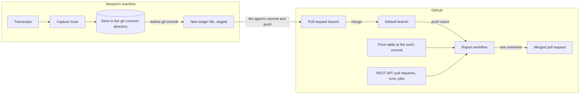
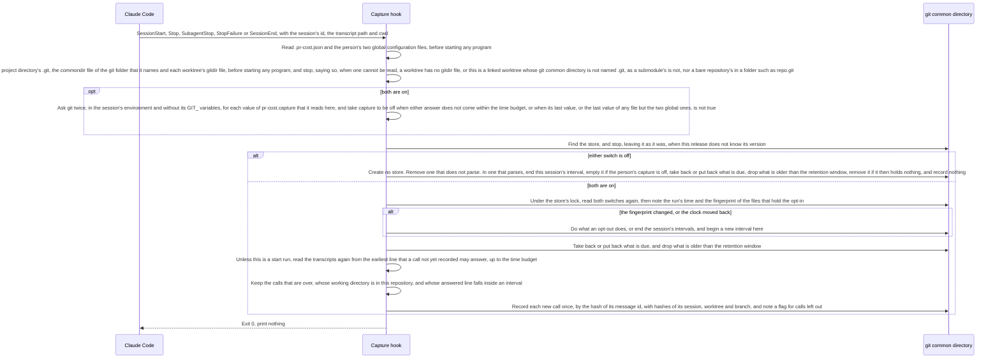
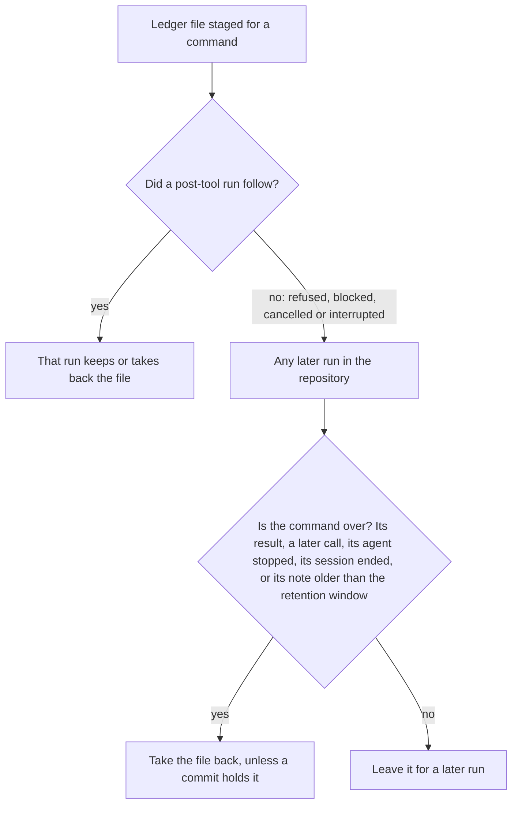
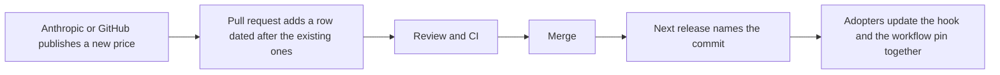
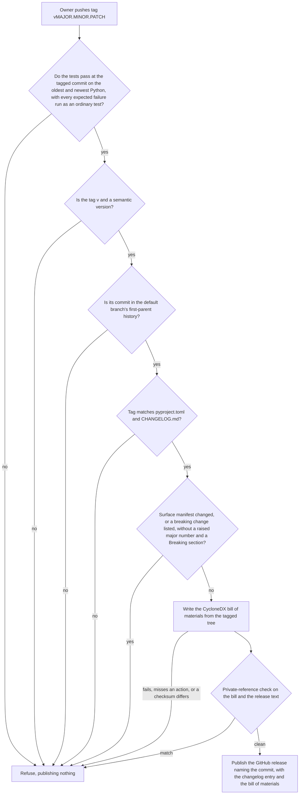

# How it works

This page explains the tool as a whole: what goes in, what comes out, how a cost is computed and from where, each flow, and every credential, permission and outside connection it uses. A developer who reads it should know what the tool does, and should treat anything it does that this page leaves out as a defect.

The tool is designed and not built yet, so this page describes the design in `openspec/changes/add-pr-cost-calculator/`. It changes in the same pull request as what it describes, and `tests/test_documentation.py` checks it against the workflows.

## In one paragraph

A hook in each Claude Code session reads the session's transcript and, for a person who has opted in, keeps the token counts of the model calls made from the repository that holds the session's project directory while both switches were on, in a store of that person's own in the repository's git common directory, for no longer than 30 days. Just before the agent commits, it writes the waiting counts into a new ledger file and stages it, so the agent's own commit carries it. When the pull request merges, a GitHub Actions workflow reads the ledger files that the merge added, prices them from the dated price table at the tool's own commit, adds the CI minutes of the pull request's own commits from GitHub's jobs API, and posts one comment. The ledger stays in the repository as the record.

## Parts

| Part | Where it runs | Reads | Writes |
|---|---|---|---|
| Capture step, one standard-library Python file | The machine running the Claude Code session | The session's and its subagents' transcripts; the hook's input from Claude Code; `.pr-cost.json` in the working tree; `pr-cost.capture` in the person's two global git configuration files, and each value of it that git reads in the repository; the device and inode numbers, size and modification times of the files that hold it; the system's clock; the repository's git state | Its store in the git common directory, which only a run that finds both switches on creates; one ledger file per commit under `.pr-cost/ledger/`, staged; nothing else |
| Store | Inside the repository's git common directory (`git rev-parse --git-common-dir`), one file for each user, `pr-cost-<uid>/store.json` where the system numbers users and `pr-cost/store.json` where it does not, outside the working tree and shared by its worktrees | Written and read by the hook only, as its owner, its folder and file readable and writable by that owner alone, except on Windows | Never committed; it keeps nothing past its retention window of 30 days, and is removed once it holds nothing |
| Ledger files | `.pr-cost/ledger/<YYYY-MM>/<random>.jsonl`, committed with the agent's work | A first line that states the ledger format's version, the count of refused calls and three flags for calls left out, then counts per call, never content | Written once, never changed by the tool |
| Configuration | `.pr-cost.json` at the repository root | `enabled`, as `true` or `false`, and no other key, since a file that holds a key that its format does not document, gives a key twice or has no `enabled` of `true` or `false` is not valid and leaves the tool off | Changed only by a pull request |
| Price table | `prices/models.json` and `prices/github-actions.json`, at the tool's commit | Dated rates, modifiers and the source of each | A new row per price change, by pull request |
| Report, a reusable workflow and its Python code | A GitHub Actions runner, on the push a merge makes to the default branch | The push event; as git blobs: the ledger files and `.pr-cost.json` before and after the merge, the ledger files of the default branch's first-parent history before it, and the hook file at the merged commit and at its own commit; the price table; GitHub's API | One comment on the merged pull request; its job summary |
| Release workflow | A GitHub Actions runner, on a pushed tag `vMAJOR.MINOR.PATCH` | `pyproject.toml`, `CHANGELOG.md`, the tag's commit | A GitHub release with a CycloneDX bill of materials |

## Inputs and outputs

**Inputs:**

- Claude Code's transcript lines, one JSON object per line: each assistant message's model, `usage` block (input, output, cache-write by lifetime, cache-read tokens), service tier, speed, inference region, server-side tool requests, the tools it called, and the working directory; and each line's time, its kind and the line that it names as its parent, which place a call inside or outside an interval.
- Claude Code's hook input: the hook event, the session's id, the transcript's path, `cwd`, and for Bash commands the command's text and `tool_use_id`.
- `.pr-cost.json`; the person's opt-in, `pr-cost.capture`, from their two global configuration files, and each value of it that git reads in the repository, with the file that each comes from; and the device and inode numbers, size and modification times of the files that hold it.
- The system's clock, read in UTC.
- The price table at the tool's own commit.
- GitHub: the push event, the pull request that a commit belongs to, the workflow runs and job attempts on the pull request's own commits, and the report's own earlier comment.

**Outputs:**

- Ledger files: a first line that states the ledger format's version, the count of refused calls and three flags for calls left out, for consent, for their age or because their repository could not be told, with no count; then one entry per call: UTC day, model, a SHA-256 hash of the message id in a field whose name ends in `_id`, main agent or subagent, the token counts, the price attributes, the activity type, and marks for a call read without a stop reason or with a usage field that capture does not know.
- One comment per merged pull request, and the report's job summary.
- A GitHub release per version tag, with its bill of materials.

## How a cost is computed

For each ledger entry counted, on the entry's UTC day *d*:

```
token cost = input × rate(model, input, d)
           + output × rate(model, output, d)
           + cache write 5 min × rate(model, cache write 5 min, d)
           + cache write 1 h × rate(model, cache write 1 h, d)
           + cache read × rate(model, cache read, d)
           + server-side tool requests × rate(model, request type, d)
```

`rate` is the latest row in `prices/models.json` dated on or before *d*, with every modifier that the table lists for the entry's attributes, combined as the table states: long-prompt rates, where a prompt's length is its input, cache-write and cache-read tokens together; the inference region's multiplier; and the rates for speed and service tier. Where the transcript gave no cache lifetime, the cost is a range between the two lifetimes' rates. An entry whose model, attribute or day has no price is counted in tokens and left out of the cost, and the comment names it.

For each attempt of each job of each counted run:

```
CI cost = ceil(duration in seconds / 60) × rate(runner type, day the job ran)
```

The runs counted are those on the pull request's own commits that no push to the default branch started and that were created before the merge. A job on a runner that `prices/github-actions.json` does not list is counted in minutes and left out of the cost.

```
total = Σ token cost + Σ CI cost
```

The comment splits the token cost by model, by token type and by activity type. Every figure can be recomputed from the ledger, the price table and the jobs API.

## Flows

### Overview



### Capture during a session



### A commit

```mermaid
sequenceDiagram
  participant CC as Claude Code
  participant H as Capture hook
  participant W as Worktree and index
  CC->>H: PreToolUse for a Bash command matching Bash(git *)
  H->>H: Record calls that are over, as in capture
  alt the command is a git commit whose branch and contents the hook can tell
    H->>W: Write .pr-cost/ledger/YYYY-MM/random.jsonl, with the flags due for that worktree and branch, and stage it alone
  else anything else
    H->>H: Stage nothing; the calls wait
  end
  CC->>W: Run the command
  CC->>H: PostToolUse or PostToolUseFailure
  alt the checked-out commit holds the file
    H->>H: Note its calls as taken
  else no commit took it
    H->>W: Take the file back, and its calls and flags wait for a later commit
  end
```

### A commit that never ran



### A merge and its report

```mermaid
sequenceDiagram
  participant GH as GitHub
  participant R as Report
  GH->>R: Push to the default branch, made by a merge
  R->>R: Refuse any other event
  R->>R: Check out the tool's own code at job.workflow_sha, without keeping the token
  R->>GH: List pull requests associated with each commit the push adds
  alt the commits belong to exactly one pull request
    R->>R: Read .pr-cost.json before and after; if both leave the tool off, say why in the job summary and stop
    R->>R: Fetch the default branch's history and refs/pull/<n>/head
    R->>R: Read the ledger files the merge adds, as git blobs, within the size bound, holding each file to the version of the ledger format that its first line states
    R->>R: Read the call ids of the first-parent history's earlier ledger files, by the versions they state, so no call counts twice
    R->>R: Compare the hook file at the merged commit with the one at its own commit
    R->>GH: List runs and every job attempt on the pull request's own commits
    R->>R: Price tokens and minutes from the price table, and note which reasons the ledger files flag calls left out for
    R->>GH: Post the comment, or update the report's own earlier one
  else none, more than one, or more commits than the call budget allows
    R->>R: Say why, and how many earlier ledger files the push removed or changed, in the job summary; post no comment
  end
```

### A price update



### A release



## Credentials and permissions

**On the session's machine:** none. The hook uses no token, no key and no account. It reads the person's two global git configuration files for `pr-cost.capture`, and asks git for each value of it that git reads in the repository, which can only turn capture off. It writes only its store inside the git common directory, a file of its own, in a folder of its own, that its owner alone can read and write, except on Windows, and the ledger file it stages, and touches the index only to stage, take back or put back that one file.

**The report's workflow**, as an adopter calls it, uses the workflow's own `GITHUB_TOKEN` and no other secret. Its caller grants it exactly:

- `contents: read`, to read the ledger files, `.pr-cost.json` and the pull request's commits from git;
- `actions: read`, to list the workflow runs and job attempts on those commits;
- `pull-requests: write`, to post and update its one comment.

It needs no `contents: write`, so a ruleset protecting the default branch needs no exception for it.

**The release workflow**, in this repository only, holds `contents: write` in its release job alone, to create the release and attach the bill of materials, and runs only for a pushed tag.

**This repository's CI** (`.github/workflows/ci.yml`) grants every job `contents: read` and nothing else. Its checkouts keep no credentials, and no job reads a secret. The job that runs the tests clones the whole history rather than one commit, so that the decision records' check can compare the records with what the default branch held before the change. The workflow names that commit in `BASE_COMMIT`: the pull request's base commit, or the commit that a push to the default branch replaced. The check also compares with where HEAD left the default branch, since a pull request's base is the branch that its author chose, and a pull request's run starts again when its base changes, and so when its title or description is edited, since GitHub reports these as one event. The repository is public, so the whole history gives the job nothing that it could not already read.

Each job of each workflow in this repository, with the permissions it is granted. `tests/test_documentation.py` fails when a job is granted anything this table does not give it, or the table gives a job something it is not granted:

| Workflow | Job | Permissions |
|---|---|---|
| `ci.yml` | `python` | `contents: read` |
| `ci.yml` | `openspec` | `contents: read` |
| `ci.yml` | `vendor` | `contents: read` |
| `ci.yml` | `ci` | `contents: read` |

## Connections to the outside world

| From | To | Protocol | Why | Credential |
|---|---|---|---|---|
| Capture step | Nothing | None | The hook opens no network connection. | None |
| Report | GitHub's REST API, at the host in `GITHUB_API_URL` (`api.github.com` on github.com) | HTTPS | Find the merged pull request, list its runs and jobs, post or update its comment | `GITHUB_TOKEN` |
| Report | GitHub, by git, through `actions/checkout` and `git fetch` | HTTPS | Fetch the tool's own code at its commit, and the adopter's repository to read as data: the default branch's history up to the push's commit and the pull request's head as `refs/pull/<number>/head` | `GITHUB_TOKEN` |
| Release workflow | GitHub's REST API | HTTPS | Create the release and upload the bill of materials | `GITHUB_TOKEN` |

Prices are never fetched: the price table is a file at the tool's commit, changed only by a pull request.

**Developing this repository** also connects to these, none of which ships to adopters:

| From | To | Protocol | Why |
|---|---|---|---|
| CI and cloud sessions | `actions/checkout`, `actions/setup-python` and `actions/setup-node` from GitHub, each pinned to a full commit | HTTPS | Check out the code and install Python and Node on the runner |
| CI and cloud sessions | The Python Package Index | HTTPS | Install the pinned development tools in `requirements-dev.txt` |
| CI and cloud sessions | The npm registry | HTTPS | Install the pinned OpenSpec CLI from `package-lock.json` |
| CI | `github.com/obra/superpowers` | HTTPS, git | Check that `vendor/superpowers/` matches the commit that `UPSTREAM.lock` pins |

## Environment variables

As designed, the hook reads `CLAUDE_PROJECT_DIR`, `HOME`, `XDG_CONFIG_HOME` and `PATH`, and on Windows `HOMEDRIVE`, `HOMEPATH` and `USERPROFILE`. It sets `GIT_NO_LAZY_FETCH=1` and `GIT_TERMINAL_PROMPT=0` for every git command it runs, so that git fetches nothing and asks for no credentials. Its own reading of the opt-in ignores the variables that point git at other configuration files or add settings. Every git command that it starts runs without `PWD`, so that git matches a condition on a repository's folder against its real path, and without the session's variables whose names begin with `GIT_`, but those that it sets itself, so that they choose neither the repository, its index nor the files that git reads its settings from, save for one of the two git commands that ask for each value of the opt-in key, which runs in the session's own environment, its `PWD` included, where those variables and `PWD` can only turn capture off, and which the hook stops at its time budget, taking capture to be off, when a file that they name holds it up. The hook reads each run's time from the system's clock in UTC, which no variable sets. The report reads `GITHUB_API_URL`, `GITHUB_TOKEN` and the event that GitHub passes the workflow. Task 5.3 checks this list against the code once it exists.

## What it never does

- Put a prompt, a response, code, a file's contents, a tool's name, input or output, a path, a working directory, a branch name, a user name, a session identifier, a transcript's path, a `tool_use_id` or a time of day, or a hash of any of them, in a ledger file or in anything it publishes. For its own use, the person's store in the git common directory of their clone keeps, for no longer than 30 days, the worktree and branch that each waiting call goes to, a session's id, a transcript's path, a `tool_use_id` and the fingerprint of the files that hold the opt-in, each as a hash, and, only until a run resolves a staged or taken-back ledger file, that file's path and its worktree's name, and for a staged one its transcript's path, which carries the session's id, and nothing in the store leaves that directory.
- Record the usage of anyone who has not turned capture on for themselves, or a call that it cannot show was made while both switches were on. A run that finds a switch off creates no store and adds nothing of its session to one, so someone who has never opted in leaves nothing in the git common directory, and an opt-out empties the store of everything but what a take-back or a put-back still needs, at a run of a release that knows the store's version.
- Keep a copy of a transcript, or of any line of one, in any file.
- Unpublish what was pushed. An opt-out, a removed ledger file or a removed store leaves each pushed ledger file in its branch's history, in every clone and fork that holds it, and in the comments already posted.
- Send anything from the session's machine anywhere. The ledger leaves the machine only in the person's own commits, when they push.
- Run, import or install anything from the pull request it reports on.
- Write to the repository, beyond the ledger file staged for the agent's own commit.
- Fetch prices, or contact any service other than GitHub.
