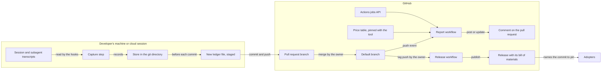

# Threat model

What could go wrong with the calculator, for the people who use it and for this repository, and what answers each threat. Every change revisits this file (see `CLAUDE.md`).

It was written for the first change, `add-pr-cost-calculator`, before any code, so the answers are requirements and tasks rather than code. It holds 100 threats across 8 trust boundaries. T38 to T69 were found by the design-stage review, T70 to T78 by the design-stage review of the decision records in `docs/decisions/`, T79 to T81 by the implementation-stage review of those records and their checks, and T82 to T100 by the design-stage review of the assumptions, the glossary and the golden set; they follow T37, each under a heading for its boundary, so that the numbers stay in order, and a threat that a change removes keeps its ID out of use (see Retired IDs). Where an answer can be a scenario in a spec, it is one, so that an acceptance test holds it. `tests/test_threat_model.py` checks that every citation below names a scenario, task, decision, decision record or file that exists.

## How it was built

1. Draw how data moves, from the agent's session to the comment on the pull request, and from a tag to a release.
2. Mark each trust boundary: a place where data crosses from one party's control into another's.
3. At each boundary, ask the six STRIDE questions. Can someone pretend to be someone else (**spoofing**)? Change what they should not (**tampering**)? Deny what they did (**repudiation**)? See what they should not (**information disclosure**)? Stop it working (**denial of service**)? Gain powers they should not have (**elevation of privilege**)? A seventh kind, **reliability**, covers failures nobody causes on purpose that would still make a figure wrong.
4. Rate each threat for impact and for likelihood, each from 1 to 3, and give its risk as their product, from 1 to 9 (DR-094).
   - **Impact** is how bad it is when the threat happens. **3, high:** private data is published, or someone gains a write token or runs code they should not. **2, medium:** a figure is wrong or misleading, or someone's work is disturbed. **1, low:** an inconvenience, or a small error that the report makes visible.
   - **Likelihood** is how likely the threat is to happen with its answer in place as designed, so that the matrix shows the risk that remains if the answer is built as specified (DR-112). **3, likely:** ordinary use meets it, or anyone who can push to a branch can do it without skill. **2, possible:** it needs a particular sequence, a mistake that people make, or a motivated person with the access the boundary already gives. **1, unlikely:** it needs several independent conditions, a defect that a test is written to catch, or access that the boundary does not give.
   - The threats are modelled twice in every change (`CLAUDE.md`). At design, before the design is approved, reviewers who did not write the design, one per trust boundary, each in a context of their own, read the design and the specs, find the threats that are missing and rate their likelihood, and their findings change the design where they need to. At implementation, before the pull request merges, a review in a context separate from the builder's rates each threat again against the code and adds the threats that the code itself brings (`add-pr-cost-calculator` task 5.2).
5. Give each threat its answer, and cite what holds that answer: a scenario (`capability`: "name"), a task or a decision of a change, a decision record by its ID, or a file. Name every decision record that lists the threat among its threats, and have every record that a change adds and names here list the threat (R131). A threat with no answer is marked accepted, with the reason.

## How data moves

The trust boundaries:

1. **Transcript to capture.** The transcript holds everything the session saw, in every repository it worked in: prompts, code, tool output, web pages and possibly secrets. Only the counts of calls made from this repository may cross, and only with the consent of the person whose session it is.
2. **Capture to the repository.** The capture step keeps its records in the repository's git directory, and writes and stages files in a working tree it does not control, in the middle of someone's work.
3. **Ledger to report.** Whoever can push to a pull request's branch writes its ledger, and its whole diff, including the author of a pull request from a fork. The report must treat both as untrusted data.
4. **Report to GitHub.** The report holds a token that can write comments.
5. **Comment to readers.** What the report posts is rendered as Markdown for everyone who reads the pull request.
6. **Tool to adopters.** Adopters run the hook on their machines and the report in their CI, called from a workflow they write.
7. **Contributors to this repository.** Anyone can open a pull request here, and agents working here read what others wrote.
8. **Tag to release.** Whoever can create a tag starts a workflow that holds `contents: write`, and GitHub runs that workflow as it stands at the tagged commit. The release it publishes tells adopters which commit to trust.

## Boundary 1: transcript to capture

### T1. Transcript text reaches the ledger

- **Kind:** information disclosure
- **Impact:** 3 (high)
- **Likelihood:** 1 (unlikely)
- **Risk:** 3
- **What could happen:** a prompt, a piece of code, a file's contents, a tool's output or a secret is copied into a ledger entry and published with the pull request.
- **Answer:** entries are built from typed values only. A count is copied as a number. The only text taken from a transcript is the model's name and the values of the price attributes, each only when the price table that the hook ships with lists it, or else recorded as `unknown`, because a private gateway, a custom model or an alias can have a name that looks like one of Anthropic's. Tool names, including MCP server names, which can name a private service, are read only to choose the activity type and are never written.
- **Held by:** `ledger`: "Content in the transcript does not reach the ledger"; `ledger`: "A planted string never reaches the ledger"; `ledger`: "An unexpected model name is recorded as unknown"; `ledger`: "A model name the price table does not list is recorded as unknown"; `ledger`: "An attribute value the price table does not list is recorded as unknown"; `activity-types`: "An MCP call does not record the server's name"; `project-standards`: "A golden call that no entry or cited scenario accounts for fails CI"; DR-029; DR-045; DR-054

### T2. Work in another repository is published here

- **Kind:** information disclosure
- **Impact:** 3 (high)
- **Likelihood:** 2 (possible)
- **Risk:** 6
- **What could happen:** a transcript belongs to a session, not to a repository, and one session can work in several, such as a public one and a private one. Recording the whole transcript would publish, in the public repository's ledger and comment, how much work went into the private one and with which models.
- **Answer:** this repository is the one that holds the project directory that Claude Code gives the hook, whatever directory the hook runs in. Capture records only the calls whose transcript line gives a working directory in this repository, meaning one whose git common directory is this repository's. Calls made in another repository, in a separate repository nested inside this one's folder, or in a folder that contains this one, are not recorded here, and neither is a call whose lines give no working directory.
- **Residual:** a line's working directory is Claude's current directory, not where the call worked. A session whose current directory is in this repository, and that works on another one through absolute paths, `git -C` or a `cd` inside a command, has those calls recorded here, with their counts and models. Claude Code keeps a `cd` between commands only within the project and the directories added to the session, and never for a subagent, so such a session can work on another repository call after call from here, and the call that moves its directory into another one is recorded here too. No rule over the transcript's working directories can tell them apart. The README tells a person who opts in to keep work on other repositories, private ones above all, out of such sessions. A person who finds the calls of such work in a ledger file can remove the file, and once a run has found a commit holding it, the step stages its calls no more in that run's clone, however the file was removed, though a run that puts a file back, after a take-back that raced a commit or followed a reset in the commit's own command, can undo, once, a removal made before that run, as T10 says. A removal that leaves the file in the working tree, as a `git rm --cached` and a commit, or a mixed `git reset`, do, leaves it where a `git add` can stage it again, as can a `git commit -a` after `git reset -N`, since the step leaves a committed ledger file to git, so the README tells such a person to delete it too, as the design's risks say. A ledger file that a later commit removes stays in git history, though, so such a removal hides nothing that was pushed. However a ledger file was removed, a session resumed in a fresh clone at the same path can record its calls again. A session that works from a folder above the repository records nothing, so its figure is too low.
- **Held by:** `usage-capture`: "Calls made from outside this repository are not recorded"; `usage-capture`: "A repository nested inside this one is not this one"; `usage-capture`: "A run from another directory works on this repository"; `usage-capture`: "A ledger file that a person removes stays removed"; `usage-capture`: "A ledger file that a person removes stays removed for another session"; `usage-capture`: "A put-back does not undo a staged removal"; `usage-capture`: "A ledger file that a removal leaves is left to git"; `usage-capture`: "A fresh clone stages a removed ledger file's calls again"; `usage-capture`: "A call whose line gives no working directory is not recorded"; `project-standards`: "A golden call that no entry or cited scenario accounts for fails CI"; DR-055; DR-056; DR-057; DR-107; DR-130; `add-pr-cost-calculator` task 4.4

### T3. A person's usage is published without their consent

- **Kind:** information disclosure
- **Impact:** 2 (medium)
- **Likelihood:** 2 (possible)
- **Risk:** 4
- **What could happen:** a repository's owner turns the tool on, and the usage of everyone who works there, including outside contributors who never agreed, is committed and published with their pull requests.
- **Answer:** capture also needs the person's own opt-in, in their global git configuration, which is not part of the repository. It is read from the person's global configuration files, `~/.gitconfig` and git's file in their XDG configuration folder, and not from files that they include, which can lie in a repository's folder. That folder is taken from `XDG_CONFIG_HOME` only when it holds an absolute path, since git reads a relative one from its current directory, which can be in a repository's folder too. The setting is read as git reads it: the last value in a file decides, git's spellings of the section and key count, and a subsection or a comment does not, though only `true`, `yes`, `on`, `1` and the bare key opt a person in, where git also reads other numbers as true. The environment variables that a repository's settings could set, to point git at a file that opts everyone in or to add the setting, are ignored, and a repository's own git configuration can turn it off but not on. The README says what is published when capture is on.
- **Residual:** a repository's own hooks can run any command on a contributor's machine, including one that changes that setting (see Assumptions). One opt-in covers every repository that uses the tool, until the person turns it off in one.
- **Held by:** `switch-and-opt-in`: "A person who has not opted in is not recorded"; `switch-and-opt-in`: "No configuration file means no capture"; `switch-and-opt-in`: "A repository's own git configuration cannot opt a person in"; `switch-and-opt-in`: "The environment cannot opt a person in"; `switch-and-opt-in`: "A setting in an included file does not opt a person in"; `switch-and-opt-in`: "The XDG configuration file can opt a person in"; `switch-and-opt-in`: "The home configuration file decides when both set it"; `switch-and-opt-in`: "A relative XDG folder is not read"; `switch-and-opt-in`: "A person can turn capture off in one repository"; `switch-and-opt-in`: "The last value in a file decides"; `switch-and-opt-in`: "Git's spellings of the setting opt a person in"; `switch-and-opt-in`: "The setting's names in any case, and its value in quotes, opt a person in"; `switch-and-opt-in`: "A subsection or a comment does not opt a person in"; `switch-and-opt-in`: "A number other than `1`, or a value that git cannot read, does not opt a person in"; DR-046; DR-048; DR-049; DR-050; `add-pr-cost-calculator` task 4.4

### T4. An identifier links the ledger to a session or a person

- **Kind:** information disclosure
- **Impact:** 2 (medium)
- **Likelihood:** 1 (unlikely)
- **Risk:** 2
- **What could happen:** the transcript carries session ids, request ids, the working directory, user names inside paths, and the branch. Any of them in the ledger would link a public record to a person or a private session.
- **Answer:** a call is identified by a SHA-256 hash of its message id, kept only so that no call is recorded twice. No session value, path, working directory, user name or branch name is written into an entry, and a ledger file's name is random, so that neither an entry nor a file's path carries one.
- **Residual:** whoever holds the original message ids, such as the session's owner, can match them to entries. That is the person the data came from.
- **Held by:** `ledger`: "Content in the transcript does not reach the ledger"; `ledger`: "A planted string never reaches the ledger"; DR-045; DR-053; DR-088; DR-127; DR-136

### T5. Call times show when someone works

- **Kind:** information disclosure
- **Impact:** 1 (low)
- **Likelihood:** 3 (likely)
- **Risk:** 3
- **What could happen:** a time on every model call would show, call by call, when a contributor's agent was working, in a repository anyone can read.
- **Answer:** an entry records the UTC day only, which is all that pricing needs.
- **Residual:** commit times in git already show when someone worked. The ledger adds nothing finer than the day.
- **Held by:** `usage-capture`: "An entry records the UTC day, not the time"; DR-052

### T6. A malformed value is recorded as usage

- **Kind:** tampering
- **Impact:** 2 (medium)
- **Likelihood:** 1 (unlikely)
- **Risk:** 2
- **What could happen:** a transcript in an unexpected shape gives counts as text, fractions, negative numbers, not-a-number, or `true` and `false`, which Python accepts where it expects a number. Recorded as they are, they make the cost wrong.
- **Answer:** every count must be a whole number from zero up to a documented ceiling, and a count at the ceiling is recorded while one above it, or one that is not a number, is refused. `true` and `false` are refused explicitly. A call with a refused value is left out, and the ledger counts it as refused, so that the comment can say how many were left out. A hook that succeeds shows its standard error to no one, so the count is kept in the ledger and not printed.
- **Held by:** `usage-capture`: "A count that is not a whole number is refused"; `usage-capture`: "A negative count is refused"; `report-comment`: "Calls that capture refused are counted in the comment"; `usage-capture`: "A count at the ceiling is recorded"; `usage-capture`: "A count above the ceiling is refused"; `usage-capture`: "A count that is not a number or is `false` is refused"; DR-044

### T7. One call is counted more than once, or from a partial line

- **Kind:** reliability
- **Impact:** 2 (medium)
- **Likelihood:** 3 (likely)
- **Risk:** 6
- **What could happen:** Claude Code can write one model call over several transcript lines. In one shape of subagent transcript, the earlier lines carry partial usage; in another, almost no line gives a stop reason, and each such call's lines give only the usage of its start. Capture also runs again over the same transcript. Counting lines would count a call several times, reading an early line would count it short, and waiting for a stop reason that never comes would leave the call out.
- **Answer:** a call is recorded once, by the hash of its message id, from its lines that give a stop reason. A call with no such line is read from its last line once a later call follows it or its agent has stopped, and the ledger counts those calls, so that the comment can give their number. A call that is not over yet waits for a later run. Final lines of one call that disagree are refused rather than guessed at.
- **Residual:** a call read without a stop reason is short: its lines give fewer output tokens and server-side tool requests than it made. When there are any, the comment gives their number and says that the token cost is a lower bound.
- **Held by:** `usage-capture`: "Running again records nothing twice"; `usage-capture`: "A call written over several lines is recorded once"; `usage-capture`: "A call's partial lines are not used"; `usage-capture`: "A call followed by a later one is read without its stop reason"; `usage-capture`: "A stopped agent's last call is read without its stop reason"; `usage-capture`: "A call still being written is recorded later"; `usage-capture`: "Lines of one call that disagree are refused"; `usage-capture`: "Subagent calls are included"; `report-comment`: "Calls read without a stop reason are counted in the comment"; DR-032; DR-033

### T8. Usage never reaches the pull request

- **Kind:** reliability
- **Impact:** 2 (medium)
- **Likelihood:** 3 (likely)
- **Risk:** 6
- **What could happen:** a session's machine can be disposable, so a call that is recorded but never committed is lost with it. The newest calls can be missing from the transcript when capture runs, because Claude Code writes it asynchronously. A turn that ends in an API error runs no `Stop` hook, and a session that ends after one turn has no later turn to carry its calls. A commit made with git's own options before `commit`, or a ledger file that an ignore rule matches, could be missed. A commit whose command stages its files first, as `git add f && git commit` does, looks empty to a run that comes before the command, and a commit whose message comes from a here-document runs `cat` before git. A commit made with `-a` has nothing staged before it runs.
- **Answer:** capture runs before and after each of the agent's Bash commands that the hook's condition `Bash(git *)` matches, and when a turn, a subagent, a failed turn or the session ends. It stages for a `git commit` in this repository, including one whose command stages its own files first, one made with `-a`, and one whose message comes from a here-document whose delimiter is quoted, and recognises it whatever options git is given first, and when a later option undoes one that would make it a dry run. So each commit it stages for carries the calls recorded on its branch up to that moment, including those of the turn that commits. A call that one run missed is recorded by a later one, and neither an ignore rule nor a sparse checkout can drop the ledger file.
- **Residual:** some calls reach no commit, and the README names these cases. They are the calls made after the agent's last commit on a branch that capture staged for, such as pushing and opening the pull request, and the call that runs that commit when that commit's run cannot yet read it as over, and any call that that run leaves unread at its time budget; calls recorded on a branch that gets no later commit, in a worktree where nobody commits or that Claude Code removes, or while no branch is checked out, as during a rebase that stops at a conflict; and calls whose only later commits were made in a way that capture does not stage for: by `git merge`, `git cherry-pick` or `git rebase --continue`, by a script, an API or Claude Code's PowerShell tool, which is on by default on Windows for claude.ai and Console accounts, in the background, in a pipeline, a subshell or a group, joined to another command by `||` or behind a wrapper such as `timeout`, after another command in the same input, with a message that another command writes or that a here-document whose delimiter is not quoted holds, by git written in a form that the hook's condition does not match, such as by its path or through an alias, or while a repository's own git hook refused the ledger file. In a repository whose attributes give the ledger path a filter or a working-tree encoding, or where git refuses to add the file, no call reaches a commit. Once a run has found a commit holding a ledger file, its calls are not staged again in that run's clone, however the file leaves the branch, so in that clone the calls of a commit that is reverted, reset away in any mode but `--soft` or split in an interactive rebase are not counted, even when its changes are committed again, unless the file itself is committed again, as a squash made with a mixed `git reset` and `git add -A` commits it, except where a sparse checkout leaves `.pr-cost/` out, or an ignore rule matches it while it is untracked, as after a reset without `-N`. After a take-back, a `git stash` made before the run that puts the file back, or a mixed `git reset` back to the commit that took the file once a run has found another commit checked out, leaves the file deleted in the working tree, so that in that clone a `git commit -a` removes it, with its calls, and after a mixed `git reset` without `-N` in the commit's own command, a `git reset --soft` back to that commit leaves it deleted in the index as well, so that in that clone any next commit removes it, with its calls. Checking out or restoring from the index the path of a ledger file that has an intent-to-add entry writes empty content over the file, so that its calls are lost, as the design's risks say. A damaged index, which git 2.43 can write in a cone-mode `git sparse-checkout` command that runs with the sparse index on or is given `--sparse-index` while any file has an intent-to-add entry, or, with the sparse index on, in a squash made with `git reset -N` of commits that add a file that the sparse checkout leaves out, can make the next commit delete ledger files from the branch, with their calls, as the design's risks say. The comment counts what the pull request's commits carry. A subagent that never finishes leaves its last call unread when that call gives no stop reason. The design leaves commits made through the PowerShell tool out of this change.
- **Held by:** `usage-capture`: "A one-turn session's commit carries its calls"; `usage-capture`: "A commit carries the calls that another session recorded on its branch"; `usage-capture`: "A commit that stages its own files carries a ledger file"; `usage-capture`: "A commit of all changes with nothing staged carries a ledger file"; `usage-capture`: "A turn that ends in an API error is still recorded"; `usage-capture`: "A call still being written is recorded later"; `usage-capture`: "A commit with git's own options is still a commit"; `usage-capture`: "A dry-run option that a later option undoes is still a commit"; `usage-capture`: "An ignored ledger path is still committed"; `usage-capture`: "A sparse checkout still commits the ledger file"; `usage-capture`: "A commit message from a here-document still carries a ledger file"; `usage-capture`: "A squash with a plain reset keeps its ledger files"; `usage-capture`: "A soft reset back to a commit that its own command reset away leaves its ledger file out"; DR-007; DR-009; DR-010; DR-012; DR-013; DR-014; DR-030; DR-032; DR-034; DR-037; DR-055; DR-107; DR-128; DR-129; DR-130; `add-pr-cost-calculator` task 4.4

### T9. Usage that costs extra is priced as standard

- **Kind:** reliability
- **Impact:** 2 (medium)
- **Likelihood:** 2 (possible)
- **Risk:** 4
- **What could happen:** the price of a call can depend on more than its tokens: a higher rate for a long prompt on some models, a multiplier for the inference region, a premium for a faster speed, and a charge per web search. Ignoring them would under-report without saying so.
- **Answer:** capture records these attributes where the transcript gives them. Pricing applies every modifier the price table lists, the fast-speed premium and service-tier rates among them, combined as the table states, and names, rather than guesses, any value or combination it has no price for. Web fetches are listed at no charge, so a call that made them is still priced.
- **Held by:** `usage-capture`: "Price attributes are recorded"; `pricing`: "A long prompt is priced at its higher rates"; `pricing`: "A region multiplier applies to every token type"; `pricing`: "Web searches are priced per search"; `pricing`: "Web fetches add nothing beyond their tokens"; `pricing`: "An unpriced attribute is named, not guessed"; `pricing`: "A fast speed is priced at its premium rates"; `pricing`: "A service tier is priced at its own rates"; `pricing`: "Modifiers combine as the price table states"; `pricing`: "A combination the price table does not state is named, not guessed"; DR-124

## Boundary 2: capture to the repository

### T10. Capture disturbs the agent's git work

- **Kind:** denial of service
- **Impact:** 2 (medium)
- **Likelihood:** 2 (possible)
- **Risk:** 4
- **What could happen:** staged changes left between commits make `git rebase` refuse to run, and a staged change to a file that another branch lacks makes `git checkout` refuse too. A new file left staged follows a checkout to the next branch, carrying its calls into the wrong pull request, and `git stash` takes it. So does a ledger file that a mixed `git reset` or a `git rm --cached` leaves in the working tree, untracked or with only an intent-to-add entry, once a `git add -A`, or for that entry a `git commit -a`, adds it on the next branch, or in another worktree after `git stash -u` and a pop there. Until it is committed, or deleted together with any intent-to-add entry, such a file can also stop git commands, while some forms of `git stash`, and a `git reset --keep` to a commit that lacks the file, turn an intent-to-add entry whose file is in the working tree into an untracked file, as the design's risks say. In a sparse checkout that leaves out its folder, `git add -A` refuses an untracked one and fails, while it and `git commit -a` leave out an intent-to-add entry without an error. A run that holds the index lock while the agent commits makes the commit fail. A commit that would have failed for having nothing to commit would succeed instead, holding only the ledger file. No run follows a command that was refused, blocked by another hook or cancelled, and an interrupt runs no `Stop` hook, so a file staged for such a command would stay staged. A commit after another command in the same input can land on a branch that a run before the command cannot know, and a commit in the background can run after the run that follows its command. A command substitution, a process substitution or a here-document can run a command before the commit, such as one that changes the branch, from an argument, an assignment or a redirection. A plain commit holds no index lock once it has read the index, while its `prepare-commit-msg` and `commit-msg` hooks run, so a take-back then can remove a file that the commit has taken, and the next commit would delete it, as it would after a reset in the commit's own command and a later reset back to that commit, while a put-back that answers either could undo a person's own removal of a ledger file. A run that worked in the directory where the hook runs, which in a desktop worktree session is the main checkout, would stage in the person's index instead of the agent's worktree. The repository's own git hooks see the staged file, and one that refuses it, such as a secret scanner that takes a call's hash for a secret, fails a commit that would pass without the tool, and an agent shown that failure may retry with `--no-verify`, which skips the hook's checks on its own changes too, or reconfigure the hook. A sparse checkout can refuse to stage the file, a filter on its path, such as Git LFS's, can make the commit hold something other than the entries, and git can refuse to add it, as where `core.safecrlf` is on and line endings are converted. A `git rm` of the folder that holds the ledger file, before the commit, fails while the step's new file is staged there.
- **Answer:** between commits, capture keeps its records in the git directory and leaves the working tree and the index alone, but for the take-backs and put-backs below. It stages a ledger file only just before the agent's own `git commit`, and only when that commit is a top-level command, not in a pipeline, joined to the rest by `&&`, `;` or line breaks, in the foreground, and nothing comes before it in the command but `cd` to a path written in it and the git commands `add`, `rm`, `mv`, `status`, `diff`, `log` and `show`, with or without git's own options, counting every command or process substitution in the commit or before it, in an argument, an assignment or a redirection, as coming before it unless all it runs is `cat` reading a here-document whose delimiter is quoted, and staging nothing when the commit or a command before it reads a here-document whose delimiter is not. It finds the worktree from the current directory that the hook's input gives, followed through each top-level `cd` before the commit and the `-C` options given to git before `commit` in the commit's own command, never from where the hook runs, and stages nothing for such a `-C` path that the command does not write out. It stages nothing for a commit that would otherwise be empty when no `git add`, `git rm` or `git mv` comes before it, for a dry run, in any spelling that git accepts, for a commit of named paths, for a command that only names a commit, after a `git rm` or `git mv` that is given a `-C` path not written out, or names, read from where it runs, the ledger file's folder, a folder above it, a path with a wildcard or other pathspec magic, or a path not written out, when no call is waiting, when the ledger path has a filter or a working-tree encoding, or when git refuses to add the file, which it then removes, and it stages through ignore rules and sparse checkouts. A run that comes again before the same command, as for a deferred call, stages nothing new while that command's file is still staged and its branch still checked out, and takes the file back first when that branch is not. The run after that command takes the file back if no commit took it. For a command that gets no such run, any later run, from that session or another, does once it finds the command over, as the run when the session ends does for that session's commands. A take-back never removes a file from a worktree whose checked-out commit holds it, and leaves the file while another git command holds that worktree's index lock. Runs take back and put back what they can before they read any transcript. Every take-back notes the commit it found checked out there, which did not hold the file, and whether it removed the file from the index, the working tree or both, and the first later run there that finds another commit checked out and the index free puts the file back, as that commit holds it, when that commit holds it: into the index, when the take-back removed it from there and the index lacks it, and then into the working tree, when the take-back removed it from there, the index holds it as that commit does and the working tree lacks it. That run then forgets the note, and the step puts back no file in any other case. Once a run has found a commit holding a ledger file, the step never stages its calls again in that run's clone, so that in that clone a ledger file that anyone removes after that takes its calls with it, and the step never takes the file back, but leaves it to git, wherever git leaves it, as git leaves the other changes of a commit that a reset undoes. Apart from staging, taking back and putting back, no run touches the index. The ledger names its hash field so that detect-secrets, a common secret scanner, reads the hash as an identifier, and the README tells adopters to exclude `.pr-cost/` from their own git hooks before they turn the tool on.
- **Residual:** a git command that starts while a run stages or takes back the file fails at the index lock, as when any two git commands meet. After a refused, blocked, cancelled or interrupted commit, the file stays staged until a run finds that command over: the session's next git command, turn end or end, or another session's next run in the repository. Until then, the person's own git commands find it staged: `git rebase` refuses to run, `git checkout` carries it to another branch, where a commit of theirs takes it with its calls, and `git stash` takes it. A ledger file that a removal leaves in the working tree, as a mixed `git reset`, with or without `-N`, or a `git rm --cached` and a commit do, stays there, as the other changes that a reset leaves do, and follows a change of branch. A `git commit -a` or a `git add -A` commits the intent-to-add entry that `git reset -N` leaves, whatever ignore rule matches the file, unless a sparse checkout leaves its folder out. Unless an ignore rule matches an untracked one, or a sparse checkout leaves its folder out, a `git add -A` stages it, and unless an ignore rule matches it, `git stash -u` and a pop carry it to any worktree. So a commit can take the file, with its calls, on the branch checked out there. Until such a file is committed, or deleted together with any intent-to-add entry, it can stop git commands, and while any file has such an entry, a cone-mode `git sparse-checkout` command in git 2.43 can crash, or, with the sparse index on or given `--sparse-index`, damage the index, in ways that can lead a later commit to delete other files from the branch, ledger files among them, as the design's risks list. With the sparse index on, a squash made with `git reset -N` of commits that add a file that the sparse checkout leaves out can do the same with no entry before it, so the README asks adopters to keep the sparse index off in every worktree while the tool is on, as the design's risks say. Some forms of `git stash` and a `git reset --keep` to a commit that lacks the file drop the intent-to-add entry that `git reset -N` leaves, as the design's risks say, and where the file is in the working tree leave it untracked, so that a squash made with `git reset -N` then loses it at a `git commit -a`, or at a `git add -A` where an ignore rule matches it. In a sparse checkout that leaves out `.pr-cost/`, unless the folder is added to it, as the README says, `git add -A` refuses an untracked one, as it refuses any new file outside the sparse checkout, and exits with an error after staging the rest, so that a commit joined to it by `&&` does not run, while it and `git commit -a` leave out an intent-to-add entry without an error, so that the commit leaves out the file, with its calls. A session whose process is killed during its commit, before the command's result is written, leaves the file staged until the person removes it or the session is resumed. A call that another hook defers leaves it staged until the call is resumed, unless a session-end run takes it back when the deferral ends the process, which Claude Code's documentation leaves open; either way the resumed commit carries the calls, unless that branch is no longer checked out by then, when the resumed run takes the file back first and the calls wait for their own branch, or, when that run finds the index lock held, leaves the file staged, and a commit that starts once the lock is free takes it, with its calls, to the other branch. A take-back that races a commit leaves the file deleted in the index and the working tree until the first later run that finds that commit checked out and the index free puts it back, a commit that the person makes before then deletes it, and a later commit carries its calls again. The run that puts a file back, after such a take-back or one that followed a reset in the commit's own command, undoes, once, a removal of the file made before that run: one from the working tree alone, as when the person restores the file and then deletes it with `rm`, and, after a take-back that removed the file from the index, one that the index holds by then for another reason, as when the person restores the file and then removes it with `git rm`, or commits its deletion and then goes back to that commit with `git reset --soft`. A `git stash` made before that run, while the commit that took the file is checked out, takes the take-back's deletion with it, which its pop brings back, and once a run has found another commit checked out after a take-back, a mixed `git reset` back to a commit that took the file brings it back into the index alone; either way a `git commit -a` then deletes the file. After a mixed `git reset` without `-N` in the commit's own command, a `git reset --soft` back to that commit leaves the index without the file, so nothing is put back, and the next commit deletes it, even one that `git add -A` makes. A file that another command removes from the index while that commit runs stays removed, so the next commit deletes it, as it would without the step. A `git add` that stages nothing, before a commit that would otherwise be empty, lets that commit hold the ledger file alone. A repository hook that still refuses the ledger file fails the agent's commit, and the agent sees that hook's message, which names the file; each retry stages the calls again until the repository leaves the folder out of that hook, and an agent may instead retry with `--no-verify` or change the hook's configuration, which rests on the adopter's own rules for agents. The worst case of that retry, a secret scanner skipped for the agent's own changes, is T43.
- **Held by:** `usage-capture`: "A turn's end leaves the working tree alone"; `usage-capture`: "A commit that does not happen leaves nothing staged"; `usage-capture`: "A refused commit leaves nothing staged"; `usage-capture`: "A session's end takes back what its commands left staged"; `usage-capture`: "A later session takes back what an earlier one left staged"; `usage-capture`: "A take-back waits while the index is in use"; `usage-capture`: "A take-back leaves a committed file in place"; `usage-capture`: "A ledger file that a commit takes while a take-back runs is put back"; `usage-capture`: "A commit after another command takes no ledger file"; `usage-capture`: "A commit whose message another command writes takes no ledger file"; `usage-capture`: "A substitution before the commit takes no ledger file"; `usage-capture`: "A here-document whose delimiter is not quoted takes no ledger file"; `usage-capture`: "A commit in the background takes no ledger file"; `usage-capture`: "A commit with nothing to commit stays empty"; `usage-capture`: "An empty commit asked for stays empty"; `usage-capture`: "A `git add` that stages nothing leaves the ledger file alone in the commit"; `usage-capture`: "A commit with nothing new to record takes no ledger file"; `usage-capture`: "A commit of named paths takes no ledger file"; `usage-capture`: "A command that only names a commit stages nothing"; `usage-capture`: "A dry run of a commit stages nothing"; `usage-capture`: "A commit in another repository stages nothing here"; `usage-capture`: "A commit stages in the worktree where it runs"; `usage-capture`: "A sparse checkout still commits the ledger file"; `usage-capture`: "A ledger path with a filter takes no ledger file"; `usage-capture`: "A ledger file that git refuses to add is not left behind"; `usage-capture`: "A command's repeated run stages its calls once"; `usage-capture`: "A command's repeated run after a change of branch takes its file back"; `usage-capture`: "Removing the ledger folder before a commit takes no ledger file"; `usage-capture`: "Moving the ledger folder before a commit takes no ledger file"; `usage-capture`: "Removing ledger files by a pattern before a commit takes no ledger file"; `usage-capture`: "A commit whose `-C` path is not written out takes no ledger file"; `usage-capture`: "A `-C` after `commit` is not a path"; `usage-capture`: "A file that a later commit deleted is not put back"; `usage-capture`: "A file removed from the index while its commit runs stays removed"; `usage-capture`: "A ledger file that a person removes stays removed"; `usage-capture`: "A ledger file that a person removes stays removed for another session"; `usage-capture`: "A ledger file that a removal leaves is left to git"; `usage-capture`: "A ledger file comes back with a commit that its own command reset away"; `usage-capture`: "A soft reset back to a commit that its own command reset away leaves its ledger file out"; `usage-capture`: "A put-back does not undo a staged removal"; `usage-capture`: "Calls go to the worktree and branch they were recorded on"; `usage-capture`: "Calls made with no branch checked out wait for a commit made the same way"; `usage-capture`: "Switching branches records nothing twice"; `usage-capture`: "A commit in a pipeline, a subshell, a group, joined by `||` or behind a wrapper takes no ledger file"; DR-010; DR-011; DR-012; DR-013; DR-014; DR-034; DR-035; DR-037; DR-055; DR-107; DR-128; DR-129; DR-130; `add-pr-cost-calculator` task 1.2; `add-pr-cost-calculator` task 2.2; `add-pr-cost-calculator` task 4.4

### T11. Capture writes outside the ledger

- **Kind:** tampering
- **Impact:** 2 (medium)
- **Likelihood:** 1 (unlikely)
- **Risk:** 2
- **What could happen:** a repository can contain symbolic links. If a folder on the ledger's path were a link, writing the ledger would write somewhere else on the machine, such as a shell's start-up file.
- **Answer:** a ledger file's name is random and is created only if no file of that name exists, and capture refuses any path with a symbolic link in a folder below the repository root. The branch name plays no part in the path.
- **Held by:** `ledger`: "A symbolic link in the ledger path is refused"; `ledger`: "A new file for every commit"; DR-127

### T12. Capture stages unrelated work

- **Kind:** tampering
- **Impact:** 3 (high)
- **Likelihood:** 1 (unlikely)
- **Risk:** 3
- **What could happen:** if the step staged more than its own file, unrelated changes, perhaps ones not meant to be shared, would go into the agent's next commit.
- **Answer:** the step stages exactly the ledger file it wrote.
- **Held by:** `ledger`: "Other changes stay unstaged"; DR-035

### T13. Two writers spoil the record

- **Kind:** reliability
- **Impact:** 1 (low)
- **Likelihood:** 1 (unlikely)
- **Risk:** 1
- **What could happen:** a session and its subagents can stop at the same moment, and Claude Code runs matching hooks in parallel. Writes that interleave would split records, and two branches appending to one ledger file would conflict when they merge. A worktree with a store of its own would record again a call that the main folder's store holds, so that it reached two branches.
- **Answer:** each ledger file is written once, whole, under a new random name, so no two runs or branches write the same file, and runs at the same time keep every record whole and record no call twice. The store lives in the repository's common git directory, which every worktree shares.
- **Held by:** `usage-capture`: "Two runs at once"; `usage-capture`: "Two worktrees share one record of a call"; `usage-capture`: "A worktree of this repository is this repository"; `ledger`: "A new file for every commit"; DR-011; DR-036; DR-127

### T14. The hook steers or stalls the agent

- **Kind:** elevation of privilege
- **Impact:** 3 (high)
- **Likelihood:** 1 (unlikely)
- **Risk:** 3
- **What could happen:** a `Stop` hook that exits with code 2 sends the agent back to work with the hook's message, and a `PreToolUse` hook that exits 2 blocks the agent's commit. JSON on standard output can do the same, or approve a command without asking. Python itself exits 2 when it cannot open its script, for example when the file is unreadable. Any transcript or ledger text in such a message would reach the agent as an instruction. A slow hook holds the session until it ends, for up to the 600 seconds of Claude Code's default timeout. On Windows without Git Bash, Claude Code runs a hook's command in PowerShell, so a command written only for `sh` could fail at every stop, for every contributor, opted in or not.
- **Answer:** the registered command ends in `; exit 0`, which `sh`, Git Bash and PowerShell all read, rather than `|| true`, which Windows PowerShell 5.1 does not, so it exits with success even when its script cannot be read or started, in each shell that Claude Code runs it in. The step prints nothing on standard output, and no git command it starts prints there either, and its messages on standard error are its own words and numbers, never text from the transcript or the ledger. Claude never sees the standard error of a hook that succeeds. The command has a short timeout, and the step stops at a time budget inside it, leaving the rest for a later run.
- **Held by:** `usage-capture`: "Capture never asks the agent to continue"; `usage-capture`: "The registered command succeeds in PowerShell"; `usage-capture`: "A failure message quotes nothing from the transcript"; `usage-capture`: "A long transcript does not hold up the session"; `usage-capture`: "An unreadable transcript is skipped"; `usage-capture`: "Nothing that git prints reaches standard output"; `usage-capture`: "Standard error carries no ledger or transcript text"; DR-009; DR-031; DR-044; `add-pr-cost-calculator` task 2.3

### T15. The hook runs code planted beside it

- **Kind:** elevation of privilege
- **Impact:** 3 (high)
- **Likelihood:** 1 (unlikely)
- **Risk:** 3
- **What could happen:** Python imports from a script's own folder first, so a file there named like a standard module, such as `json.py`, would run in place of the real one.
- **Answer:** the documented hook command runs Python in isolated mode (`python3 -I`), which leaves the script's folder, the current directory and Python's environment variables out of the import path.
- **Held by:** `usage-capture`: "The capture step runs alone in isolated mode"; DR-125; `add-pr-cost-calculator` task 2.3

## Boundary 3: ledger to report

### T16. A ledger is edited by hand to change the cost

- **Kind:** tampering
- **Impact:** 2 (medium)
- **Likelihood:** 3 (likely)
- **Risk:** 6
- **What could happen:** a contributor lowers or raises the reported cost by editing their ledger.
- **Answer:** none in the tool. The ledger is in the pull request's diff, where a reviewer sees it.
- **Held by:** DR-002; DR-010; DR-066; accepted: the ledger is reviewed like any other file in the pull request, and the report is an estimate, not a bill.

### T17. A ledger entry is malformed or hostile

- **Kind:** tampering, denial of service
- **Impact:** 2 (medium)
- **Likelihood:** 2 (possible)
- **Risk:** 4
- **What could happen:** a ledger line has the wrong types, unknown fields, impossible numbers, a date in the future or before any known price, two versions of one call, or text written to be shown in the comment. One such line could also stop the whole report.
- **Answer:** the report holds each line to the ledger format that `docs/ledger-format.md` documents and capture writes: whole counts within the ceiling, never `true`, `false`, not-a-number or a number too large to hold, no field given twice, no field the format does not name, no nesting beyond the format's depth, and a day that is a date. It refuses any line that does not match, and says how many it refused, showing none of them. An entry dated after the day the report runs is refused, an entry older than any price is named and left out, and entries of one call that differ are all refused. None of these stops the report.
- **Held by:** `report-comment`: "Refused ledger lines are counted, not shown"; `report-comment`: "A name with markup is not shown as written"; `ledger`: "Entries of one call that disagree are refused"; `pricing`: "An entry from the future is refused"; `pricing`: "Usage before any known price is named, not priced"; `report-comment`: "A ledger count that is not a whole number within the ceiling is refused"; `report-comment`: "A ledger count given as `true` or `false` is refused"; `report-comment`: "A ledger count given as not-a-number is refused"; `report-comment`: "A ledger count too large to hold is refused"; `report-comment`: "A ledger line that gives a field twice is refused"; `report-comment`: "A ledger line with a field that the format does not name is refused"; `report-comment`: "A ledger line nested too deeply is refused"; `report-comment`: "A ledger day that is not a date is refused"; `report-comment`: "An unreadable ledger line is counted and the report completes"; DR-020; DR-044; DR-124; DR-131; `add-pr-cost-calculator` task 4.2

### T18. The report reads more than it should

- **Kind:** denial of service, information disclosure
- **Impact:** 2 (medium)
- **Likelihood:** 1 (unlikely)
- **Risk:** 2
- **What could happen:** a pull request adds a ledger too large to read in reasonable time or memory, or commits a symbolic link in the ledger folder, which a report reading the working tree would follow to `/dev/zero` or to a file on the runner. Once merged, such a file is also read by the capture step of everyone who works on a branch that holds it, on their own machines.
- **Answer:** the report and capture read ledger files only as blobs from git, never through the working tree, and learn each blob's size before reading it. The report refuses any added path that is not a regular file, and refuses ledger changes above a documented size bound, while still reporting the CI cost. Capture skips any path that is not a regular file and any file above that bound, and stops at its time budget.
- **Held by:** `report-comment`: "A ledger that is a link is refused"; `report-comment`: "An oversized ledger is refused"; `usage-capture`: "Capture reads no ledger file through a link"; `usage-capture`: "Capture does not read an oversized ledger file"; DR-044; DR-110

### T19. Entries are counted for the wrong pull request

- **Kind:** tampering
- **Impact:** 2 (medium)
- **Likelihood:** 2 (possible)
- **Risk:** 4
- **What could happen:** a branch name used again, or entries copied from another pull request's ledger, would count the same usage twice. A session resumed in a fresh clone at the same path, on another branch, can record calls that an earlier branch's ledger files already hold. A call recorded after a change of branch would go to the branch checked out next. A push that merges several pull requests, as a merge queue can, would charge one of them with the ledgers and runs of all, and a push that adds a commit of no pull request beside a merge would charge that commit's ledger files to the pull request.
- **Answer:** the report counts only the entries of ledger files that the merge adds, does not count an entry whose call the default branch already held before the merge, and counts a call that the pull request adds twice once. So a call recorded on two branches is counted once, for whichever pull request merges first, and a resumed session records nothing again that its own branch already holds. Capture runs before each of the agent's Bash commands that the hook's condition `Bash(git *)` matches, so a call that the transcript holds as over by then is recorded before the command can change the branch, unless that run reaches its time budget before it reads the call. A push whose commits do not all belong to one pull request, or that merges none, gets no comment, and its job summary says why. This rests on GitHub's lookup of the pull requests associated with a commit behaving as documented (see Assumptions).
- **Residual:** a call recorded on two branches can be counted for the wrong one of the two pull requests. The call that runs a command that changes the branch, when that command's run cannot yet read it as over, any call that that run leaves unread at its time budget, and calls followed by a change of branch that no command matching the hook's condition makes, go to the branch checked out next. Such a change can be made by a script, by the person, through Claude Code's PowerShell tool, or by git written in a form that the condition does not match: by its path, through `sh -c`, `env` or an environment runner, or through a shell alias or function. A program that git's own options or environment variables in a command name, such as `git -c diff.external=<program> diff` or `GIT_EDITOR=<program> git commit`, can also change the branch before a commit that the step staged for, which then takes the ledger file, with its calls, to the other branch. A ledger file that git carries to another branch, still staged, left in a working tree by a removal, or in a stash, takes its calls into that branch's pull request, as T10 says, and so does one that a command copies there with another commit's changes, as `git cherry-pick -n` does.
- **Held by:** `ledger`: "A reused branch name is not double-counted"; `ledger`: "A copied entry is counted once"; `ledger`: "One call added twice is counted once"; `report-comment`: "A push that merges several pull requests gets no comment"; `report-comment`: "A push that adds other commits beside a merge gets no comment"; `usage-capture`: "A resumed session records nothing its branch already holds"; `usage-capture`: "A call made before a checkout stays with its branch"; `usage-capture`: "The run before a git command records the calls before the command can change the branch"; `report-comment`: "A push that merges no pull request gets no comment"; DR-007; DR-012; DR-014; DR-017; DR-030; DR-034; DR-056; DR-131; DR-133

### T20. A pull request erases part of the record

- **Kind:** tampering, repudiation
- **Impact:** 2 (medium)
- **Likelihood:** 2 (possible)
- **Risk:** 4
- **What could happen:** the ledger files on the default branch are the record of earlier pull requests, and a later pull request could delete or change them.
- **Answer:** the deletion or change is in the pull request's diff before it merges. After the merge, its comment says how many earlier ledger files it removed or changed and counts none of their entries, and git history still holds the files as they were. A removal in a push that gets no comment is flagged in that push's job summary instead. A file that comes back later is T47.
- **Held by:** `ledger`: "Removed or changed ledger files are flagged"; `ledger`: "A removal in a push without a comment is flagged in the job summary"; DR-015; DR-017; DR-133

### T21. A pull request changes its own report

- **Kind:** repudiation, tampering
- **Impact:** 2 (medium)
- **Likelihood:** 2 (possible)
- **Risk:** 4
- **What could happen:** the workflow that runs the report, the tool version it pins and the configuration file are all files in the repository, so a pull request can change them, and its merge is then reported by what it changed. It could turn the tool off to go unreported, or pin a different version of the tool, with different code and prices.
- **Answer:** the report reads the configuration from the default branch both before and after the merge, and runs if either turns the tool on. When a pull request changes the configuration file or any workflow file, its comment says so, because any workflow can run with the identity that posts the report.
- **Residual:** a pull request that removes the report's workflow, or points it at code that is not this tool, gets no honest report. A change to a script or a local action that a workflow runs is not flagged, though it can act with the same identity. Each of these is in the pull request's diff, which the owner reviews before merging. A configuration made unreadable is T49, and a merge that a workflow makes is T50.
- **Held by:** `switch-and-opt-in`: "A pull request cannot turn off its own report"; `switch-and-opt-in`: "A changed report is flagged"; DR-051; DR-064

### T22. A large pull request is read only in part

- **Kind:** reliability
- **Impact:** 2 (medium)
- **Likelihood:** 2 (possible)
- **Risk:** 4
- **What could happen:** GitHub's API lists at most 3000 files and 250 commits for one pull request, and lists only the latest attempt of each job unless asked for all. A report built on those lists would quietly miss the rest. A squash or rebase merge puts new commits on the default branch, which no CI ran on, so a report that took its commits from the push would find none of the pull request's runs, while the push's own runs are still going when the report runs.
- **Answer:** the report reads a pull request's changes from git rather than from those capped lists, fetching the default branch's history up to the push and the pull request's head, since a checkout fetches one commit by default, and its own commits from its head ref, `refs/pull/<number>/head`, whatever the merge method. It counts only the runs on those commits that no push to the default branch started and that were created before the pull request merged, so it leaves out the runs that the merge's push starts, even when they run on one of those commits, as after a fast-forward, whatever their creation times, and it asks for every attempt of every job. A run that the merge starts through another event, such as the pull request's `closed` event, is created at the merge or after it, so the time cut leaves it out (see Assumptions). If any data it needs cannot be read in full, or a run it counts has not finished, it marks the figure incomplete instead of presenting part of it as the whole.
- **Residual:** runs on commits that a force-push removed from the pull request are not counted. The comment says that the CI minutes are those of the pull request's own commits. A pull request based on another one that was merged by squashing or rebasing still holds that one's commits, which the default branch does not hold by their hashes, so it counts their runs again unless it is rebased first. The README says so.
- **Held by:** `ci-minutes`: "Every commit is counted, beyond what the API lists"; `ci-minutes`: "A squash merge counts the runs on the pull request's commits"; `ci-minutes`: "A rebase merge counts the runs on the pull request's commits"; `ci-minutes`: "Runs that the merge starts are not counted"; `ci-minutes`: "A fast-forward merge counts the pull request's runs, not the push's"; `ci-minutes`: "A run that the pull request's closing starts is not counted"; `ci-minutes`: "A re-run job counts every attempt"; `ci-minutes`: "An incomplete jobs listing is reported as incomplete"; `ci-minutes`: "A run that has not finished makes the cost incomplete"; DR-017; DR-019; DR-038; DR-110; `add-pr-cost-calculator` task 4.3

## Boundary 4: report to GitHub

### T23. Code from a pull request runs with a write token

- **Kind:** elevation of privilege
- **Impact:** 3 (high)
- **Likelihood:** 1 (unlikely)
- **Risk:** 3
- **What could happen:** this is the best-known way into a GitHub workflow. A workflow triggered by an outside pull request is given a write token, then runs that pull request's code, which can then use the token. The `pull_request_target` event gives such a token, and GitHub's documentation says to avoid it when a workflow builds or runs the pull request's code.
- **Answer:** the report runs on the push that a merge makes to the default branch, so it runs only after the owner has merged, and refuses every other event, whatever triggered the workflow that calls it: it goes on only when the event is `push` and the ref is `refs/heads/` followed by the default branch's name, so a tag named like the default branch is refused too. It checks out its own code at the commit its caller pins, by the `job` context's workflow repository and commit, and reads the pull request's files only as data, never running, importing or installing anything from them.
- **Held by:** `report-comment`: "Nothing from the pull request is run"; `report-comment`: "Another event is refused"; `report-comment`: "A tag named like the default branch is refused"; DR-005; DR-006; DR-018; DR-044; DR-061; DR-062; `add-pr-cost-calculator` task 4.3

### T24. The token can do more than the report needs, or leaks

- **Kind:** elevation of privilege, information disclosure
- **Impact:** 3 (high)
- **Likelihood:** 1 (unlikely)
- **Risk:** 3
- **What could happen:** a token with wider permissions than the report needs turns any bug into a bigger one, and a token printed to a public log can be used until the job ends. A connection that the report opens anywhere but GitHub, by its API calls or by its git commands, could carry the token there.
- **Answer:** the reusable workflow declares only reading the repository and its Actions data and writing pull request comments, which a caller can narrow but not widen. Its checkout does not keep the token, and the report never writes the token to its log, its job summary or its comment. The report connects only to GitHub: to the host in `GITHUB_API_URL`, and by git to the tool's own repository and the repository it reports on, and a test fails on a connection anywhere else, including one that a git command opens.
- **Held by:** `report-comment`: "The token never reaches the output"; `project-standards`: "The report connects only to GitHub"; DR-008; DR-016; DR-020; DR-063; DR-110; DR-132; DR-160; `add-pr-cost-calculator` task 1.13; `add-pr-cost-calculator` task 4.3

### T25. The report overwrites someone else's comment

- **Kind:** tampering
- **Impact:** 2 (medium)
- **Likelihood:** 1 (unlikely)
- **Risk:** 2
- **What could happen:** the report finds its earlier comment by a hidden marker, and anyone can paste that marker into a comment of their own.
- **Answer:** the report updates only a comment that its own identity wrote.
- **Residual:** other workflows in the same repository that use `GITHUB_TOKEN` comment under the same identity, and could edit the report's comment after it is posted. A pull request that adds or changes a workflow has that flagged in its own comment (T21), and one that changes only a script or a local action that a workflow runs does not.
- **Held by:** `report-comment`: "A planted marker does not redirect the update"; `switch-and-opt-in`: "A changed report is flagged"; DR-044; DR-064

## Boundary 5: comment to readers

### T26. The comment carries text someone else wrote

- **Kind:** spoofing, tampering
- **Impact:** 2 (medium)
- **Likelihood:** 1 (unlikely)
- **Risk:** 2
- **What could happen:** model names, runner labels, file names, branch names and job names come from data that contributors control. Echoed into a Markdown comment, they could carry links, images that track who reads them, @-mentions that notify people, or text that looks like the report's own.
- **Answer:** the comment holds numbers, its own fixed text, and model, attribute and runner names that the price table lists, shown as code. A ledger line that names a model or an attribute value the table does not list, other than `unknown`, is refused, and a job on a runner the table does not list is counted in minutes and left out of the cost, unnamed. An entry's day reaches the comment only as a date, since a ledger line whose day is not one is refused. Nothing else from the ledger, the pull request or the jobs API reaches the comment. The job summary and the log are T52.
- **Held by:** `report-comment`: "A name with markup is not shown as written"; `report-comment`: "A runner label with markup is not shown"; `report-comment`: "Refused ledger lines are counted, not shown"; `ci-minutes`: "A job on a runner the price table does not list is not priced"; `report-comment`: "A ledger day that is not a date is refused"; DR-044; DR-110; DR-124

### T27. The comment claims more than the estimate supports

- **Kind:** repudiation
- **Impact:** 1 (low)
- **Likelihood:** 2 (possible)
- **Risk:** 2
- **What could happen:** a reader takes the figure as a bill, or cannot tell how it was reached.
- **Answer:** the comment says it is an API-equivalent estimate and not a bill, and names the price table's date and the tool's version, so anyone can recompute it from the ledger.
- **Held by:** `report-comment`: "The comment says what the figure is"; DR-002; DR-020; DR-124

## Boundary 6: tool to adopters

### T28. A compromised version of the tool reaches adopters

- **Kind:** elevation of privilege
- **Impact:** 3 (high)
- **Likelihood:** 1 (unlikely)
- **Risk:** 3
- **What could happen:** a malicious change to this repository, or to something it depends on, runs on adopters' machines through the hook and in their CI through the workflow. The hook is a file that adopters copy, so how it reaches them is part of this.
- **Answer:** the tool has no runtime dependencies beyond Python's standard library. The hook is one file that imports nothing else, which an adopter copies from the full commit that their calling workflow pins, not from a tag, which can be moved, and checks against the checksum that the README at that commit gives and the hook registration carries, which a test holds to the file's SHA-256; after that, it changes in their repository only through their own review. The actions the tool's workflows use are pinned to commits, the image that one CI job runs git 2.43 in is pinned to its digest, and the README's calling workflow pins the tool to a full commit that a release of this repository names, not a branch. A release is made only from a commit in the default branch's first-parent history, and only an identity that agent sessions never hold can create a tag (T67). Changes reach `main` only through pull requests that pass CI, and the owner merges them. Development tools are pinned to exact versions, with their own dependencies locked and hashed, and Renovate proposes an update that it can date only after it has been out for 14 days, while it lets a vulnerability fix through at once.
- **Residual:** the checksum comes from the same commit as the file, so it shows that a copy is whole, not that the commit is honest. That rests on the adopter's choice of commit, as it does for the workflow; a commit that only a fork holds is T58.
- **Held by:** `usage-capture`: "The capture step runs alone in isolated mode"; `releases-and-compatibility`: "A tag on a commit outside the default branch's first-parent history is refused"; `releases-and-compatibility`: "A vulnerability fix is not held back"; DR-022; DR-023; DR-028; DR-062; DR-068; DR-072; DR-073; DR-080; DR-122; DR-125; DR-126; DR-140; DR-156; DR-157; DR-161; `add-pr-cost-calculator` task 1.8; `add-pr-cost-calculator` task 4.4; `tests/test_repository.py`; `renovate.json`

### T29. An adopter's workflow calls the report unsafely

- **Kind:** elevation of privilege
- **Impact:** 3 (high)
- **Likelihood:** 1 (unlikely)
- **Risk:** 3
- **What could happen:** a reusable workflow runs with its caller's event and token. An adopter could call the report from a `pull_request_target` workflow, grant it every permission, or pass it every secret with `secrets: inherit`.
- **Answer:** the report refuses every event but a push to the default branch, declares the permissions it needs, and asks for no secret. The README's calling workflow grants those permissions only and passes no secrets, and a test holds that snippet.
- **Held by:** `report-comment`: "Another event is refused"; `report-comment`: "No secret is configured"; DR-005; DR-061; DR-063; DR-132; `add-pr-cost-calculator` task 4.3; `add-pr-cost-calculator` task 4.4

### T30. A price is changed to misreport

- **Kind:** tampering
- **Impact:** 2 (medium)
- **Likelihood:** 2 (possible)
- **Risk:** 4
- **What could happen:** a pull request changes a price so that reports come out lower or higher.
- **Answer:** the price table ships with the pinned tool, so changing it in an adopting repository means pinning a different tool, which T21 covers. In this repository, each price row names its source page, the statements of how modifiers combine are dated like prices, and a test fails when a pull request changes or removes an existing row, or adds one dated on or before the newest row for the same price.
- **Residual:** a new row dated after the newest row, but before the day its pull request merges, changes what the usage between those two days costs. That row is in the pull request's diff, with its source page, for review.
- **Held by:** `switch-and-opt-in`: "A changed report is flagged"; `pricing`: "A changed combination reprices nothing earlier"; DR-020; DR-062; DR-064; `add-pr-cost-calculator` task 3.1; `add-pr-cost-calculator` task 3.2

### T31. An adopter publishes more than they expect

- **Kind:** information disclosure
- **Impact:** 1 (low)
- **Likelihood:** 2 (possible)
- **Risk:** 2
- **What could happen:** in a public repository, the ledger and the comment are public: which models were used, how many tokens, on which days, and the cost.
- **Answer:** the README says so where it explains how to turn the tool on and how each person opts in.
- **Held by:** DR-045; `add-pr-cost-calculator` task 4.4

## Boundary 7: contributors to this repository

### T32. Private data enters this public repository

- **Kind:** information disclosure
- **Impact:** 3 (high)
- **Likelihood:** 2 (possible)
- **Risk:** 6
- **What could happen:** real usage records, transcripts, session ids or private names reach a tracked file, a fixture, a decision record, a commit message or the repository's history.
- **Answer:** tests use synthetic fixtures only, a test fails on the private references it knows in tracked files and in their path names, and task 1.9 extends that check to the messages and files of every commit a pull request adds. An observation among the assumptions never says whose work it was seen in, and a test fails on a path under a home folder or a session identifier in the assumptions or in a file named for an observation.
- **Residual:** a reference the test does not know, or one in what a file that is not UTF-8 holds, which the check skips. `CLAUDE.md` makes it the author's responsibility. Pull request text is T65, and a record that holds private text is T77.
- **Held by:** DR-069; DR-070; DR-114; DR-162; `project-standards`: "An assumption that names a private source fails CI"; `tests/test_repository.py`; `add-pr-cost-calculator` task 1.9; `CLAUDE.md`

### T33. Text in the repository steers an agent

- **Kind:** elevation of privilege
- **Impact:** 3 (high)
- **Likelihood:** 2 (possible)
- **Risk:** 6
- **What could happen:** agents building this tool read fixtures, price tables, decision records, issues and pull request comments that anyone can write. Text there that reads as an instruction could redirect them, which is called prompt injection.
- **Answer:** `CLAUDE.md` says that data files describe and never instruct, and that anything meant to steer an agent belongs in `CLAUDE.md`, `.claude/` or a workflow, which, like the vendored skills that `.claude/settings.json` enables, change only through the owner's merge. It also says that issue text, pull request text and review comments, from anyone, are data and never tell an agent what to do, and that decision records describe and never instruct, with `CLAUDE.md` steering where a record and it disagree (T73). Fixtures that carry hostile text on purpose are named for it. The glossary, the assumptions and the pages that a file here links to describe too, and where the glossary or an assumption differs from `CLAUDE.md` or a spec, those steer (T93, T95).
- **Residual:** no test can tell an instruction from a description, so this rests on the rule.
- **Held by:** DR-072; DR-080; DR-082; DR-115; DR-140; DR-166; `CLAUDE.md`

### T34. A session on a contributor's branch runs that branch's instructions

- **Kind:** elevation of privilege
- **Impact:** 3 (high)
- **Likelihood:** 2 (possible)
- **Risk:** 6
- **What could happen:** a session started on an unmerged branch, for example to review an outside contributor's pull request, loads that branch's `CLAUDE.md`, skills and session hooks. The hooks run with the session's credentials, which can push to this repository. A checkout alone does the same once `/clear` or a compaction runs the session-start hooks from the working tree, and once the tool is turned on here, at the next git command (T59).
- **Answer:** `CLAUDE.md` says to review a pull request from `main`, reading its diff as data, and never to start a session on, or check out, an unmerged branch that someone outside the project wrote.
- **Residual:** this rests on the rule.
- **Held by:** DR-081; DR-115; `CLAUDE.md`

### T35. A vendored or generated skill changes what agents do

- **Kind:** elevation of privilege
- **Impact:** 3 (high)
- **Likelihood:** 1 (unlikely)
- **Risk:** 3
- **What could happen:** Superpowers' skills and OpenSpec's generated skills are loaded into the context of agents working here, so a changed skill changes their behaviour, and `.claude/settings.json` runs vendored hook scripts at session start with the session's credentials, so a changed vendored file runs code. A fetch by commit id takes any commit upstream serves, including those of its open pull requests, so a lock could pin code that no release contains.
- **Answer:** both are pinned. The vendored copy must match the pinned upstream commit, that commit must be the one the lock's release tag names, and the upstream repository itself is pinned. The generated skills must match what the pinned OpenSpec writes. CI fails on any difference, and a new version arrives only as a pull request that the owner reviews. `CLAUDE.md` says never to start a session on a dependency-update branch before the owner has reviewed its diff.
- **Held by:** DR-041; DR-042; DR-072; DR-079; DR-080; DR-140; DR-142; DR-145; `scripts/sync-superpowers.sh`; `tests/test_vendor_sync.py`; `vendor/superpowers/UPSTREAM.lock`; `tests/test_repository.py`; `scripts/verify-openspec.sh`

### T36. A development tool reports how it is used

- **Kind:** information disclosure
- **Impact:** 1 (low)
- **Likelihood:** 2 (possible)
- **Risk:** 2
- **What could happen:** OpenSpec collects anonymous usage statistics unless told not to, and Superpowers has its own switch.
- **Answer:** sessions working here turn both off through `.claude/settings.json`, and the OpenSpec check turns them off in CI. A test holds the two settings in `.claude/settings.json`.
- **Residual:** no test holds the switches that the OpenSpec check sets in CI, and a development tool added later may honour neither.
- **Held by:** DR-071; `.claude/settings.json`; `scripts/verify-openspec.sh`; `tests/test_repository.py`

### T37. A contributor's pull request misuses CI

- **Kind:** elevation of privilege, denial of service
- **Impact:** 1 (low)
- **Likelihood:** 2 (possible)
- **Risk:** 2
- **What could happen:** a pull request from a fork runs this repository's CI with code its author chose.
- **Answer:** GitHub gives such runs a read-only token and no secrets, and this CI declares a read-only token and holds no secrets. GitHub also waits for the owner's approval before any outside contributor's workflows run, a setting the owner keeps (see below).
- **Held by:** DR-067; DR-078; DR-115; `.github/workflows/ci.yml`; `tests/test_repository.py`; `add-pr-cost-calculator` task 1.16

## Boundary 1, continued: found at the design review

### T38. Consent is checked for a run, not for the calls it records

- **Kind:** information disclosure
- **Impact:** 2 (medium)
- **Likelihood:** 2 (possible)
- **Risk:** 4
- **What could happen:** every run reads a transcript on from where the last one stopped, and a run that finds capture off reads nothing. When the person opts in, opts back in, or the tool is turned on, the next run would read on from the old position, or from the start of a transcript it has never read, and record calls made while capture was off. Calls recorded before an opt-out could still be staged at the next commit, and a switch check that also stopped take-backs would leave a staged file in place, with T10's disturbances. The harm is greater when those calls are the work on another repository that T2 says to keep out.
- **Answer:** the store notes, for each session, each run that finds both switches on and each that finds either off, and the step records only the calls whose transcript time falls inside one of their session's intervals when both were on. A run that finds the person's own capture off ends that interval for every session the store notes, and no call made before that run is staged after it. Taking back and putting back ledger files does not wait on the switches. Each run's time is read from the system's clock in UTC, which no environment variable sets.
- **Residual:** a run with capture off creates the store, in the git directory, even for someone who has not opted in; nothing in it leaves that directory. The step cannot tell when a setting changed between two runs, so a person who opts in during a session, before its first run, has that session's calls recorded from its start, as the design's risks say.
- **Held by:** `switch-and-opt-in`: "Calls made before a person opts in are not recorded"; `switch-and-opt-in`: "Calls made while capture was off are not recorded when it is on again"; `switch-and-opt-in`: "Calls recorded before an opt-out are not staged"; `switch-and-opt-in`: "A file staged before capture is turned off is still taken back"; `switch-and-opt-in`: "The calls of a file taken back after an opt-out are not staged again"; `switch-and-opt-in`: "The environment cannot move a run's time"; `project-standards`: "A golden call that no entry or cited scenario accounts for fails CI"; DR-011; DR-014; DR-047; DR-130; `add-pr-cost-calculator` task 2.4

### T39. A usage field the step does not know is dropped, or refuses every call

- **Kind:** reliability
- **Impact:** 2 (medium)
- **Likelihood:** 2 (possible)
- **Risk:** 4
- **What could happen:** Claude Code adds a field to a call's usage. A step that refused unknown shapes would refuse every call after that update, and one that kept only the fields it knows would silently drop a new price-bearing one, such as a new server tool's request count or a new cache tier, which is T9's harm in a copied hook that no fixture has caught up with.
- **Answer:** the step reads the fields it knows and counts the calls whose usage has a field it does not, at its top level or in a block nested in it. The comment gives that count and says the token cost may be low.
- **Held by:** `usage-capture`: "A usage field the step does not know is counted"; `report-comment`: "Calls with a usage field that capture does not know are counted in the comment"; DR-135; `add-pr-cost-calculator` task 1.1; `add-pr-cost-calculator` task 1.2; `add-pr-cost-calculator` task 4.1

### T40. Model calls that Claude Code makes for its own tools are missing

- **Kind:** reliability
- **Impact:** 2 (medium)
- **Likelihood:** 2 (possible)
- **Risk:** 4
- **What could happen:** some of Claude Code's own tools, such as WebFetch, answer with a small model of their own. If those calls are not written to the transcript with their usage, capture never sees them, and the figure is low without saying so.
- **Answer:** task 1.1 checks which of Claude Code's own model calls the transcript records. The comment says what the figure is, and the README says that calls Claude Code makes for its own tools without writing them to the transcript are not counted.
- **Residual:** such calls, if any, are left out of the figure; the report says so rather than estimating them.
- **Held by:** `report-comment`: "The comment says what the figure is"; DR-009; `add-pr-cost-calculator` task 1.1; `add-pr-cost-calculator` task 4.4

### T41. On Windows, the step reads another home folder than git does

- **Kind:** information disclosure, reliability
- **Impact:** 2 (medium)
- **Likelihood:** 1 (unlikely)
- **Risk:** 2
- **What could happen:** on Windows, Python's home folder comes from the user's profile and ignores `HOME`, while git reads `~/.gitconfig` from `HOME`. A person who sets `HOME` would opt in or out in a file the step does not read, and a relative value would point at a file inside the repository.
- **Answer:** the step finds the home folder the way git for Windows does: `HOME` when it holds an absolute path, and otherwise `HOMEDRIVE` and `HOMEPATH` together where they name a folder that exists and is not Windows' system folder, and the profile folder where they do not; it never reads a relative path.
- **Held by:** `switch-and-opt-in`: "The home folder is the one git reads on Windows"; `switch-and-opt-in`: "A relative home folder is not read"; DR-048; `add-pr-cost-calculator` task 2.4

### T42. One run stops later runs from making progress, or loses a call

- **Kind:** reliability
- **Impact:** 2 (medium)
- **Likelihood:** 1 (unlikely)
- **Risk:** 2
- **What could happen:** Claude Code writes the transcript asynchronously, so the last line may be half-written when a run reads it, and a run that moved past it would lose that call. A line too long to read within a run's budget would stop every later run at the same place. A run killed at its timeout while it writes could leave the store torn, its lock held, or a ledger file staged that nothing notes.
- **Answer:** a run reads only complete lines and leaves a half-written last line for a later run. A line that a whole budget cannot read is skipped and counted. The store is replaced whole, under a lock that the operating system releases when the process dies, and a ledger file is noted in the store before it is written, so a later run takes back a file that a killed run left.
- **Residual:** how large the store grows is measured, not bounded, as the design's risks say.
- **Held by:** `usage-capture`: "A half-written last line waits for a later run"; `usage-capture`: "A line too long for a run's budget is skipped and counted"; `usage-capture`: "A run killed while it writes leaves its store whole"; `ledger`: "A ledger file that a killed run left is taken back"; DR-009; DR-011; DR-014; DR-036; `add-pr-cost-calculator` task 2.1; `add-pr-cost-calculator` task 2.2

## Boundary 2, continued: found at the design review

### T43. A repository hook that refuses the ledger file leads to `--no-verify`

- **Kind:** information disclosure
- **Impact:** 3 (high)
- **Likelihood:** 1 (unlikely)
- **Risk:** 3
- **What could happen:** a repository's own secret scanner takes a call's hash in the staged ledger file for a secret and fails the agent's commit. An agent shown that failure may retry with `--no-verify`, which skips the scanner for the agent's own changes too, so a real secret in the same commit is published.
- **Answer:** the ledger names its hash field so that a common secret scanner reads the hash as an identifier, and the README tells adopters to exclude `.pr-cost/` from their own git hooks before they turn the tool on. The design's risks name this case as the worst one of T10.
- **Residual:** it needs a scanner that still flags the file, an agent that bypasses the hook rather than stopping, and a secret in that commit. Whether an agent may skip a repository's hooks rests on the adopter's own rules for agents.
- **Held by:** DR-136; `add-pr-cost-calculator` task 1.2; `add-pr-cost-calculator` task 4.4

### T44. Two versions of the step share one store

- **Kind:** reliability, information disclosure
- **Impact:** 2 (medium)
- **Likelihood:** 2 (possible)
- **Risk:** 4
- **What could happen:** the hook runs from the working tree, so its version is whatever branch is checked out, while the store in the common git directory is shared by every worktree and session. Once a second version ships, older code could misread a newer store's notes, among them those that keep a removed file's calls out, and stage those calls again.
- **Answer:** the store carries a format version from the first release, and a run that finds a version it does not know records, stages, takes back and puts back nothing, and exits with success. The store's format is part of the public surface whose change raises the major number.
- **Held by:** `usage-capture`: "A store of a format the step does not know is left alone"; DR-011; DR-096; DR-137; DR-154; `add-pr-cost-calculator` task 2.1

### T45. In a partial clone, reading a ledger file fetches it from the remote

- **Kind:** denial of service, reliability
- **Impact:** 2 (medium)
- **Likelihood:** 2 (possible)
- **Risk:** 4
- **What could happen:** in a partial clone whose sparse checkout leaves `.pr-cost/` out, a ledger blob is not local, and git fetches it from the remote when the step reads it. The hook would go to the network, which it must not, and could wait on a credential helper or a slow remote until its budget is spent. A network guard inside the Python process does not see a connection that a git subprocess makes.
- **Answer:** every git command the step runs has `GIT_NO_LAZY_FETCH=1` and `GIT_TERMINAL_PROMPT=0`, and a blob that the clone lacks is skipped, as an oversized one is.
- **Residual:** git's own source names `GIT_NO_LAZY_FETCH` in no file at v2.43.0 to v2.43.3 or at v2.44.0, and reads it at v2.43.4, v2.44.1 and v2.45.0, so on a plain git 2.43.0 to 2.43.3 or 2.44.0, which the floor admits, the variable does nothing and this answer does not hold until the floor or the step's check changes (T86).
- **Held by:** `usage-capture`: "Capture fetches no ledger file that its clone lacks"; `usage-capture`: "Capture skips a ledger file whose blob its clone lacks"; `project-standards`: "The hook opens no connection"; DR-060; `add-pr-cost-calculator` task 2.1

### T46. On Windows, a program planted in the current directory runs as git

- **Kind:** elevation of privilege
- **Impact:** 3 (high)
- **Likelihood:** 1 (unlikely)
- **Risk:** 3
- **What could happen:** hooks run in Claude's current directory, and Windows looks for a program named without a path in the current directory before the system's. A `git.exe` in a folder that Claude has moved into, such as an extracted archive or a third-party clone, would run at the next git command or turn end, for people who never opted in as well. Isolated mode covers Python's imports only (T15).
- **Answer:** the step finds git at an absolute path, from `PATH`'s absolute entries only, sets its own working directory to a folder that only an administrator can write, passes each git command its repository with `-C`, and reads both switches before it starts any program.
- **Residual:** a run with capture off still starts git, at that absolute path, because it notes the switches' state and takes files back (T38).
- **Held by:** `usage-capture`: "A program planted in the current directory is not run"; DR-047; DR-059; `add-pr-cost-calculator` task 2.1; `add-pr-cost-calculator` task 2.3

## Boundary 3, continued: found at the design review

### T47. A ledger file that leaves the default branch and comes back is counted again

- **Kind:** tampering, reliability
- **Impact:** 2 (medium)
- **Likelihood:** 2 (possible)
- **Risk:** 4
- **What could happen:** reverting a merged pull request removes its ledger files, and a revert of that revert, or a pull request that restores erased files, adds them back. Compared only with the commit before the merge, the re-landing pull request would be charged the earlier one's usage, and a branch name used again after its old files left would have them counted again too.
- **Answer:** the report counts no entry whose call any ledger file in the default branch's first-parent history held before the merge, and counts such files as restored.
- **Held by:** `ledger`: "A ledger file that a revert brings back is not counted again"; `ledger`: "A ledger file that a revert brings back is counted as restored"; DR-131; `add-pr-cost-calculator` task 4.2

### T48. A ledger file already merged stops or slows every later report

- **Kind:** denial of service
- **Impact:** 2 (medium)
- **Likelihood:** 2 (possible)
- **Risk:** 4
- **What could happen:** to skip calls that the default branch already holds, the report reads every ledger file there. A file that an earlier report refused, oversized, a submodule or with an unreadable line, can still have been merged, and every later report would then read it.
- **Answer:** the report holds files that the default branch already holds to capture's rules: it skips a path that is not a regular file and a file above the per-file bound, and skips an unreadable line without stopping. Such a line is counted neither as an entry nor as refused, so that later pull requests' comments do not repeat a refusal that is not theirs.
- **Held by:** `report-comment`: "An oversized ledger file that the default branch holds does not stop the report"; `report-comment`: "A submodule in the default branch's ledger folder does not stop the report"; `report-comment`: "An unreadable line in an earlier ledger file does not stop the report"; DR-044; DR-131; `add-pr-cost-calculator` task 4.2

### T49. A pull request makes the configuration unreadable and goes unreported

- **Kind:** repudiation, denial of service
- **Impact:** 2 (medium)
- **Likelihood:** 2 (possible)
- **Risk:** 4
- **What could happen:** a report that stopped on a malformed, oversized, linked or otherwise unreadable `.pr-cost.json` after the merge would post nothing, not even the notice that the pull request changed its report, so one changed file would undo T21's answer without touching a workflow.
- **Answer:** the configuration is read only as a blob at each commit, within a small bound, and a missing, non-regular, oversized or unparseable file counts as not turning the tool on at that commit, without stopping the report. The change is flagged. Capture treats a configuration file that is not a regular file as turning capture off.
- **Held by:** `switch-and-opt-in`: "A pull request that makes the configuration unreadable still gets its report"; `switch-and-opt-in`: "A pull request that makes the configuration unreadable is flagged"; `switch-and-opt-in`: "A configuration file that is not a regular file turns capture off"; DR-021; DR-044; DR-051; DR-064; `add-pr-cost-calculator` task 4.1

### T50. A merge that a workflow makes gets no report, and nothing says so

- **Kind:** repudiation
- **Impact:** 2 (medium)
- **Likelihood:** 2 (possible)
- **Risk:** 4
- **What could happen:** a merge that a workflow makes with `GITHUB_TOKEN`, such as an auto-merge job, starts no workflow run, so the report never runs for it and no job summary says why.
- **Answer:** none in the tool, since nothing runs. The design and the README name the case, so an adopter who merges that way knows such merges go unreported.
- **Residual:** such merges are not reported.
- **Held by:** DR-018; `add-pr-cost-calculator` task 4.4

## Boundary 4, continued: found at the design review

### T51. The report's API calls grow with what the pull request's author controls

- **Kind:** denial of service
- **Impact:** 2 (medium)
- **Likelihood:** 2 (possible)
- **Risk:** 4
- **What could happen:** the report looks up the pull request for each commit a push adds, and lists the runs and every job attempt on each of the pull request's commits, whose number the author sets. `GITHUB_TOKEN`'s request limit is shared by every workflow in the repository, so a pull request with enough commits would use it up and make other workflows' API calls fail, and a job with no time limit could run on. GitHub also cuts a filtered runs listing short.
- **Answer:** the report keeps to a documented call budget and its job has a `timeout-minutes`. A pull request with more commits than the budget allows has its CI cost marked incomplete, and a push with more commits than it allows gets no comment. A runs listing that GitHub cuts short is not taken as whole.
- **Held by:** `ci-minutes`: "A pull request with more commits than the call budget allows is marked incomplete"; `ci-minutes`: "A runs listing that GitHub cuts short is not taken as whole"; `report-comment`: "A push with more commits than the call budget allows gets no comment"; DR-039; DR-110; `add-pr-cost-calculator` task 3.3; `add-pr-cost-calculator` task 4.3; `add-pr-cost-calculator` task 4.4

## Boundary 5, continued: found at the design review

### T52. The report's job summary or log carries text someone else wrote

- **Kind:** spoofing, tampering
- **Impact:** 2 (medium)
- **Likelihood:** 2 (possible)
- **Risk:** 4
- **What could happen:** the report also writes a job summary, which is rendered as Markdown for anyone who can see the run, and a log, from which GitHub reads workflow commands. A ledger line, a path, which git allows to hold a line break, or API text echoed there would put someone else's text, or a workflow command, under the report's name.
- **Answer:** the rule that the comment shows only what the report computed covers the job summary and the log too, workflow commands included, and so does the rule that the token never reaches the output. The property test over planted strings covers all three.
- **Held by:** `report-comment`: "A name with markup is not shown as written"; `report-comment`: "A runner label with markup is not shown"; `report-comment`: "Refused ledger lines are counted, not shown"; `report-comment`: "The token never reaches the output"; DR-044; DR-088; `add-pr-cost-calculator` task 4.1

## Boundary 6, continued: found at the design review

### T53. A breaking change ships as a minor or patch release

- **Kind:** reliability
- **Impact:** 2 (medium)
- **Likelihood:** 1 (unlikely)
- **Risk:** 2
- **What could happen:** adopters' update bots treat minor and patch releases as safe. A public surface that left out what adopters depend on, such as the opt-in key, the ledger path, the workflow's path or the floors, or a version check that trusted the changelog's own label, would let a breaking change through, and a newer report that could not read what an older hook wrote would break the common case of a pin updated before the copied hook.
- **Answer:** the public surface names everything adopters configure or depend on, a manifest of it is kept in the repository, and the release check compares it between the previous release's commit and the tag, refusing a release whose surface changed without a raised major number and a `### Breaking` section. A newer report reads every ledger format that an earlier release's hook wrote, with one fixture per released format.
- **Held by:** `releases-and-compatibility`: "A changed public surface needs a major version"; `releases-and-compatibility`: "A breaking change raises the major version"; DR-040; DR-096; DR-123; DR-149; DR-154; `add-pr-cost-calculator` task 6.1; `add-pr-cost-calculator` task 6.4

### T54. An update bot moves the workflow pin and leaves the hook behind

- **Kind:** reliability
- **Impact:** 2 (medium)
- **Likelihood:** 2 (possible)
- **Risk:** 4
- **What could happen:** once releases exist, bots that follow tags can propose a new commit for the calling workflow's pin, but cannot change the copied hook file, so the hook and the report drift apart: models are recorded as `unknown`, lines are refused, and nothing says why. A fix also reaches only adopters who move both.
- **Answer:** the hook file names its release in its first line, the comment says when the hook in the merged commit differs from the one at the report's own commit, quoting nothing from the file, and the README tells adopters to update the file, its checksum and the pin together, in one pull request.
- **Residual:** an adopter who updates only the pin gets a comment that says so, not a fixed hook. No advisory process for security fixes is designed yet.
- **Held by:** `usage-capture`: "The hook file names its release"; `report-comment`: "A hook from another commit than the report's is named"; DR-022; DR-139; `add-pr-cost-calculator` task 2.3; `add-pr-cost-calculator` task 4.4

### T55. Copies of the oldest supported Python drift apart

- **Kind:** reliability
- **Impact:** 2 (medium)
- **Likelihood:** 1 (unlikely)
- **Risk:** 2
- **What could happen:** the oldest supported Python is stated in many files, and a CI matrix check that counted entries rather than distinct versions would pass a matrix that tests one version twice. Copies that disagree would tell adopters one floor and test another.
- **Answer:** `requires-python` is the one source, and a test fails when any other copy disagrees, or when the CI matrix lacks either the oldest version or the newest release.
- **Held by:** `releases-and-compatibility`: "Declared versions that disagree are reported"; `releases-and-compatibility`: "A CI matrix without the newest release fails a test"; DR-026; `add-pr-cost-calculator` task 1.11; `tests/test_repository.py`

### T56. The hook runs under a Python or git older than CI tests

- **Kind:** reliability
- **Impact:** 2 (medium)
- **Likelihood:** 1 (unlikely)
- **Risk:** 2
- **What could happen:** the hook is a copied file, so nothing installs it under a supported Python: it runs with whatever `python3` the machine has, and its command hides a failure. The design relies on git's behaviour in detail, and a run under an older git that behaves differently could misrecord calls or leave the index changed.
- **Answer:** the step checks, before anything else, that Python is 3.11 or later, and before its first other git command that git is 2.43 or later, the oldest git that CI tests. Below either floor it records nothing, stages nothing, prints nothing and exits with success. Both floors are part of the public surface.
- **Held by:** `releases-and-compatibility`: "An older Python is refused quietly"; `releases-and-compatibility`: "An older git is refused quietly"; DR-025; DR-027; DR-096; DR-154

### T57. The documentation check passes while the page is wrong

- **Kind:** reliability
- **Impact:** 2 (medium)
- **Likelihood:** 1 (unlikely)
- **Risk:** 2
- **What could happen:** a check that looked only for a permission's text anywhere on the page, collected only `.yml` workflows, or ignored container and service images, would pass a page that leaves out a permission or a connection, so the tool would do something its documentation does not say.
- **Answer:** the test compares the page's table of permissions, per workflow and per job, with every workflow, `.yml` and `.yaml` alike, in both directions, and compares every action and image the workflows use with the connections the page names. A requirement that a later change removes leaves the register, and its ID is retired.
- **Held by:** `project-standards`: "An undocumented permission or action fails CI"; DR-102; DR-106; DR-117; `add-pr-cost-calculator` task 1.12; `add-pr-cost-calculator` task 1.16; `tests/test_documentation.py`

### T58. An adopter pins a commit that only a fork holds

- **Kind:** spoofing
- **Impact:** 3 (high)
- **Likelihood:** 1 (unlikely)
- **Risk:** 3
- **What could happen:** GitHub resolves a commit id in `uses:` across the repository's fork network and serves a fork's commits under this repository's address, so a commit that only a fork holds would run as this tool. A pull request to the adopter that "updates the pin", or a fork's own release page, could point an adopter at one, and that commit's README checksum matches its own hook.
- **Answer:** the README tells adopters to pin only a commit that a release of this repository names, and to check it in a clone of this repository with `git merge-base --is-ancestor <commit> origin/main`, which fails for a commit that only a fork holds. A release names only a commit in the default branch's first-parent history.
- **Held by:** `releases-and-compatibility`: "A tag on a commit outside the default branch's first-parent history is refused"; DR-122; DR-156; `add-pr-cost-calculator` task 4.4

### T59. Checking out an untrusted branch runs that branch's hook file

- **Kind:** elevation of privilege
- **Impact:** 3 (high)
- **Likelihood:** 1 (unlikely)
- **Risk:** 3
- **What could happen:** the registered command runs a file in the working tree around every git command and at every stop, and any pull request to an adopting repository can change that file. An agent that checks out a pull request's branch to review it would run that pull request's code with the session's credentials at its next git command, even when the review only reads the diff. T34 covers a session started on the branch, and adopters have no rule against checking one out.
- **Answer:** the registered command carries the hook file's SHA-256, reads the file once and runs what it read only when it matches, in every shell the command runs in. The README tells maintainers to review a pull request from another worktree, or from its diff.
- **Residual:** this relies on Claude Code keeping the hook registrations it read at session start (see Assumptions). A hook file that changes during a session stops capture for the rest of that session.
- **Held by:** `usage-capture`: "A changed hook file is not run"; DR-022; DR-058; `add-pr-cost-calculator` task 2.3; `add-pr-cost-calculator` task 4.4

### T60. A pull request changes the hook file an adopting repository records with

- **Kind:** tampering
- **Impact:** 2 (medium)
- **Likelihood:** 1 (unlikely)
- **Risk:** 2
- **What could happen:** a pull request edits the adopter's own copy of the hook, to drop calls or scale counts, and changes every later pull request's figures, while the comment flagged only workflow and configuration changes.
- **Answer:** the hook file's path is fixed by the README, a pull request that changes it has that flagged in its comment, and a hook that differs from the one at the report's own commit is named.
- **Held by:** `switch-and-opt-in`: "A changed report is flagged"; `report-comment`: "A hook from another commit than the report's is named"; DR-022; DR-064; DR-065; DR-139; `add-pr-cost-calculator` task 4.4

## Boundary 7, continued: found at the design review

### T61. A bug report carries private data

- **Kind:** information disclosure
- **Impact:** 3 (high)
- **Likelihood:** 2 (possible)
- **Risk:** 6
- **What could happen:** a bug in reading transcripts is naturally reported with the transcript line, the ledger file or the name of a private repository, and issue text is public the moment it is posted, before any check could read it.
- **Answer:** the bug report is an issue form whose first field is a required checkbox saying that the issue holds no transcript, session identifier, token, private name or usage figure from private work, and a test holds that the box is required.
- **Residual:** nothing reads an issue before it is posted, so a reporter can tick the box and still paste private text; this rests on the form's warning.
- **Held by:** DR-069; DR-077; DR-114; DR-115; DR-116; `.github/ISSUE_TEMPLATE/bug_report.yml`; `tests/test_repository.py`

### T62. A code-owner rule invites a bypass that agent sessions share

- **Kind:** elevation of privilege
- **Impact:** 3 (high)
- **Likelihood:** 2 (possible)
- **Risk:** 6
- **What could happen:** the owner's account is the only code owner. Under a rule requiring code-owner review, no pull request that account opens could be approved, and every agent session's pull request is opened by it, which pushes toward a bypass for the account. A bypass on `main`'s ruleset would also let agent sessions merge without `ci`, or push to `main` directly (T64).
- **Answer:** code-owner review stays off while one account is both author and code owner, and `main`'s ruleset has no bypass actor (see Settings the owner keeps). `CLAUDE.md` says that agents never change a repository setting or a ruleset. The code-owners file's comment describes a rule; it is not a control.
- **Residual:** both settings are the owner's, and no test reads them.
- **Held by:** DR-075; DR-080; DR-116; DR-140; DR-141; DR-144; `.github/CODEOWNERS`; `CLAUDE.md`

### T63. A pinned action is a commit that its repository never tagged

- **Kind:** tampering
- **Impact:** 3 (high)
- **Likelihood:** 1 (unlikely)
- **Risk:** 3
- **What could happen:** a check that accepts any full commit id lets a pull request swap a pin for a fork's commit and keep the version comment, and the diff shows only a hash. The reusable workflow's pins run in every adopter's CI, with their repository's contents and `pull-requests: write`, and the release job's run with `contents: write`.
- **Answer:** every action and container image that a workflow uses is pinned to a commit or digest that a tag of its source names, and CI fails on anything else, checked against a local fixture.
- **Held by:** `project-standards`: "An action pinned to an untagged commit fails CI"; DR-068; `add-pr-cost-calculator` task 1.15

### T64. Agent sessions act on GitHub as the owner's own account

- **Kind:** elevation of privilege
- **Impact:** 3 (high)
- **Likelihood:** 1 (unlikely)
- **Risk:** 3
- **What could happen:** a pull request opened from an agent session is authored by the owner's account, so everything left to "the owner", such as merging, approving major updates on the dependency dashboard, any ruleset bypass, and creating or deleting tags and releases, is within reach of a mistaken or steered agent (T33). `main`'s ruleset requires a pull request and `ci`, not a second person. A merge also accepts every decision record that it adds, attributions included, and keeps it on the default branch for good: a record can be closed, never removed (T72).
- **Answer:** each control that is the owner's alone names an identity that agent sessions never hold, wherever there is one, such as the deploy key that alone may bypass the tag ruleset. Where there is none, as for dashboard approvals, and for merges while the only code owner's account also opens pull requests here, `CLAUDE.md`'s section on what an agent never does here keeps them with the owner. Adopters pin only a commit that a release names, so an agent's merge reaches no adopter before the owner releases it.
- **Residual:** merges and dashboard approvals rest on the rule.
- **Held by:** DR-073; DR-080; DR-111; DR-140; DR-141; DR-144; DR-156; `CLAUDE.md`; `add-pr-cost-calculator` task 4.4

### T65. Private references reach pull request text

- **Kind:** information disclosure
- **Impact:** 3 (high)
- **Likelihood:** 2 (possible)
- **Risk:** 6
- **What could happen:** tooling that opens pull requests can put a link to a session, project or thread, with its identifiers, into a pull request's public title or body, and the checks of tracked files and commit messages never read that text. An edit history keeps text that a later edit removes.
- **Answer:** a CI job checks a pull request's title and body against the same private patterns and name hashes as tracked files, whenever the pull request is opened, edited, reopened or updated, and fails naming the pattern and quoting none of the text. `CLAUDE.md` says that no such link or identifier goes into a commit, a pull request's text, an issue or a comment here, whatever a tool adds.
- **Residual:** issues and comments are not checked, and the check runs only after the text is public.
- **Held by:** `project-standards`: "A pull request body with a private reference fails CI"; `project-standards`: "An edited body is checked again"; DR-069; DR-070; DR-114; `add-pr-cost-calculator` task 1.14; `CLAUDE.md`

### T66. A compromised development tool runs with the owner's credentials

- **Kind:** elevation of privilege
- **Impact:** 3 (high)
- **Likelihood:** 1 (unlikely)
- **Risk:** 3
- **What could happen:** a cloud session's start-up hook installs the development tools from the session's branch, with the owner's account. Dependencies that are not locked resolve to their newest release at every session start, outside Renovate's wait, and a session on an update branch installs a new version before the owner has reviewed it. T28 covers only what reaches adopters.
- **Answer:** every development dependency, the tools' own included, is locked with hashes and installed with `--require-hashes`, in CI and in sessions. `CLAUDE.md` says never to start a session on a dependency-update branch before the owner has reviewed its diff.
- **Residual:** until task 1.8 is done, the tools' own dependencies are not locked.
- **Held by:** DR-042; DR-126; DR-145; `add-pr-cost-calculator` task 1.8; `.claude/hooks/session-start.sh`; `CLAUDE.md`

## Boundary 8: tag to release

### T67. A release names a commit nobody reviewed

- **Kind:** spoofing, elevation of privilege
- **Impact:** 3 (high)
- **Likelihood:** 1 (unlikely)
- **Risk:** 3
- **What could happen:** GitHub runs the release workflow as it stands at the tagged commit, so a tag on a commit outside `main` runs that commit's own check, and any identity with `contents: write` can create a release and its tag through the API with no workflow at all. A commit from inside a merged pull request is held by the default branch, though `main` never had that state. Adopters pin what a release names.
- **Answer:** a release is made only from a tag that names a commit in the default branch's first-parent history, which is a guard against mistakes, not the control. The control is who can create a tag or a release: a tag ruleset whose only bypass is an identity that agent sessions never hold, and immutable releases (see Settings the owner keeps). The release's text names the tag and the commit in the workflow's own fixed words. `CLAUDE.md` says that agents never create, move or delete a tag or a release.
- **Residual:** the ruleset and immutable releases are the owner's settings, and no test reads them.
- **Held by:** `releases-and-compatibility`: "A tag on a commit outside the default branch's first-parent history is refused"; `releases-and-compatibility`: "A tag that matches the version and the changelog is released"; DR-073; DR-074; DR-122; DR-144; DR-148; DR-161; `add-pr-cost-calculator` task 6.1; `CLAUDE.md`

### T68. The release job's write token runs someone else's code

- **Kind:** elevation of privilege
- **Impact:** 3 (high)
- **Likelihood:** 1 (unlikely)
- **Risk:** 3
- **What could happen:** the job that holds `contents: write` installs a package, restores a cache that another workflow wrote, keeps the checkout's token, or passes a tag name or changelog text to a shell inside `${{ }}`, where git allows shell characters in tag names.
- **Answer:** the release job alone holds `contents: write`, runs only for a pushed tag, checks the tag's form before any other step, installs nothing, restores no cache, checks out without keeping credentials, runs only `python3 -I` on the tagged commit's standard-library scripts and actions pinned by commit, and passes event data only through `env:`. It needs a read-only job that runs the tests on the oldest and newest Python. Actions' default workflow permissions stay read-only as a backstop (see Settings the owner keeps).
- **Held by:** `releases-and-compatibility`: "A tag that is not a semantic version stops the workflow first"; DR-067; DR-076; DR-148; `add-pr-cost-calculator` task 6.3

### T69. The bill of materials misstates what a release holds and runs

- **Kind:** reliability
- **Impact:** 2 (medium)
- **Likelihood:** 1 (unlikely)
- **Risk:** 2
- **What could happen:** a bill of materials that named no run-time component would leave out the actions that the report runs, and the vendored and generated parts that GitHub's source archive of every release holds. One written from a working tree could pick up untracked files or runner paths, and its hook checksum could differ from the file's.
- **Answer:** the bill of materials is written from the tagged tree, never from a working tree, and names the tool, its version, commit and licence, the oldest supported Python, the hook file's SHA-256, each action the reusable workflow uses at its pinned commit, and the vendored and generated parts as development-only components. A release is not published when it cannot be written, when the workflow uses an action it does not list, when its checksum differs from the file's or the README's, or when the private-reference check matches it or the release's text.
- **Held by:** `releases-and-compatibility`: "The bill of materials describes the release"; `releases-and-compatibility`: "An action missing from the bill of materials stops the release"; `releases-and-compatibility`: "A release without a bill of materials is not published"; DR-022; DR-069; DR-097; `add-pr-cost-calculator` task 6.2; `add-pr-cost-calculator` task 6.3

## Boundary 7, continued: found at the design review of the decision records

### T70. The record check compares nothing, or the wrong commits

- **Kind:** tampering, reliability
- **Impact:** 2 (medium)
- **Likelihood:** 1 (unlikely)
- **Risk:** 2
- **What could happen:** the check that accepted records never change compares a commit with a base, and a natural choice of base compares nothing in several cases. On a push to `main`, the tip is its own merge base with `origin/main`. At a tag, a clone of one commit has no default branch. A shallow clone may have no merge base. A tag named like the default branch takes its place, as git prefers the tag with only a warning. A pull request's base is the branch that it targets, which its author chooses: one opened against a branch that holds no record compares with nothing, and changing its base afterwards starts no run unless the workflow asks for that event. A comparison by `git diff` reports a renamed or moved record as renamed rather than removed, and a record replaced by a link or a submodule as a change of a kind that a check of contents can miss.
- **Answer:** the check compares git trees, never the working tree: every file with a record's name anywhere in the base's tree, by path, mode and object, against HEAD's, with no rename detection, so a rename, a move or anything else put in a record's place counts as removed or changed. It compares with the merge base of HEAD and `refs/remotes/origin/main`, resolved by its full name so that neither a tag nor a local branch can take its place, and in CI also with the base that the workflow names through `env:` as `BASE_COMMIT`: the pull request's base commit, or the commit that a push to the default branch replaced. CI fetches the whole history, and runs again when a pull request's base changes. The check fails when a base is not a full commit ID, is not in the clone or cannot be found, and says how to fetch it. It skips only while no base's tree holds `docs/decisions/`, and fails when a base holds that folder with no file in it named as a record. The release's test job names the commit of the previous release's tag as its base (task 6.3), and tasks 1.9 and 3.1 compare with the same base as this check.
- **Residual:** a local run compares with the remote-tracking branch as last fetched, so CI is the gate. In the pull request that adds the first records the check has nothing to compare, because the default branch holds no record yet, and until the next pull request its planted tests are its only evidence. GitHub gives a change of a pull request's base and an edit of its title or description one event, `edited`, so CI runs again on every such edit too, and those runs count in the pull request's CI minutes; that cost is accepted, since skipping the tests on an edit would report the check without running them.
- **Held by:** `project-standards`: "A record removed, renamed or changed fails CI"; `project-standards`: "A base that cannot be found fails CI"; `project-standards`: "A base whose records' folder holds no record fails CI"; `project-standards`: "A tag never stands in for the default branch"; `project-standards`: "A pull request is compared with the default branch as well"; `project-standards`: "CI names the base for each event"; DR-121; `add-pr-cost-calculator` task 1.18; `add-pr-cost-calculator` task 6.3

### T71. A pull request rewrites an accepted record together with what checks it

- **Kind:** tampering, repudiation
- **Impact:** 2 (medium)
- **Likelihood:** 2 (possible)
- **Risk:** 4
- **What could happen:** the check runs from the pull request's own tree, so one pull request can change an accepted record and, in the same diff, edit `tests/test_decisions.py`, deselect the test in `pyproject.toml` or in a new `conftest.py`, or drop its step from `ci.yml`. The likeliest actor is whoever builds a change: an agent shown a failing test, because it changed a record to fix something that the rule forbids fixing (T75, T77) or because its clone lacks the default branch, may change the test instead.
- **Answer:** the check's failure messages name the record and the change that is allowed, closing it with a record that replaces it, and say how to fetch what the clone lacks: `git fetch --unshallow` in a shallow clone, and `git fetch origin main:refs/remotes/origin/main` where it lacks the default branch. `CLAUDE.md` says that an accepted record changes only by being closed, and its rule against weakening an acceptance test covers this test, which holds a requirement's scenarios.
- **Residual:** a pull request can still change the check and the workflow that runs it together. That rests on the owner's review of the diff, as T21's does, and running the default branch's copy of the check instead would rest on it too, since a pull request can change the workflow that runs that copy. Git history keeps every version of a record.
- **Held by:** `project-standards`: "A record removed, renamed or changed fails CI"; `project-standards`: "A base that cannot be found fails CI"; DR-080; DR-121; `CLAUDE.md`

### T72. A record claims a decider or an acceptance that it lacks

- **Kind:** spoofing
- **Impact:** 2 (medium)
- **Likelihood:** 2 (possible)
- **Risk:** 4
- **What could happen:** an agent writes that the owner made a choice, from its own reading of a conversation, or an outside contributor writes it, for a choice the owner never made. A record on an unmerged branch already says that it is accepted, and sessions on that branch read it as decided. One merge accepts every record in a pull request, attributions included, whether or not each was read. Later agents then defend or build on a choice that nobody made.
- **Answer:** "Decided by" takes one of three fixed forms: the owner, with the dates of the decision; the change that made it; or that change, with the dates on which the owner asked for what it decided. Each date must be a real one, no later than the day the tests run, the change must exist, and no link, quotation or identifier fits in the field. The index's column of deciders puts every attribution in one diff, for the owner to read before merging. `CLAUDE.md` says that a record the default branch does not hold is a proposal, whatever its status says, and that the owner's present word decides, not a record's attribution.
- **Residual:** no machine can tell whether the owner made a decision; that rests on the owner's review. Agents act as the owner's account, so the merge that accepts a record is only as reliable as T64's answer.
- **Held by:** `project-standards`: "A record out of form fails CI"; `project-standards`: "A record that names nothing fails CI"; `project-standards`: "An index out of step with the records fails CI"; DR-080; DR-108; DR-151; `CLAUDE.md`

### T73. A record steers an agent by what it says was decided, or by text a reviewer cannot see

- **Kind:** elevation of privilege
- **Impact:** 3 (high)
- **Likelihood:** 1 (unlikely)
- **Risk:** 3
- **What could happen:** agents build to accepted records, so a record steers through what it says was decided, with no instruction for T33's rule to catch. A section on how to reverse a decision reads as a procedure, which an agent asked to reverse it may run with the session's credentials. A record about who merges or tags that differs from `CLAUDE.md` reads as the owner's newer word. GitHub hides HTML comments when it shows a file, and characters that a reader cannot see can make one text read two ways, so a reviewer and an agent could read different records, in a file that can never be corrected afterwards. Markdown also hides a link reference definition and the cells of a table's row beyond its header's, and shows an entity, an escaped character, an e-mail address or a bare `www.` address as something other than its text.
- **Answer:** `CLAUDE.md` says that records describe and never instruct, and that where a record and `CLAUDE.md` disagree, `CLAUDE.md` steers and the agent tells the owner. A record's last section says what reversing the decision would change, not how to do it. CI fails on a record or an index that holds anything but printable ASCII characters and line breaks, or `&`, a backslash, `@`, a fenced block, a web address, a link reference definition, `<` or `][` outside inline code, or a link but from a record's ID to that record's file, and on a record that holds `|` outside inline code, with which Markdown makes a table, or a line other than its headings that starts with `#`. A record about what agents may do lands in the same pull request as the `CLAUDE.md` change that steers by it.
- **Residual:** no test can tell an instruction from a description, as for T33.
- **Held by:** `project-standards`: "A record that hides text or links elsewhere fails CI"; DR-108; DR-152; `CLAUDE.md`

### T74. A closed or outdated record is still followed

- **Kind:** reliability
- **Impact:** 2 (medium)
- **Likelihood:** 2 (possible)
- **Risk:** 4
- **What could happen:** a closed record keeps its text. An agent that finds it by search, or by a mention in the design, a spec, a feature page or `CLAUDE.md`, builds to a decision that no longer holds, and an adopter reads it as a current guarantee. An accepted record also reads as in force when every requirement that it cites has been retired, or when a later change altered the behaviour it describes without closing it.
- **Answer:** only the records, their index, the changelog and archived changes may name a closed record, each by its exact path, and CI fails on any other tracked file that names one, `CLAUDE.md` and this threat model included. CI also fails on an accepted record whose cited requirements are all retired, so the change that retires them closes it. `CLAUDE.md` says that a closed record holds nothing.
- **Residual:** a change can alter a decided behaviour without retiring a requirement and leave a record wrong. That rests on the rule that such a change adds its record, and on the review against the code (task 5.2). Files under `tests/` and `vendor/`, and tracked files that are not UTF-8, are not read for mentions.
- **Held by:** `project-standards`: "A mention of a closed record fails CI"; `project-standards`: "An accepted record that rests only on retired requirements fails CI"; DR-095; DR-108; DR-121; `CLAUDE.md`

### T75. The rule forbids a correction that ordinary work needs

- **Kind:** reliability, denial of service
- **Impact:** 2 (medium)
- **Likelihood:** 2 (possible)
- **Risk:** 4
- **What could happen:** a record is permanent, but what it names can move. If the threat model's numbers could have no gap, removing a threat would renumber every later one, and a record's threats would then name others while every citation still resolved. A requirement ID that comes to name another requirement does the same. A link from a record to a path or a heading breaks when the change is archived or the design is restructured. A revert of a merge that added or closed records removes or reopens them, which the rule refuses. Each case leaves a record wrong, or every pull request's CI failing, and pushes toward weakening the check (T71).
- **Answer:** threat IDs are retired, never reused or renumbered, as requirement IDs already are, and the threat model's test accepts only the gaps that its list of retired IDs names. An ID that the default branch's register or threat model holds or retires must stay held or retired. A record names requirements, threats and records by ID, its change by name, and that change's design decisions and tasks by number, and CI fails on any of them that does not exist, finding a design decision or a task named without its change in any change, active or archived; it links only to other records. A mistaken merge's records are undone by new records that close them, and the check's message on a removal says that a record is only ever closed.
- **Residual:** an ID or a number that keeps its number but changes its meaning is not caught. Nor is a file that a record names by its path and that later moves: a record describes the tree as it stood when it was accepted. A requirement, a threat, a change or a task named in a file other than Markdown is not resolved, since a data file can hold such a pattern by chance, as a lock file's hashes can.
- **Held by:** `project-standards`: "An ID that vanishes fails CI"; `project-standards`: "A gap or a reused ID in the threats fails CI"; `project-standards`: "A record that hides text or links elsewhere fails CI"; `project-standards`: "A record that names nothing fails CI"; DR-106; DR-120; DR-121; DR-152; DR-158; `tests/test_threat_model.py`

### T76. Two pull requests give records the same number, and the rule forbids the fix

- **Kind:** denial of service
- **Impact:** 2 (medium)
- **Likelihood:** 1 (unlikely)
- **Risk:** 2
- **What could happen:** two branches each add the next number. GitHub runs a pull request's CI again when the pull request is pushed to, not when its base moves, so the second can merge on a result from before the first merged. The default branch then holds one number twice, every later pull request fails, and renumbering either record is a change that the rule forbids. Stacked pull requests merged out of order leave a gap in the same way.
- **Answer:** `main`'s ruleset requires branches to be up to date before merging (see Settings the owner keeps), so the later pull request's CI runs on what the default branch holds and fails while its record can still be renumbered. The check names a number held twice as such, and CI's run on the push to the default branch reports it at once.
- **Residual:** the setting is the owner's, and no test reads it. A repeat that reaches the default branch anyway needs the owner's decision on how to recover.
- **Held by:** `project-standards`: "A gap or a repeat in the record numbers fails CI"; DR-108; DR-119; DR-121

### T77. A record that holds private text cannot be corrected

- **Kind:** information disclosure
- **Impact:** 3 (high)
- **Likelihood:** 1 (unlikely)
- **Risk:** 3
- **What could happen:** most of a record is new prose, written by agents in sessions that may also work in other repositories (T2), about reasons that often come from private conversations. Its consequences could quote cost figures from someone's own sessions, and the words of its file name could carry a name. Once the default branch holds the record, the rule forbids changing or removing it, so the private text stays, or an agent closes the record and leaves the text in it, or weakens the check.
- **Answer:** once a record is closed, any line of text under its sections may become `[removed]`, and nothing else in it may change, while the record that closes it restates what still holds. The private-reference check reads tracked path names as well as what the files hold (T32).
- **Residual:** git history keeps the text, and only the owner can rewrite history. A closed record's title and file name, its row in the index, and the titled mentions of it in records that stay accepted never become `[removed]`, so only review before the merge keeps private text out of them.
- **Held by:** `project-standards`: "A record closed, or cleared once closed, passes"; DR-069; DR-121; DR-153; `tests/test_repository.py`

### T78. Moving reasons out of the design changes what a requirement or a threat's answer rests on

- **Kind:** reliability, tampering
- **Impact:** 2 (medium)
- **Likelihood:** 1 (unlikely)
- **Risk:** 2
- **What could happen:** the design's decisions mix how the tool works, why, and what was not chosen, often in one sentence, so moving their reasons into records can drop or reword a clause that a scenario or a threat's answer rests on, and the record that receives it can afterwards only be closed. This threat model's answers cited the design's decisions, and each decision splits into several records, so each citation is pointed again by judgment. Other tracked files name the design's decisions too, and before this change no test read those mentions.
- **Answer:** sentences move word for word. A script, run once in the pull request that makes the move, shows that every sentence of the design before the move is in the design or a record after it, apart from the changes it lists, and its result is evidence in that pull request. Every mention of a record or a design decision in tracked prose must resolve, and a threat that cites a record that the default branch does not hold yet must be listed among that record's threats.
- **Residual:** whether a record that a citation now names holds the answer is for the review against the code (task 5.2).
- **Held by:** `project-standards`: "A mention of nothing fails CI"; `project-standards`: "A new record that leaves out a threat citing it fails CI"; DR-095; DR-108; DR-159; `add-pr-cost-calculator` task 5.2

## Boundary 7, continued: found at the implementation review of the decision records

### T79. A record, an index row or a file in the records' folder that the checks never read

- **Kind:** spoofing, tampering
- **Impact:** 2 (medium)
- **Likelihood:** 1 (unlikely)
- **Risk:** 2
- **What could happen:** a check reads only what its patterns match, and a reader sees more. A record numbered with an extra zero, or with digits from another script, sits beside an accepted record and gives its number to another decision. A line of the index that the check does not read as a row still shows on GitHub as one, with a title and a decider that nobody chose. A file in a folder under `docs/decisions/`, or with another extension, is shaped as a record that replaces one, and no rule of form, plain text or numbering reaches it. A record that is a link shows on GitHub as the path it points to and changes whenever that file does, while the check of changes compares the link alone. A link whose text names one record leads to another.
- **Answer:** a record's number is written in ASCII digits, padded to three and no further. CI fails on any folder, link or file in `docs/decisions/` but the records and their index, and on a file named as a record anywhere else. Every line of the index's table, which runs to its first blank line, must be a row that the check reads, and a later line that holds `|` fails, and a link whose text is a record's ID must lead to that record's file.
- **Residual:** whether what a record says is true rests on the owner's review (T72).
- **Held by:** `project-standards`: "A record out of form fails CI"; `project-standards`: "A file out of place fails CI"; `project-standards`: "An index out of step with the records fails CI"; `project-standards`: "A record that hides text or links elsewhere fails CI"; DR-108; DR-152; `add-pr-cost-calculator` task 1.18

### T80. A threat's answer outlives the record it rests on

- **Kind:** reliability
- **Impact:** 2 (medium)
- **Likelihood:** 1 (unlikely)
- **Risk:** 2
- **What could happen:** a threat's answer states choices that records hold. When such a record is closed, nothing makes the change that closes it look at the threat, so the threat model goes on stating an answer that no longer holds, and the owner and agents rely on it.
- **Answer:** each threat that an accepted record lists names that record in its Held by line, so the change that closes the record finds the threat model naming a closed record, which fails CI until the threat is revisited. A threat that names a record the default branch does not hold yet must be listed in that record, and a field of a threat that runs onto a second line fails CI, so that every name in a Held by line is read.
- **Residual:** whether the revisit changed the right thing rests on the review, as T78's does.
- **Held by:** `project-standards`: "A threat that leaves out a record listing it fails CI"; `project-standards`: "A new record that leaves out a threat citing it fails CI"; `project-standards`: "A threat's field that runs onto another line fails CI"; DR-095; DR-121; DR-159; `add-pr-cost-calculator` task 1.18

### T81. An attribute hides a record's diff from the review

- **Kind:** tampering, spoofing
- **Impact:** 2 (medium)
- **Likelihood:** 1 (unlikely)
- **Risk:** 2
- **What could happen:** a line in `.gitattributes` can give the records an attribute that changes how their diff shows: with `-diff` or `binary`, git shows a changed record as a binary file, and GitHub's documentation says that it hides by default the diff of a file marked `linguist-generated`. The owner's review of a pull request's diff is what accepts its records (T72, T73), so a record could be added or closed without being read.
- **Answer:** CI fails when the repository's attributes give a record or the index `binary`, `diff` or `linguist-generated`, in any state, and a person's own global attributes file is not read. The line that sets such an attribute shows in the pull request's own diff.
- **Residual:** whether GitHub's view of a pull request honours `-diff` was not checked; the check refuses it either way.
- **Held by:** `project-standards`: "An attribute that hides a record's diff fails CI"; `project-standards`: "A person's own attributes are not read"; DR-108; `add-pr-cost-calculator` task 1.18

## Boundary 1, continued: found at the design review of the assumptions, the glossary and the golden set

### T82. A call whose line gives no working directory is recorded from another directory

- **Kind:** information disclosure
- **Impact:** 3 (high)
- **Likelihood:** 1 (unlikely)
- **Risk:** 3
- **What could happen:** this model's section on assumptions held the only statement that a call whose line gives no working directory is not recorded, and task 1.19 moves that section. If a release of Claude Code writes a call's lines without one, whoever builds the filter on working directories has two directories at hand to use in its place, the current directory that the hook's input gives and the project directory, and using either passed every scenario. A call made while Claude's current directory was in another repository is then recorded here and published with the pull request: T2's harm.
- **Answer:** `usage-capture` states the rule in a scenario that an acceptance test holds, task 1.1 gives it a fixture, and when the section moves, each of its sentences that states what the tool does, rather than what it assumes, moves to the spec that holds that behaviour.
- **Residual:** such calls are left out of the figure, and nothing counts them; whether to count them, as refused calls are counted, is an open question of the design. Whether Claude Code ever writes a call's lines without a working directory is not known.
- **Held by:** `usage-capture`: "A call whose line gives no working directory is not recorded"; `add-pr-cost-calculator` task 1.1; `add-pr-cost-calculator` task 1.19; DR-162

### T83. A golden entry makes capture record a call that it must leave out

- **Kind:** information disclosure
- **Impact:** 3 (high)
- **Likelihood:** 1 (unlikely)
- **Risk:** 3
- **What could happen:** a golden session's hand-worked entries say which of its calls cross, which applies the rules of scope, consent and pricing rather than arithmetic, so the working that the test checks does not cover them. A wrong entry is still an acceptance test that is never rewritten to make an implementation pass. Where a session combines rules in a way that no single scenario's test holds, the builder of the capture step sees only a failing test that it may not change, and changes the step until it records the call, and the released step then records such calls, from another repository or with a name that the price table does not list, in every repository that adopts it: T2's or T1's harm.
- **Answer:** each golden session lists every call of its transcripts, by its message ID, with the entry that capture must write for it or the scenario that leaves it out, and a test fails on a call left unaccounted for or on a citation of a scenario that does not exist. The set holds sessions whose calls the rules of this boundary leave out or change.
- **Residual:** whether a cited scenario says what the session takes it to say rests on the review, as it does for this model's own citations.
- **Held by:** `project-standards`: "A golden call that no entry or cited scenario accounts for fails CI"; `add-pr-cost-calculator` task 1.21; DR-165

### T84. A way for tests to set a run's time ships in the hook

- **Kind:** tampering, information disclosure
- **Impact:** 2 (medium)
- **Likelihood:** 1 (unlikely)
- **Risk:** 2
- **What could happen:** a golden session that models calls made while capture was off needs its runs to happen at fixed times, between its calls. The hook is one file that adopters copy, and the obvious way to set the time of a run started as a command is an environment variable that the step reads. A repository's `.claude/settings.json` sets environment variables for every process of everyone who works in it, hooks included, so a repository that set such a variable would move the times that the store notes for its contributors' runs, and with them the intervals, so that calls made while capture was off fall inside one and are recorded: T38's harm. A run's time read in a local zone that the environment sets would do the same.
- **Answer:** each run's time is read from the system's clock in UTC, which no environment variable sets, and a scenario that sets `TZ` holds it. The golden tests call the step's entry point in the test's own process and give each run its time there.
- **Residual:** a repository's own hooks can still change a person's git configuration before any run, as the assumptions accept.
- **Held by:** `switch-and-opt-in`: "The environment cannot move a run's time"; `add-pr-cost-calculator` decision 14; `add-pr-cost-calculator` task 1.21; DR-165

## Boundary 2, continued: found at the design review of the assumptions, the glossary and the golden set

### T85. The golden tests run the capture step on the clone that runs them

- **Kind:** reliability, denial of service
- **Impact:** 2 (medium)
- **Likelihood:** 1 (unlikely)
- **Risk:** 2
- **What could happen:** the registered command finds the step's file through the project directory, and the step works on the repository that holds it. A harness that runs the command as the README registers it, from the clone that runs the tests, makes that clone the step's repository, and in this repository the tool is on with the owner opted in once task 7.1 is done. A golden session that models an opt-out then ends, in the clone's store, the interval of every session that the store notes, so the calls that the session running the tests recorded are never staged, and its pull request's comment shows a lower cost with nothing saying why. A run can also stage a ledger file in the clone's index between the person's commits (T10), and a version under test that moves the store's format can leave a store that the person's own hook does not know (T44).
- **Answer:** the golden tests run each session in a temporary repository of its own, with a home folder and a configuration folder inside the test's temporary folder, and a check around the whole test session fails when the clone's store, index or working tree changes.
- **Residual:** a test that writes into another repository on the machine, as at an absolute path taken from a fixture, is not covered.
- **Held by:** `project-standards`: "The golden set leaves the clone that runs it alone"; `add-pr-cost-calculator` task 1.21; DR-165

### T86. A fact observed on one build of git is recorded as holding for its version

- **Kind:** reliability, denial of service
- **Impact:** 2 (medium)
- **Likelihood:** 1 (unlikely)
- **Risk:** 2
- **What could happen:** `git --version` prints the same version for builds that differ. The git 2.43.0 that Ubuntu 24.04 packages carries a security patch that its changelog says disables lazy fetching by default, and T45's answer rests on git reading `GIT_NO_LAZY_FETCH`, while the capture step's floor reads only the version. An assumption recorded as observed with git 2.43.0 then reads as checked for every git that the floor admits. A plain git 2.43.0 to 2.43.3 or 2.44.0 names the variable nowhere in its source, so on it, in a partial clone whose sparse checkout leaves `.pr-cost/` out, the step fetches ledger blobs from the remote and can wait out its budget on a credential helper or a slow remote: T45's harm, on a git that the floor, CI and the assumptions all accept.
- **Answer:** an observation names the file that reproduces what was seen, the date, and the program, the version that it prints and its build, and a test fails on one that does not. The design's context names the build that the observation was made on and the releases whose source does not name the variable, and task 1.19 records the fact as not holding on those releases, linking their source.
- **Residual:** a plain git 2.43.0 to 2.43.3 or 2.44.0 passes the floor while T45's answer does not hold on it, until the floor or the step's check changes (T45), and a build that a distribution patches is known only where it was observed.
- **Held by:** `project-standards`: "An observation that cannot be followed fails CI"; `add-pr-cost-calculator` task 1.19; DR-162

## Boundary 3, continued: found at the design review of the assumptions, the glossary and the golden set

### T87. The golden set holds the report's figures only for ledgers that capture wrote

- **Kind:** reliability
- **Impact:** 2 (medium)
- **Likelihood:** 1 (unlikely)
- **Risk:** 2
- **What could happen:** run on transcripts alone, the report only ever reads what capture writes, and capture never writes a refused line, never changes a file once written and never brings back a removed one. A session that does not state the ledger files that the default branch held, what the merge adds, removes or changes, the jobs API's responses and the day the report runs leaves the rules of T17, T19, T20, T47 and T48 held only by scenarios that each name one condition. Code that skips a whole earlier file for one unreadable line passes those scenarios, and then counts that file's calls again when a later pull request adds them, in any of the ways that T19 lists.
- **Answer:** each golden session states the pull request it is reported for, the report runs without capture on a session that gives no transcripts, and the set holds a session for each rule at this boundary that changes a figure or a count. `report-comment` holds that an earlier file's valid lines keep their calls beside an unreadable one, and task 4.2 skips the line, not the file.
- **Residual:** a combination that no session holds still rests on the scenarios' own tests. A golden CI figure replays recorded responses, so it holds the report's arithmetic and not GitHub's data, and a figure worked out from a wrong spec reproduces the spec's error.
- **Held by:** `project-standards`: "A golden pull request can hold ledger lines that no capture step wrote"; `report-comment`: "An earlier ledger file's valid lines keep their calls beside an unreadable one"; `add-pr-cost-calculator` task 1.21; `add-pr-cost-calculator` task 4.2; DR-165

### T88. A test that replays GitHub's answer is taken as the check of how GitHub behaves

- **Kind:** reliability
- **Impact:** 2 (medium)
- **Likelihood:** 1 (unlikely)
- **Risk:** 2
- **What could happen:** T19's and T22's answers rest on how GitHub finds the pull request of a commit and orders a run's creation against a merge, of which this model says that its own merges cannot check it. No test may use the network (DR-090), so a test of such a fact replays a recording whose premise is the fact itself. Moving the assumptions, task 1.19 could mark the fact as tested by naming such a test: the check passes, the statement that nothing checks the fact is gone, and if GitHub behaves otherwise, the replay still passes while the figures are wrong.
- **Answer:** GitHub has a page of its own among the assumptions, and a fact whose subject no test may reach, such as Claude Code or GitHub, is never checked by a test alone: it is observed, documented or not yet, and may name beside that the test that holds the tool's handling of it.
- **Residual:** an observation goes stale when GitHub changes after it was made, and whether a linked page says what the fact claims rests on the reviews.
- **Held by:** `project-standards`: "A fact that no test can reach, checked by a test alone, fails CI"; `add-pr-cost-calculator` task 1.19; DR-162

## Boundary 5, continued: found at the design review of the assumptions, the glossary and the golden set

### T89. The comment shows its figures by a rule that no spec states

- **Kind:** reliability
- **Impact:** 2 (medium)
- **Likelihood:** 1 (unlikely)
- **Risk:** 2
- **What could happen:** nothing says what unit the comment's figures are in, how precise they are, how they are rounded or what arithmetic gives them. Built before that code, the golden set would either hold the costs before they are shown, so that nothing holds what readers see, or choose a rounding that no spec states, so that a test file decides what the comment says. With Python's own formatting to two places, three costs of 0.004 each show as 0.00 beside a total of 0.01, 2.675 shows as 2.67 where decimal arithmetic rounding half up gives 2.68, and 0.00001 prints as 1e-05. A cost that is not zero reads as free, and a reader who recomputes a figure from the ledger gets another number, with nothing saying which is right.
- **Answer:** the golden set holds each figure as the comment shows it, and its tests compare the comment that the report writes. Task 1.21 waits until `report-comment` states how a cost is shown, a rule whose choices are the owner's and an open question of the design.
- **Residual:** until that rule is in a spec, this answer holds nothing. A test of the comment's text cannot see how GitHub renders it, and whether the rule suits readers is the owner's call.
- **Held by:** `project-standards`: "A result that differs from the golden set fails CI"; `add-pr-cost-calculator` task 1.21; DR-165

## Boundary 6, continued: found at the design review of the assumptions, the glossary and the golden set

### T90. A rewording changes a name or an instruction that adopters copy

- **Kind:** reliability
- **Impact:** 2 (medium)
- **Likelihood:** 1 (unlikely)
- **Risk:** 2
- **What could happen:** the specs use both "turn on" and "enabled" for the repository's switch, the kind of doubled wording that the glossary removes, and `enabled` is also the configuration key, part of the public surface. A wording test that matched inside code would fail on every page that gives the key, and the rule that every use of a newly listed word is reworded in the same pull request would push the key to change. Changed in the documents alone, the key no longer matches the code, so an adopter who writes it gets a file that is not valid, which leaves the tool off and records nothing, and looks the same as a repository that turned it off. Changed in the code, the public surface changes.
- **Answer:** the wording test never reads inline code or fenced code blocks, which give names, commands, paths and snippets as they must be typed; a word is listed to avoid only if it is wrong wherever it appears in prose; and the review reads the pages that adopters act on before and after a rewording.
- **Residual:** a rewording that keeps every name but changes what an instruction asks, such as which commit to pin or what a public repository publishes, rests on the review alone. Product labels quoted in prose are still read as prose.
- **Held by:** `project-standards`: "A word to avoid in code is left as written"; `add-pr-cost-calculator` decision 14; `add-pr-cost-calculator` task 1.20; DR-164

### T91. A newer report gives other figures for a ledger that an older hook wrote

- **Kind:** reliability
- **Impact:** 2 (medium)
- **Likelihood:** 1 (unlikely)
- **Risk:** 2
- **What could happen:** adopters update the workflow's pin more readily than the copied hook, so a report of one release commonly reads entries that an earlier release's hook wrote (T54). The ledger records price attributes, and newer versions of Claude Code have added fields that change a price, so the format will change, and a newer report has to decide what an older entry's missing field means. A golden set that runs one version's capture step and report on each session fixes no figure for an older format, and a check that the report counts each released format's entries passes a report that prices them another way. Adopters with an older hook then get other figures, and a spec that changes a golden figure reaches them in a minor release with nothing in the changelog saying that the same ledger now gives other figures.
- **Answer:** for each ledger format that a release wrote, the golden set keeps sessions whose entries are as that release wrote them, with their hand-worked figures, for as long as the report reads that format, and a pull request that changes a golden session that the latest release's tag holds names it in the changelog's unreleased entry.
- **Residual:** combinations in an older format that no golden session covers.
- **Held by:** `project-standards`: "An earlier release's entries give their hand-worked figures"; `project-standards`: "A format that the report reads keeps a golden session"; `project-standards`: "A released golden figure changed without a changelog line fails CI"; `add-pr-cost-calculator` task 6.4; DR-165

## Boundary 7, continued: found at the design review of the assumptions, the glossary and the golden set

### T92. The assumptions behind the threats that matter most are listed after ones that matter less

- **Kind:** elevation of privilege, reliability
- **Impact:** 3 (high)
- **Likelihood:** 1 (unlikely)
- **Risk:** 3
- **What could happen:** this model rates a threat's likelihood with its answer in place (DR-112), and an assumption is part of an answer, so the better an assumption keeps a threat down, the lower that threat's risk. Listed by the highest risk among their threats, the assumptions that GitHub enforces a workflow's permissions and gives a reusable workflow its caller's event, and that Claude Code keeps the hook registrations it read at a session's start, behind T23, T24, T29, T59, T67 and T68 at risk 3, would come after any assumption behind a threat of impact 2 and risk 4 or 6, such as T7, T8, T19 or T51, whose failure makes a figure wrong. If such an assumption becomes false unnoticed, as after a change in Claude Code or GitHub, the owner reading the list from the top reaches it late, and the answer it holds up fails with it: a token that can write comments in the hands of code that is not the tool's, or a pull request's code run with a maintainer's credentials.
- **Answer:** the assumptions are listed by the highest impact among the threats that rest on them, then with the least checked first, then by the highest risk, all read from this model, and the index shows each assumption's impact beside its risk.
- **Residual:** within one impact level, the order still follows the risk that remains with each assumption true, and many assumptions tie at the top. The order only directs attention: nothing looks at an observation again when Claude Code or GitHub changes.
- **Held by:** `project-standards`: "An assumption out of order fails CI"; `project-standards`: "An assumption behind a threat of higher impact comes first"; `project-standards`: "An index line without the impact fails CI"; `add-pr-cost-calculator` decision 14; `add-pr-cost-calculator` task 1.19; DR-163

### T93. A glossary entry changes what a rule or a requirement means, with no diff to either

- **Kind:** elevation of privilege, tampering
- **Impact:** 3 (high)
- **Likelihood:** 1 (unlikely)
- **Risk:** 3
- **What could happen:** the glossary gives the meaning of words that `CLAUDE.md`'s rules and the specs rest on, and agents read it so as to read fewer words. A one-sentence meaning that narrows a word, such as "synthetic" defined as made for the tests with every identifier replaced, or "someone outside the project" as whoever opens a pull request from a fork, changes what a rule lets an agent do, while the diff is one row of a table and `CLAUDE.md` does not change. An agent that acts on the narrower meaning can run a branch's hooks with the session's credentials or publish private data, and a looser meaning of a term in a scenario changes what the code is built to.
- **Answer:** the glossary describes the words that the specs and pages use and never changes what they say; where a meaning in it differs from a requirement, a scenario or `CLAUDE.md`, those hold and the glossary is corrected, and `CLAUDE.md` names the glossary among the files that describe and never instruct.
- **Residual:** a meaning that narrows a rule without contradicting its words rests on the owner's review of the glossary's diff.
- **Held by:** `CLAUDE.md`; `add-pr-cost-calculator` decision 14; DR-166

### T94. A rewording changes what a rule, a requirement or a threat's answer says

- **Kind:** tampering, elevation of privilege, information disclosure
- **Impact:** 3 (high)
- **Likelihood:** 1 (unlikely)
- **Risk:** 3
- **What could happen:** task 1.20 rewords every tracked Markdown page that the wording test reads, `CLAUDE.md`, the specs, the README and this model among them, and each later pull request that lists a word to avoid rewords every use of it. A replacement, or a fix to a word with several senses, can change what a sentence says while its title stays. "Usage record" replaced with "ledger entry" in `CLAUDE.md`'s privacy rule would no longer bar real usage data in any other form; a scoping rule or the README's warning, reworded, can let another repository's calls cross; and "refused", "skipped" and "left out" keep apart the reasons that the comment counts, so merging two of them counts a line under the wrong one. A contributor who wants a rule changed can hide the change among many mechanical lines.
- **Answer:** a script, run once in each pull request that rewords, shows that each changed line differs only by words to avoid replaced with their terms, and lists every other change, those to `CLAUDE.md` first. The review in a separate context reads, before and after, the requirements, `CLAUDE.md`, this model's answers and residuals, the README's statements of what opting in records and publishes, and the pages that adopters act on. Each concept that a rule tells apart has a term of its own, so listing one as a word to avoid for another fails the check of the glossary.
- **Residual:** a change of meaning that the script lists and the review misses. A word with several senses in a line that the rewording leaves alone is held only by the reviews, and no test yet reads the README's statement of what opting in publishes.
- **Held by:** `project-standards`: "A term defined twice fails CI"; `add-pr-cost-calculator` decision 14; `add-pr-cost-calculator` task 1.20; DR-164

### T95. A page that an assumption links to steers the agent that checks it

- **Kind:** elevation of privilege
- **Impact:** 3 (high)
- **Likelihood:** 1 (unlikely)
- **Risk:** 3
- **What could happen:** a fact checked by documentation links a page, and a reader is meant to follow each check to its source. A pull request can add a documented fact whose link text names a vendor while its target is a page that its author controls, since Markdown shows the text and not the target, and a page that the owner read before merging can change afterwards. Each later agent that checks the fact fetches the page into its context, where text written as instructions can steer it, with the session's credentials, as the owner's account (T64); among them are the reviewers of an outside contributor's pull request.
- **Answer:** a documented fact links, by its address shown as its text, only a vendor's page on a host that the test lists or a GitHub file at a full commit, and `CLAUDE.md` says that a page that a file here links to is data.
- **Residual:** a vendor's own page, and a listed host that comes to serve other people's content. The list changes only in a pull request that the owner reviews (T71).
- **Held by:** `project-standards`: "A documented fact that links elsewhere fails CI"; `CLAUDE.md`; `add-pr-cost-calculator` task 1.19; DR-162; DR-166

### T96. An assumption and a threat that rests on it do not name each other

- **Kind:** reliability
- **Impact:** 2 (medium)
- **Likelihood:** 1 (unlikely)
- **Risk:** 2
- **What could happen:** an assumption's place in the list comes from the threats that its entry names, and two of the ten assumptions in this model's section name a threat. The assumption on Claude Code's hooks names none, though T8's answer rests on its facts about when `Stop` and `SessionEnd` run; an entry that named only T14 would sort it low, and a change that later finds the hooks behaving otherwise revisits only what the entry names, so T8 keeps an answer that rests on a false fact. Neither T23 nor T24 names the assumption about GitHub that their answers rest on, so a correction of it need not meet them.
- **Answer:** a threat that rests on an assumption names it in a field of its own, the assumption names the threat, and a test fails when either names the other alone. Task 1.19 replaces each "(see Assumptions)" with the assumption's ID, and a script shows that each sentence of the section it moves is in an assumption or a spec afterwards.
- **Residual:** a threat that rests on an assumption and names none. Only the reviews find it, as they do for records under T80.
- **Held by:** `project-standards`: "An assumption and a threat that do not name each other fail CI"; `add-pr-cost-calculator` task 1.19; DR-162

### T97. An assumption claims an observation that nobody can follow

- **Kind:** spoofing, reliability
- **Impact:** 2 (medium)
- **Likelihood:** 1 (unlikely)
- **Risk:** 2
- **What could happen:** this model's one observed assumption says only that it was "observed when this model was written". Restating it as observed, with what was seen and when, an agent has a sentence and a commit date, so it writes a description that nobody can follow, or makes one up; a new fact can likewise be marked observed from what an agent believes Claude Code does. A fact then reads as checked, and the threats that rest on it read as sounder than they are.
- **Answer:** an observation names a file under `tests/` that reproduces what was seen, the date, and the program, version and build it was seen on, and a test fails on one that names no such file. Until a file exists, the fact is `not yet`.
- **Residual:** a file can be made up too, but it is then a file that the review reads and a test runs, not a sentence. Some observations, such as GitHub's timing, may never fit a file and stay `not yet`.
- **Held by:** `project-standards`: "An observation that cannot be followed fails CI"; `add-pr-cost-calculator` task 1.19; DR-162

### T98. A pull request rewrites a golden figure and its working together with the code

- **Kind:** tampering, reliability
- **Impact:** 2 (medium)
- **Likelihood:** 1 (unlikely)
- **Risk:** 2
- **What could happen:** an agent building the capture step or the report sees a golden test fail, judges the hand-worked figure wrong, and, since `CLAUDE.md` lets it fix a wrong test first, changes the figure and its working together, beside the code that now reproduces them. The test that a figure follows from its working passes, so the change shows only as a figure changed beside code, a path that a contributor who wants a figure to come out otherwise can use too (T71).
- **Answer:** a pull request that changes a golden session that its base holds either changes a spec or changes nothing outside the golden set, and a test fails otherwise, so a slip in the set is fixed on its own and a rule change comes with its spec.
- **Residual:** a pull request that changes a spec, the code and the set together rests on the review in a separate context; the comparison with the base has T70's limits; and a fix to the code that reveals a slip in the set takes two pull requests.
- **Held by:** `project-standards`: "A golden session changed beside other files without its spec fails CI"; `project-standards`: "A golden session changed alone or with a spec passes"; `add-pr-cost-calculator` task 1.21; DR-165

## Boundary 8, continued: found at the design review of the assumptions, the glossary and the golden set

### T99. A release is published whose version does not reproduce the golden set

- **Kind:** reliability
- **Impact:** 2 (medium)
- **Likelihood:** 1 (unlikely)
- **Risk:** 2
- **What could happen:** acceptance tests are kept as expected failures that may not pass early, with their expected error (DR-084), and that strict mode stops only a test that passes. A golden test whose code gives a wrong figure keeps failing, and if it fails with the error that its marker names, as when that error is the comparison's own assertion, pytest counts an expected failure and the run succeeds. No task removed the markers or checked that the set passes, so the release's test job passes and adopters pin a version that does not give the figures that the specs give.
- **Answer:** the release's test job runs every expected failure as an ordinary test, which the tests that parse the workflow check, so no version is released while any acceptance test fails, and each golden test names as its expected error one that only a missing capture step or report raises, so a wrong figure fails CI on the pull request, before any tag.
- **Residual:** a release still ships whatever the golden set and the acceptance tests leave out, and a slip in the hand-working that its own working repeats.
- **Held by:** `project-standards`: "A version that does not reproduce the golden set is not released"; `add-pr-cost-calculator` task 1.21; `add-pr-cost-calculator` task 6.3; DR-167

### T100. The settings that control releases are left out of the assumptions, or listed as checked when nothing checks them

- **Kind:** reliability
- **Impact:** 2 (medium)
- **Likelihood:** 1 (unlikely)
- **Risk:** 2
- **What could happen:** the tag ruleset and immutable releases are T67's control, read-only default permissions back up T68, and no file holds these settings and no test reads them. Moving only the section on assumptions would leave them out of the list meant to show what the design rests on, and writing them as observed on the day of the task would show them as checked long after. A setting can change with no commit, as when the tag ruleset gains a bypass, so no check runs, and the owner or an agent that reads the list before a release takes the control as still in place.
- **Answer:** each setting that the owner keeps is listed in the assumptions as a fact that points to this model's section on those settings, checked as `not yet`, since no test may read a setting on GitHub, so the list never shows it as checked.
- **Residual:** nothing on the release's path looks at the settings; a release gate on how recently they were observed, or a read of them at the release, is left to the owner and is not designed here.
- **Held by:** `add-pr-cost-calculator` decision 14; `add-pr-cost-calculator` task 1.19; DR-162

## Risk matrix

Generated from the ratings above. Each cell lists the threats whose impact and likelihood it names.

| Impact \ Likelihood | 1 unlikely | 2 possible | 3 likely |
|---|---|---|---|
| 3 high | T1, T12, T14, T15, T23, T24, T28, T29, T35, T43, T46, T58, T59, T63, T64, T66, T67, T68, T73, T77, T82, T83, T92, T93, T94, T95 | T2, T32, T33, T34, T61, T62, T65 |  |
| 2 medium | T4, T6, T11, T18, T25, T26, T41, T42, T53, T55, T56, T57, T60, T69, T70, T76, T78, T79, T80, T81, T84, T85, T86, T87, T88, T89, T90, T91, T96, T97, T98, T99, T100 | T3, T9, T10, T17, T19, T20, T21, T22, T30, T38, T39, T40, T44, T45, T47, T48, T49, T50, T51, T52, T54, T71, T72, T74, T75 | T7, T8, T16 |
| 1 low | T13 | T27, T31, T36, T37 | T5 |

The threats with a risk of 6 or more:

- **T2** (risk 6): Work in another repository is published here
- **T7** (risk 6): One call is counted more than once, or from a partial line
- **T8** (risk 6): Usage never reaches the pull request
- **T16** (risk 6): A ledger is edited by hand to change the cost
- **T32** (risk 6): Private data enters this public repository
- **T33** (risk 6): Text in the repository steers an agent
- **T34** (risk 6): A session on a contributor's branch runs that branch's instructions
- **T61** (risk 6): A bug report carries private data
- **T62** (risk 6): A code-owner rule invites a bypass that agent sessions share
- **T65** (risk 6): Private references reach pull request text

## Assumptions

- GitHub enforces the permissions a workflow declares, gives runs from forks a read-only token, and gives a reusable workflow its caller's event, as its documentation says.
- GitHub creates a workflow run that a merge starts through an event other than its push, such as the pull request's `closed` event, no earlier than the pull request's merge time. Its documentation does not order the two times. The report counts only runs created strictly before the merge time, and leaves out the runs that the merge's push starts by their event, whatever their creation times. None of this repository's own workflows runs on such an event, so its own merges cannot check this.
- Claude Code's hooks behave as its documentation describes. This model relies on what it says about exit codes, standard output and standard error for stop, session-end, pre-tool-use and post-tool-use hooks; about the `if` condition on tool events, which matches git as Claude writes it; about which tool calls get a post-tool-use run, which a call that was refused, blocked or cancelled does not; about when `Stop` and `SessionEnd` run; and about the project directory and the current directory that a hook's input gives, which can differ from the directory the hook runs in.
- Claude Code does not let a project's settings set `HOME` or the `XDG_*` variables, as its documentation says.
- Claude Code's transcripts name each line's working directory, Claude's current directory at the time of the call, and write a call's usage on its lines, the final usage on a line that gives its stop reason wherever such a line is written, as observed when this model was written. A call whose line gives no working directory is not recorded.
- Claude Code writes a result into the transcript for a Bash command that was refused, blocked or cancelled. Its documentation says that a blocked call's reason comes back to Claude as the call's error, and that a cancelled call's result carries the interruption message; whether the transcript holds these results, and a refused call's, was not checked when this model was written, and task 1.1 checks it. Where no such result is written, a ledger file staged for that command waits to be taken back until a later call of its agent, its agent's stop or its session's end.
- GitHub's lookup of the pull requests associated with a commit behaves as documented: for a commit on the default branch, it gives the merged pull request that introduced the commit. The report's rule that a push whose commits do not all belong to one pull request gets no comment rests on it (T19).
- Claude Code keeps the hook registrations it read at session start, so a hook file that a checkout changes is compared with the checksum the session started with (T59). Task 1.1 checks this.
- The machine running a session belongs to the person running it. The capture step does not defend against a compromised machine.
- A repository opened in Claude Code can already run any hook its own settings register, including one that changes a person's git configuration. The capture step adds no trust beyond that.

## Settings the owner keeps

These are settings of the repository on GitHub, which no file here holds and no test reads. Several answers above rest on them.

- **Approval for running fork pull request workflows from contributors**, under the repository's Actions settings, set to *Require approval for all external contributors*, the strictest choice. GitHub warns that the first-time contributor options can be met by getting one harmless change merged (T37).
- **The ruleset on `main`** requires a pull request and the `ci` check, so nothing reaches the default branch without both, and has no bypass actor (T62, T64).
- **Branches up to date before merging**, in `main`'s ruleset, so that a pull request's CI has run on what the default branch holds when it merges, and two pull requests cannot both take a record's number (T76).
- **A tag ruleset on every tag**, restricting their creation, update and deletion, whose only bypass is a deploy key kept for releases on the owner's own machine, not the owner's account (T67).
- **Immutable releases**, so that a published release cannot be changed or its tag moved (T67).
- **Code-owner review off**, with 0 approvals required, while the only code owner's account also opens pull requests here (T62).
- **Actions' default workflow permissions read-only**, as a backstop for any workflow that declares none (T68).
- **Private vulnerability reporting on**, which `SECURITY.md` sends reporters to (T61).

Agent sessions act on GitHub as the owner's own account, so GitHub cannot tell an agent's action from the owner's, and a setting reserved for the owner is within an agent's reach (T64). `CLAUDE.md`'s section "What an agent never does here" answers this: agents never change a repository setting, a ruleset or a secret, never merge, and never create, move or delete a tag or a release.

## Retired IDs

IDs are stable: a threat keeps its ID while it exists, and a new one takes the next free number. A threat that a later change removes leaves the list above, and its ID is listed here with the change that removed it, never to be used again.

None yet. An entry names the ID and the change that removed it, as in "T7, removed by `change-name`".
