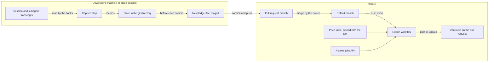

# Threat model

What could go wrong with the calculator, for the people who use it and for this repository, and what answers each threat. Every change revisits this file (see `CLAUDE.md`).

It was written for the first change, `add-pr-cost-calculator`, before any code, so the answers are requirements and tasks rather than code. Where an answer can be a scenario in a spec, it is one, so that an acceptance test holds it. `tests/test_threat_model.py` checks that every citation below names a scenario, task, decision or file that exists.

## How it was built

1. Draw how data moves, from the agent's session to the comment on the pull request.
2. Mark each trust boundary: a place where data crosses from one party's control into another's.
3. At each boundary, ask the six STRIDE questions. Can someone pretend to be someone else (**spoofing**)? Change what they should not (**tampering**)? Deny what they did (**repudiation**)? See what they should not (**information disclosure**)? Stop it working (**denial of service**)? Gain powers they should not have (**elevation of privilege**)? A seventh kind, **reliability**, covers failures nobody causes on purpose that would still make a figure wrong.
4. Rate each threat's impact. **High:** private data is published, or someone gains a write token or runs code they should not. **Medium:** a figure is wrong or misleading, or someone's work is disturbed. **Low:** an inconvenience, or a small error that the report makes visible.
5. Give each threat its answer, and cite what holds that answer: a scenario (`capability`: "name"), a task or a decision of a change, or a file. A threat with no answer is marked accepted, with the reason.

## How data moves

The trust boundaries:

1. **Transcript to capture.** The transcript holds everything the session saw, in every repository it worked in: prompts, code, tool output, web pages and possibly secrets. Only the counts of calls made from this repository may cross, and only with the consent of the person whose session it is.
2. **Capture to the repository.** The capture step keeps its records in the repository's git directory, and writes and stages files in a working tree it does not control, in the middle of someone's work.
3. **Ledger to report.** Whoever can push to a pull request's branch writes its ledger, and its whole diff, including the author of a pull request from a fork. The report must treat both as untrusted data.
4. **Report to GitHub.** The report holds a token that can write comments.
5. **Comment to readers.** What the report posts is rendered as Markdown for everyone who reads the pull request.
6. **Tool to adopters.** Adopters run the hook on their machines and the report in their CI, called from a workflow they write.
7. **Contributors to this repository.** Anyone can open a pull request here, and agents working here read what others wrote.

## Boundary 1: transcript to capture

### T1. Transcript text reaches the ledger

- **Kind:** information disclosure
- **Impact:** high
- **What could happen:** a prompt, a piece of code, a file's contents, a tool's output or a secret is copied into a ledger entry and published with the pull request.
- **Answer:** entries are built from typed values only. A count is copied as a number. The only text taken from a transcript is the model's name and the values of the price attributes, each only when the price table that the hook ships with lists it, or else recorded as `unknown`, because a private gateway, a custom model or an alias can have a name that looks like one of Anthropic's. Tool names, including MCP server names, which can name a private service, are read only to choose the activity type and are never written.
- **Held by:** `usage-capture`: "Content in the transcript does not reach the ledger"; `usage-capture`: "A planted string never reaches the ledger"; `usage-capture`: "An unexpected model name is recorded as unknown"; `usage-capture`: "A model name the price table does not list is recorded as unknown"; `usage-capture`: "An attribute value the price table does not list is recorded as unknown"; `usage-capture`: "An MCP call does not record the server's name"

### T2. Work in another repository is published here

- **Kind:** information disclosure
- **Impact:** high
- **What could happen:** a transcript belongs to a session, not to a repository, and one session can work in several, such as a public one and a private one. Recording the whole transcript would publish, in the public repository's ledger and comment, how much work went into the private one and with which models.
- **Answer:** this repository is the one that holds the project directory that Claude Code gives the hook, whatever directory the hook runs in. Capture records only the calls whose transcript line gives a working directory in this repository, meaning one whose git common directory is this repository's. Calls made in another repository, in a separate repository nested inside this one's folder, or in a folder that contains this one, are not recorded here.
- **Residual:** a line's working directory is Claude's current directory, not where the call worked. A session whose current directory is in this repository, and that works on another one through absolute paths, `git -C` or a `cd` inside a command, has those calls recorded here, with their counts and models. Claude Code keeps a `cd` between commands only within the project and the directories added to the session, and never for a subagent, so such a session can work on another repository call after call from here, and the call that moves its directory into another one is recorded here too. No rule over the transcript's working directories can tell them apart. The README tells a person who opts in to keep work on other repositories, private ones above all, out of such sessions. A person who finds the calls of such work in a ledger file can remove the file, and once a run has found a commit holding it, the step stages its calls no more in that run's clone, however the file was removed, though a run that puts a file back, after a take-back that raced a commit or followed a reset in the commit's own command, can undo, once, a removal made before that run, as T10 says. A removal that leaves the file in the working tree, as a `git rm --cached` and a commit, or a mixed `git reset`, do, leaves it where a `git add` can stage it again, as can a `git commit -a` after `git reset -N`, since the step leaves a committed ledger file to git, so the README tells such a person to delete it too, as `git rm` without `--cached` does. The file stays in git history, though, so removing it hides nothing that was pushed, and a session resumed in a fresh clone at the same path can record its calls again. A session that works from a folder above the repository records nothing, so its figure is too low.
- **Held by:** `usage-capture`: "Calls made from outside this repository are not recorded"; `usage-capture`: "A repository nested inside this one is not this one"; `usage-capture`: "A run from another directory works on this repository"; `usage-capture`: "A ledger file that a person removes stays removed"; `usage-capture`: "A put-back does not undo a staged removal"; `usage-capture`: "A ledger file that a removal leaves is left to git"; `usage-capture`: "A fresh clone stages a removed ledger file's calls again"; `add-pr-cost-calculator` task 4.4

### T3. A person's usage is published without their consent

- **Kind:** information disclosure
- **Impact:** medium
- **What could happen:** a repository's owner turns the tool on, and the usage of everyone who works there, including outside contributors who never agreed, is committed and published with their pull requests.
- **Answer:** capture also needs the person's own opt-in, in their global git configuration, which is not part of the repository. It is read from the person's global configuration files, `~/.gitconfig` and git's file in their XDG configuration folder, and not from files that they include, which can lie in a repository's folder. That folder is taken from `XDG_CONFIG_HOME` only when it holds an absolute path, since git reads a relative one from its current directory, which can be in a repository's folder too. The environment variables that a repository's settings could set, to point git at a file that opts everyone in or to add the setting, are ignored, and a repository's own git configuration can turn it off but not on. The README says what is published when capture is on.
- **Residual:** a repository's own hooks can run any command on a contributor's machine, including one that changes that setting (see Assumptions). One opt-in covers every repository that uses the tool, until the person turns it off in one.
- **Held by:** `usage-capture`: "A person who has not opted in is not recorded"; `usage-capture`: "No configuration file means no capture"; `usage-capture`: "A repository's own git configuration cannot opt a person in"; `usage-capture`: "The environment cannot opt a person in"; `usage-capture`: "A setting in an included file does not opt a person in"; `usage-capture`: "The XDG configuration file can opt a person in"; `usage-capture`: "The home configuration file decides when both set it"; `usage-capture`: "A relative XDG folder is not read"; `usage-capture`: "A person can turn capture off in one repository"; `add-pr-cost-calculator` decision 6; `add-pr-cost-calculator` task 4.4

### T4. An identifier links the ledger to a session or a person

- **Kind:** information disclosure
- **Impact:** medium
- **What could happen:** the transcript carries session ids, request ids, the working directory, user names inside paths, and the branch. Any of them in the ledger would link a public record to a person or a private session.
- **Answer:** a call is identified by a SHA-256 hash of its message id, kept only so that no call is recorded twice. No session value, path, working directory, user name or branch name is written into an entry, and a ledger file's name is random.
- **Residual:** whoever holds the original message ids, such as the session's owner, can match them to entries. That is the person the data came from.
- **Held by:** `usage-capture`: "Content in the transcript does not reach the ledger"

### T5. Call times show when someone works

- **Kind:** information disclosure
- **Impact:** low
- **What could happen:** a time on every model call would show, call by call, when a contributor's agent was working, in a repository anyone can read.
- **Answer:** an entry records the UTC day only, which is all that pricing needs.
- **Residual:** commit times in git already show when someone worked. The ledger adds nothing finer than the day.
- **Held by:** `usage-capture`: "An entry records the UTC day, not the time"

### T6. A malformed value is recorded as usage

- **Kind:** tampering
- **Impact:** medium
- **What could happen:** a transcript in an unexpected shape gives counts as text, fractions, negative numbers, not-a-number, or `true` and `false`, which Python accepts where it expects a number. Recorded as they are, they make the cost wrong.
- **Answer:** every count must be a whole number from zero up to a documented ceiling. `true` and `false` are refused explicitly. A call with a refused value is left out, and the ledger counts it as refused, so that the comment can say how many were left out. A hook that succeeds shows its standard error to no one, so the count is kept in the ledger and not printed.
- **Held by:** `usage-capture`: "A count that is not a whole number is refused"; `usage-capture`: "A negative count is refused"; `cost-reporting`: "Calls that capture refused are counted in the comment"

### T7. One call is counted more than once, or from a partial line

- **Kind:** reliability
- **Impact:** medium
- **What could happen:** Claude Code can write one model call over several transcript lines. In one shape of subagent transcript, the earlier lines carry partial usage; in another, almost no line gives a stop reason, and each such call's lines give only the usage of its start. Capture also runs again over the same transcript. Counting lines would count a call several times, reading an early line would count it short, and waiting for a stop reason that never comes would leave the call out.
- **Answer:** a call is recorded once, by the hash of its message id, from its lines that give a stop reason. A call with no such line is read from its last line once a later call follows it or its agent has stopped, and the ledger counts those calls, so that the comment can give their number. A call that is not over yet waits for a later run. Final lines of one call that disagree are refused rather than guessed at.
- **Residual:** a call read without a stop reason is short: its lines give fewer output tokens and server-side tool requests than it made. When there are any, the comment gives their number and says that the token cost is a lower bound.
- **Held by:** `usage-capture`: "Running again records nothing twice"; `usage-capture`: "A call written over several lines is recorded once"; `usage-capture`: "A call's partial lines are not used"; `usage-capture`: "A call followed by a later one is read without its stop reason"; `usage-capture`: "A stopped agent's last call is read without its stop reason"; `usage-capture`: "A call still being written is recorded later"; `usage-capture`: "Lines of one call that disagree are refused"; `usage-capture`: "Subagent calls are included"; `cost-reporting`: "Calls read without a stop reason are counted in the comment"

### T8. Usage never reaches the pull request

- **Kind:** reliability
- **Impact:** medium
- **What could happen:** a session's machine can be disposable, so a call that is recorded but never committed is lost with it. The newest calls can be missing from the transcript when capture runs, because Claude Code writes it asynchronously. A turn that ends in an API error runs no `Stop` hook, and a session that ends after one turn has no later turn to carry its calls. A commit made with git's own options before `commit`, or a ledger file that an ignore rule matches, could be missed. A commit whose command stages its files first, as `git add f && git commit` does, looks empty to a run that comes before the command, and a commit whose message comes from a here-document runs `cat` before git. A commit made with `-a` has nothing staged before it runs.
- **Answer:** capture runs before and after each of the agent's Bash commands that the hook's condition `Bash(git *)` matches, and when a turn, a subagent, a failed turn or the session ends. It stages for a `git commit` in this repository, including one whose command stages its own files first, one made with `-a`, and one whose message comes from a here-document whose delimiter is quoted, and recognises it whatever options git is given first, and when a later option undoes one that would make it a dry run. So each commit it stages for carries the calls recorded on its branch up to that moment, including those of the turn that commits. A call that one run missed is recorded by a later one, and neither an ignore rule nor a sparse checkout can drop the ledger file.
- **Residual:** some calls reach no commit, and the README names these cases. They are the calls made after the agent's last commit on a branch that capture staged for, such as pushing and opening the pull request, and the call that runs that commit when that commit's run cannot yet read it as over, and any call that that run leaves unread at its time budget; calls recorded on a branch that gets no later commit, in a worktree where nobody commits or that Claude Code removes, or while no branch is checked out, as during a rebase that stops at a conflict; and calls whose only later commits were made in a way that capture does not stage for: by `git merge`, `git cherry-pick` or `git rebase --continue`, by a script, an API or Claude Code's PowerShell tool, which is on by default on Windows for claude.ai and Console accounts, in the background, in a pipeline, a subshell or a group, joined to another command by `||` or behind a wrapper such as `timeout`, after another command in the same input, with a message that another command writes or that a here-document whose delimiter is not quoted holds, by git written in a form that the hook's condition does not match, such as by its path or through an alias, or while a repository's own git hook refused the ledger file. In a repository whose attributes give the ledger path a filter or a working-tree encoding, or where git refuses to add the file, no call reaches a commit. Once a run has found a commit holding a ledger file, its calls are not staged again in that run's clone, however the file leaves the branch, so the calls of a commit that is reverted, reset away in any mode but `--soft` or split in an interactive rebase are not counted, even when its changes are committed again, unless the file itself is committed again, as a squash made with a mixed `git reset` and `git add -A` commits it, except where a sparse checkout leaves `.pr-cost/` out, or an ignore rule matches it while it is untracked, as after a reset without `-N`. After a take-back, a `git stash` made before the run that puts the file back, or a mixed `git reset` back to the commit that took the file once a run has found another commit checked out, leaves the file deleted in the working tree, so that a `git commit -a` removes it, with its calls, and after a mixed `git reset` without `-N` in the commit's own command, a `git reset --soft` back to that commit leaves it deleted in the index as well, so that any next commit removes it, with its calls. The comment counts what the pull request's commits carry. A subagent that never finishes leaves its last call unread when that call gives no stop reason. The design leaves commits made through the PowerShell tool out of this change.
- **Held by:** `usage-capture`: "A one-turn session's commit carries its calls"; `usage-capture`: "A commit that stages its own files carries a ledger file"; `usage-capture`: "A commit of all changes with nothing staged carries a ledger file"; `usage-capture`: "A turn that ends in an API error is still recorded"; `usage-capture`: "A call still being written is recorded later"; `usage-capture`: "A commit with git's own options is still a commit"; `usage-capture`: "A dry-run option that a later option undoes is still a commit"; `usage-capture`: "An ignored ledger path is still committed"; `usage-capture`: "A sparse checkout still commits the ledger file"; `usage-capture`: "A commit message from a here-document still carries a ledger file"; `usage-capture`: "A squash with a plain reset keeps its ledger files"; `usage-capture`: "A soft reset back to a commit that its own command reset away leaves its ledger file out"; `add-pr-cost-calculator` task 4.4

### T9. Usage that costs extra is priced as standard

- **Kind:** reliability
- **Impact:** medium
- **What could happen:** the price of a call can depend on more than its tokens: a higher rate for a long prompt on some models, a multiplier for the inference region, a premium for a faster speed, and a charge per web search. Ignoring them would under-report without saying so.
- **Answer:** capture records these attributes where the transcript gives them. Pricing applies every modifier the price table lists, and names, rather than guesses, any value or combination it has no price for. Web fetches are listed at no charge, so a call that made them is still priced.
- **Held by:** `usage-capture`: "Price attributes are recorded"; `cost-pricing`: "A long prompt is priced at its higher rates"; `cost-pricing`: "A region multiplier applies to every token type"; `cost-pricing`: "Web searches are priced per search"; `cost-pricing`: "Web fetches add nothing beyond their tokens"; `cost-pricing`: "An unpriced attribute is named, not guessed"

## Boundary 2: capture to the repository

### T10. Capture disturbs the agent's git work

- **Kind:** denial of service
- **Impact:** medium
- **What could happen:** staged changes left between commits make `git rebase` refuse to run, and a staged change to a file that another branch lacks makes `git checkout` refuse too. A new file left staged follows a checkout to the next branch, carrying its calls into the wrong pull request, and `git stash` takes it. So does a ledger file that a mixed `git reset` or a `git rm --cached` leaves in the working tree, untracked or with only an intent-to-add entry, once a `git add -A`, or for that entry a `git commit -a`, adds it on the next branch, or in another worktree after `git stash -u` and a pop there. Such a file also stops a checkout, a merge, a `git cherry-pick`, a `git rebase` or a `git reset --keep` that would bring back a commit holding it, unless it is untracked and either an ignore rule matches it or a sparse checkout leaves its folder out, and while it has an intent-to-add entry, any `git rebase`, `git cherry-pick` or `git revert`, any merge that is not a fast-forward, any `git reset --merge`, and any `git stash` except `git stash push --staged`, which, when it saves other staged changes, leaves it untracked, as a `git reset --keep` to a commit that lacks the file does. In a sparse checkout that leaves out its folder, `git add -A` refuses an untracked one and fails, while it and `git commit -a` leave out an intent-to-add entry without an error. A run that holds the index lock while the agent commits makes the commit fail. A commit that would have failed for having nothing to commit would succeed instead, holding only the ledger file. No run follows a command that was refused, blocked by another hook or cancelled, and an interrupt runs no `Stop` hook, so a file staged for such a command would stay staged. A commit after another command in the same input can land on a branch that a run before the command cannot know, and a commit in the background can run after the run that follows its command. A command substitution, a process substitution or a here-document can run a command before the commit, such as one that changes the branch, from an argument, an assignment or a redirection. A plain commit holds no index lock once it has read the index, while its `prepare-commit-msg` and `commit-msg` hooks run, so a take-back then can remove a file that the commit has taken, and the next commit would delete it, as it would after a reset in the commit's own command and a later reset back to that commit, while a put-back that answers either could undo a person's own removal of a ledger file. A run that worked in the directory where the hook runs, which in a desktop worktree session is the main checkout, would stage in the person's index instead of the agent's worktree. The repository's own git hooks see the staged file, and one that refuses it, such as a secret scanner that takes a call's hash for a secret, fails a commit that would pass without the tool, and an agent shown that failure may retry with `--no-verify`, which skips the hook's checks on its own changes too, or reconfigure the hook. A sparse checkout can refuse to stage the file, a filter on its path, such as Git LFS's, can make the commit hold something other than the entries, and git can refuse to add it, as where `core.safecrlf` is on and line endings are converted. A `git rm` of the folder that holds the ledger file, before the commit, fails while the step's new file is staged there.
- **Answer:** between commits, capture keeps its records in the git directory and leaves the working tree and the index alone, but for the take-backs and put-backs below. It stages a ledger file only just before the agent's own `git commit`, and only when that commit is a top-level command, not in a pipeline, joined to the rest by `&&`, `;` or line breaks, in the foreground, and nothing comes before it in the command but `cd` to a path written in it and the git commands `add`, `rm`, `mv`, `status`, `diff`, `log` and `show`, with or without git's own options, counting every command or process substitution in the commit or before it, in an argument, an assignment or a redirection, as coming before it unless all it runs is `cat` reading a here-document whose delimiter is quoted, and staging nothing when the commit or a command before it reads a here-document whose delimiter is not. It finds the worktree from the current directory that the hook's input gives, followed through each top-level `cd` before the commit and the `-C` options given to git before `commit` in the commit's own command, never from where the hook runs, and stages nothing for such a `-C` path that the command does not write out. It stages nothing for a commit that would otherwise be empty when no `git add`, `git rm` or `git mv` comes before it, for a dry run, in any spelling that git accepts, for a commit of named paths, for a command that only names a commit, after a `git rm` or `git mv` that is given a `-C` path not written out, or names, read from where it runs, the ledger file's folder, a folder above it, a path with a wildcard or other pathspec magic, or a path not written out, when no call is waiting, when the ledger path has a filter or a working-tree encoding, or when git refuses to add the file, which it then removes, and it stages through ignore rules and sparse checkouts. A run that comes again before the same command, as for a deferred call, stages nothing new while that command's file is still staged and its branch still checked out, and takes the file back first when that branch is not. The run after that command takes the file back if no commit took it. For a command that gets no such run, any later run, from that session or another, does once it finds the command over, as the run when the session ends does for that session's commands. A take-back never removes a file from a worktree whose checked-out commit holds it, and leaves the file while another git command holds that worktree's index lock. Runs take back and put back what they can before they read any transcript. Every take-back notes the commit it found checked out there, which did not hold the file, and whether it removed the file from the index, the working tree or both, and the first later run there that finds another commit checked out and the index free puts the file back, as that commit holds it, when that commit holds it: into the index, when the take-back removed it from there and the index lacks it, and then into the working tree, when the take-back removed it from there, the index holds it as that commit does and the working tree lacks it. That run then forgets the note, and the step puts back no file in any other case. Once a run has found a commit holding a ledger file, the step never stages its calls again in that run's clone, so a ledger file that anyone removes after that takes its calls with it, and never takes the file back, but leaves it to git, wherever git leaves it, as git leaves the other changes of a commit that a reset undoes. Apart from staging, taking back and putting back, no run touches the index. The ledger names its hash field so that detect-secrets, a common secret scanner, reads the hash as an identifier, and the README tells adopters to exclude `.pr-cost/` from their own git hooks before they turn the tool on.
- **Residual:** a git command that starts while a run stages or takes back the file fails at the index lock, as when any two git commands meet. After a refused, blocked, cancelled or interrupted commit, the file stays staged until a run finds that command over: the session's next git command, turn end or end, or another session's next run in the repository. Until then, the person's own git commands find it staged: `git rebase` refuses to run, `git checkout` carries it to another branch, where a commit of theirs takes it with its calls, and `git stash` takes it. A ledger file that a removal leaves in the working tree, as a mixed `git reset`, with or without `-N`, or a `git rm --cached` and a commit do, stays there, as the other changes that a reset leaves do, and follows a change of branch. A `git commit -a` or a `git add -A` commits the intent-to-add entry that `git reset -N` leaves, whatever ignore rule matches the file, unless a sparse checkout leaves its folder out. Unless an ignore rule matches an untracked one, or a sparse checkout leaves its folder out, a `git add -A` stages it, and unless an ignore rule matches it, `git stash -u` and a pop carry it to any worktree. So a commit can take the file, with its calls, on the branch checked out there. Until such a file is committed or deleted, an untracked one stops a checkout, a merge, a `git cherry-pick`, a `git rebase` or a `git reset --keep` that would bring back a commit holding it, as any untracked file in the way does, unless an ignore rule matches it or a sparse checkout leaves its folder out, while an intent-to-add entry stops them whatever ignore rule matches it, in a sparse checkout too, and, as any such entry does, also stops any `git rebase`, `git cherry-pick` or `git revert`, any merge that is not a fast-forward, any `git reset --merge`, and any `git stash` except `git stash push --staged`. A `git stash push --staged` that saves other staged changes drops the entry and leaves the file untracked, as a `git reset --keep` to a commit that lacks the file does, so that a squash made with `git reset -N` then loses it at a `git commit -a`, or at a `git add -A` where an ignore rule matches it. In a sparse checkout that leaves out `.pr-cost/`, unless the folder is added to it, as the README says, `git add -A` refuses an untracked one, as it refuses any new file outside the sparse checkout, and exits with an error after staging the rest, so that a commit joined to it by `&&` does not run, while it and `git commit -a` leave out an intent-to-add entry without an error, so that the commit leaves out the file, with its calls. A session whose process is killed during its commit, before the command's result is written, leaves the file staged until the person removes it or the session is resumed. A call that another hook defers leaves it staged until the call is resumed, unless a session-end run takes it back when the deferral ends the process, which Claude Code's documentation leaves open; either way the resumed commit carries the calls, unless that branch is no longer checked out by then, when the resumed run takes the file back first and the calls wait for their own branch, or, when that run finds the index lock held, leaves the file staged, and a commit that starts once the lock is free takes it, with its calls, to the other branch. A take-back that races a commit leaves the file deleted in the index and the working tree until the first later run that finds that commit checked out and the index free puts it back, a commit that the person makes before then deletes it, and a later commit carries its calls again. The run that puts a file back, after such a take-back or one that followed a reset in the commit's own command, undoes, once, a removal of the file made before that run: one from the working tree alone, as when the person restores the file and then deletes it with `rm`, and, after a take-back that removed the file from the index, one that the index holds by then for another reason, as when the person restores the file and then removes it with `git rm`, or commits its deletion and then goes back to that commit with `git reset --soft`. A `git stash` made before that run, while the commit that took the file is checked out, takes the take-back's deletion with it, which its pop brings back, and once a run has found another commit checked out after a take-back, a mixed `git reset` back to a commit that took the file brings it back into the index alone; either way a `git commit -a` then deletes the file. After a mixed `git reset` without `-N` in the commit's own command, a `git reset --soft` back to that commit leaves the index without the file, so nothing is put back, and the next commit deletes it, even one that `git add -A` makes. A file that another command removes from the index while that commit runs stays removed, so the next commit deletes it, as it would without the step. A `git add` that stages nothing, before a commit that would otherwise be empty, lets that commit hold the ledger file alone. A repository hook that still refuses the ledger file fails the agent's commit, and the agent sees that hook's message, which names the file; each retry stages the calls again until the repository leaves the folder out of that hook, and an agent may instead retry with `--no-verify` or change the hook's configuration, which rests on the adopter's own rules for agents.
- **Held by:** `usage-capture`: "A turn's end leaves the working tree alone"; `usage-capture`: "A commit that does not happen leaves nothing staged"; `usage-capture`: "A refused commit leaves nothing staged"; `usage-capture`: "A session's end takes back what its commands left staged"; `usage-capture`: "A later session takes back what an earlier one left staged"; `usage-capture`: "A take-back waits while the index is in use"; `usage-capture`: "A take-back leaves a committed file in place"; `usage-capture`: "A commit after another command takes no ledger file"; `usage-capture`: "A commit whose message another command writes takes no ledger file"; `usage-capture`: "A substitution before the commit takes no ledger file"; `usage-capture`: "A here-document whose delimiter is not quoted takes no ledger file"; `usage-capture`: "A commit in the background takes no ledger file"; `usage-capture`: "A commit with nothing to commit stays empty"; `usage-capture`: "An empty commit asked for stays empty"; `usage-capture`: "A `git add` that stages nothing leaves the ledger file alone in the commit"; `usage-capture`: "A commit with nothing new to record takes no ledger file"; `usage-capture`: "A commit of named paths takes no ledger file"; `usage-capture`: "A command that only names a commit stages nothing"; `usage-capture`: "A commit in another repository stages nothing here"; `usage-capture`: "A commit stages in the worktree where it runs"; `usage-capture`: "A sparse checkout still commits the ledger file"; `usage-capture`: "A ledger path with a filter takes no ledger file"; `usage-capture`: "A ledger file that git refuses to add is not left behind"; `usage-capture`: "A command's repeated run stages its calls once"; `usage-capture`: "A command's repeated run after a change of branch takes its file back"; `usage-capture`: "Removing the ledger folder before a commit takes no ledger file"; `usage-capture`: "Moving the ledger folder before a commit takes no ledger file"; `usage-capture`: "Removing ledger files by a pattern before a commit takes no ledger file"; `usage-capture`: "A commit whose `-C` path is not written out takes no ledger file"; `usage-capture`: "A `-C` after `commit` is not a path"; `usage-capture`: "A file that a later commit deleted is not put back"; `usage-capture`: "A file removed from the index while its commit runs stays removed"; `usage-capture`: "A ledger file that a person removes stays removed"; `usage-capture`: "A ledger file that a removal leaves is left to git"; `usage-capture`: "A ledger file comes back with a commit that its own command reset away"; `usage-capture`: "A soft reset back to a commit that its own command reset away leaves its ledger file out"; `usage-capture`: "A put-back does not undo a staged removal"; `usage-capture`: "Calls go to the worktree and branch they were recorded on"; `usage-capture`: "Calls made with no branch checked out wait for a commit made the same way"; `usage-capture`: "Switching branches records nothing twice"; `add-pr-cost-calculator` task 1.2; `add-pr-cost-calculator` task 2.2; `add-pr-cost-calculator` task 4.4

### T11. Capture writes outside the ledger

- **Kind:** tampering
- **Impact:** medium
- **What could happen:** a repository can contain symbolic links. If a folder on the ledger's path were a link, writing the ledger would write somewhere else on the machine, such as a shell's start-up file.
- **Answer:** a ledger file's name is random and is created only if no file of that name exists, and capture refuses any path with a symbolic link in a folder below the repository root. The branch name plays no part in the path.
- **Held by:** `usage-capture`: "A symbolic link in the ledger path is refused"; `usage-capture`: "A new file for every commit"

### T12. Capture stages unrelated work

- **Kind:** tampering
- **Impact:** medium
- **What could happen:** if the step staged more than its own file, unrelated changes, perhaps ones not meant to be shared, would go into the agent's next commit.
- **Answer:** the step stages exactly the ledger file it wrote.
- **Held by:** `usage-capture`: "Other changes stay unstaged"

### T13. Two writers spoil the record

- **Kind:** reliability
- **Impact:** low
- **What could happen:** a session and its subagents can stop at the same moment, and Claude Code runs matching hooks in parallel. Writes that interleave would split records, and two branches appending to one ledger file would conflict when they merge. A worktree with a store of its own would record again a call that the main folder's store holds, so that it reached two branches.
- **Answer:** each ledger file is written once, whole, under a new random name, so no two runs or branches write the same file, and runs at the same time keep every record whole and record no call twice. The store lives in the repository's common git directory, which every worktree shares.
- **Held by:** `usage-capture`: "Two runs at once"; `usage-capture`: "Two worktrees share one record of a call"; `usage-capture`: "A worktree of this repository is this repository"; `usage-capture`: "A new file for every commit"

### T14. The hook steers or stalls the agent

- **Kind:** elevation of privilege
- **Impact:** high
- **What could happen:** a `Stop` hook that exits with code 2 sends the agent back to work with the hook's message, and a `PreToolUse` hook that exits 2 blocks the agent's commit. JSON on standard output can do the same, or approve a command without asking. Python itself exits 2 when it cannot open its script, for example when the file is unreadable. Any transcript or ledger text in such a message would reach the agent as an instruction. A slow hook holds the session until it ends, for up to the 600 seconds of Claude Code's default timeout. On Windows without Git Bash, Claude Code runs a hook's command in PowerShell, so a command written only for `sh` could fail at every stop, for every contributor, opted in or not.
- **Answer:** the registered command ends in `; exit 0`, which `sh`, Git Bash and PowerShell all read, rather than `|| true`, which Windows PowerShell 5.1 does not, so it exits with success even when its script cannot be read or started, in each shell that Claude Code runs it in. The step prints nothing on standard output, and its messages on standard error are its own words and numbers, never text from the transcript or the ledger. Claude never sees the standard error of a hook that succeeds. The command has a short timeout, and the step stops at a time budget inside it, leaving the rest for a later run.
- **Held by:** `usage-capture`: "Capture never asks the agent to continue"; `usage-capture`: "The registered command succeeds in PowerShell"; `usage-capture`: "A failure message quotes nothing from the transcript"; `usage-capture`: "A long transcript does not hold up the session"; `usage-capture`: "An unreadable transcript is skipped"; `add-pr-cost-calculator` task 2.3

### T15. The hook runs code planted beside it

- **Kind:** elevation of privilege
- **Impact:** medium
- **What could happen:** Python imports from a script's own folder first, so a file there named like a standard module, such as `json.py`, would run in place of the real one.
- **Answer:** the documented hook command runs Python in isolated mode (`python3 -I`), which leaves the script's folder, the current directory and Python's environment variables out of the import path.
- **Held by:** `usage-capture`: "The capture step runs alone in isolated mode"; `add-pr-cost-calculator` task 2.3

## Boundary 3: ledger to report

### T16. A ledger is edited by hand to change the cost

- **Kind:** tampering
- **Impact:** low
- **What could happen:** a contributor lowers or raises the reported cost by editing their ledger.
- **Answer:** none in the tool. The ledger is in the pull request's diff, where a reviewer sees it.
- **Held by:** accepted: the ledger is reviewed like any other file in the pull request, and the report is an estimate, not a bill.

### T17. A ledger entry is malformed or hostile

- **Kind:** tampering, denial of service
- **Impact:** medium
- **What could happen:** a ledger line has the wrong types, unknown fields, impossible numbers, a date in the future or before any known price, two versions of one call, or text written to be shown in the comment. One such line could also stop the whole report.
- **Answer:** the report reads each line against the same strict format that capture writes, refuses any line that does not match, and says how many it refused, showing none of them. An entry dated after the day the report runs is refused, an entry older than any price is named and left out, and entries of one call that differ are all refused. None of these stops the report.
- **Held by:** `cost-reporting`: "Refused ledger lines are counted, not shown"; `cost-reporting`: "A name with markup is not shown as written"; `cost-reporting`: "Entries of one call that disagree are refused"; `cost-pricing`: "An entry from the future is refused"; `cost-pricing`: "Usage before any known price is named, not priced"

### T18. The report reads more than it should

- **Kind:** denial of service, information disclosure
- **Impact:** medium
- **What could happen:** a pull request adds a ledger too large to read in reasonable time or memory, or commits a symbolic link in the ledger folder, which a report reading the working tree would follow to `/dev/zero` or to a file on the runner. Once merged, such a file is also read by the capture step of everyone who works on a branch that holds it, on their own machines.
- **Answer:** the report and capture read ledger files only as blobs from git, never through the working tree, and learn each blob's size before reading it. The report refuses any added path that is not a regular file, and refuses ledger changes above a documented size bound, while still reporting the CI cost. Capture skips any path that is not a regular file and any file above that bound, and stops at its time budget.
- **Held by:** `cost-reporting`: "A ledger that is a link is refused"; `cost-reporting`: "An oversized ledger is refused"; `usage-capture`: "Capture reads no ledger file through a link"; `usage-capture`: "Capture does not read an oversized ledger file"

### T19. Entries are counted for the wrong pull request

- **Kind:** tampering
- **Impact:** medium
- **What could happen:** a branch name used again, or entries copied from another pull request's ledger, would count the same usage twice. A session resumed in a fresh clone at the same path, on another branch, can record calls that an earlier branch's ledger files already hold. A call recorded after a change of branch would go to the branch checked out next. A push that merges several pull requests, as a merge queue can, would charge one of them with the ledgers and runs of all, and a push that adds a commit of no pull request beside a merge would charge that commit's ledger files to the pull request.
- **Answer:** the report counts only the entries of ledger files that the merge adds, does not count an entry whose call the default branch already held before the merge, and counts a call that the pull request adds twice once. So a call recorded on two branches is counted once, for whichever pull request merges first, and a resumed session records nothing again that its own branch already holds. Capture runs before each of the agent's Bash commands that the hook's condition `Bash(git *)` matches, so a call that the transcript holds as over by then is recorded with its branch before the command can change it, unless that run reaches its time budget before it reads the call. A push whose commits do not all belong to one pull request gets no comment, and its job summary says why.
- **Residual:** a call recorded on two branches can be counted for the wrong one of the two pull requests. The call that runs a command that changes the branch, when that command's run cannot yet read it as over, any call that that run leaves unread at its time budget, and calls followed by a change of branch that no command matching the hook's condition makes, go to the branch checked out next. Such a change can be made by a script, by the person, through Claude Code's PowerShell tool, or by git written in a form that the condition does not match: by its path, through `sh -c`, `env` or an environment runner, or through a shell alias or function. A program that git's own options or environment variables in a command name, such as `git -c diff.external=<program> diff` or `GIT_EDITOR=<program> git commit`, can also change the branch before a commit that the step staged for, which then takes the ledger file, with its calls, to the other branch. A ledger file that git carries to another branch, still staged, left in a working tree by a removal, or in a stash, takes its calls into that branch's pull request, as T10 says, and so does one that a command copies there with another commit's changes, as `git cherry-pick -n` does.
- **Held by:** `cost-reporting`: "A reused branch name is not double-counted"; `cost-reporting`: "A copied entry is counted once"; `cost-reporting`: "One call added twice is counted once"; `cost-reporting`: "A push that merges several pull requests gets no comment"; `cost-reporting`: "A push that adds other commits beside a merge gets no comment"; `usage-capture`: "A resumed session records nothing its branch already holds"; `usage-capture`: "A call made before a checkout stays with its branch"

### T20. A pull request erases part of the record

- **Kind:** tampering, repudiation
- **Impact:** medium
- **What could happen:** the ledger files on the default branch are the record of earlier pull requests, and a later pull request could delete or change them.
- **Answer:** the deletion or change is in the pull request's diff before it merges. After the merge, its comment says how many earlier ledger files it removed or changed and counts none of their entries, and git history still holds the files as they were.
- **Held by:** `cost-reporting`: "Removed or changed ledger files are flagged"

### T21. A pull request changes its own report

- **Kind:** repudiation, tampering
- **Impact:** medium
- **What could happen:** the workflow that runs the report, the tool version it pins and the configuration file are all files in the repository, so a pull request can change them, and its merge is then reported by what it changed. It could turn the tool off to go unreported, or pin a different version of the tool, with different code and prices.
- **Answer:** the report reads the configuration from the default branch both before and after the merge, and runs if either turns the tool on. When a pull request changes the configuration file or any workflow file, its comment says so, because any workflow can run with the identity that posts the report.
- **Residual:** a pull request that removes the report's workflow, or points it at code that is not this tool, gets no honest report. A change to a script or a local action that a workflow runs is not flagged, though it can act with the same identity. Each of these is in the pull request's diff, which the owner reviews before merging.
- **Held by:** `cost-reporting`: "A pull request cannot turn off its own report"; `cost-reporting`: "A changed report is flagged"; `add-pr-cost-calculator` decision 7

### T22. A large pull request is read only in part

- **Kind:** reliability
- **Impact:** medium
- **What could happen:** GitHub's API lists at most 3000 files and 250 commits for one pull request, and lists only the latest attempt of each job unless asked for all. A report built on those lists would quietly miss the rest. A squash or rebase merge puts new commits on the default branch, which no CI ran on, so a report that took its commits from the push would find none of the pull request's runs, while the push's own runs are still going when the report runs.
- **Answer:** the report reads a pull request's changes from git rather than from those capped lists, and its own commits from its head ref, `refs/pull/<number>/head`, whatever the merge method. It counts only the runs on those commits that no push to the default branch started and that were created before the pull request merged, so it leaves out the runs that the merge's push starts, even when they run on one of those commits, as after a fast-forward, whatever their creation times, and it asks for every attempt of every job. A run that the merge starts through another event, such as the pull request's `closed` event, is created at the merge or after it, so the time cut leaves it out (see Assumptions). If any data it needs cannot be read in full, or a run it counts has not finished, it marks the figure incomplete instead of presenting part of it as the whole.
- **Residual:** runs on commits that a force-push removed from the pull request are not counted. The comment says that the CI minutes are those of the pull request's own commits. A pull request based on another one that was merged by squashing or rebasing still holds that one's commits, which the default branch does not hold by their hashes, so it counts their runs again unless it is rebased first. The README says so.
- **Held by:** `cost-pricing`: "Every commit is counted, beyond what the API lists"; `cost-pricing`: "A squash merge counts the runs on the pull request's commits"; `cost-pricing`: "A rebase merge counts the runs on the pull request's commits"; `cost-pricing`: "Runs that the merge starts are not counted"; `cost-pricing`: "A fast-forward merge counts the pull request's runs, not the push's"; `cost-pricing`: "A run that the pull request's closing starts is not counted"; `cost-pricing`: "A re-run job counts every attempt"; `cost-pricing`: "An incomplete jobs listing is reported as incomplete"; `cost-pricing`: "A run that has not finished makes the cost incomplete"; `add-pr-cost-calculator` decision 7

## Boundary 4: report to GitHub

### T23. Code from a pull request runs with a write token

- **Kind:** elevation of privilege
- **Impact:** high
- **What could happen:** this is the best-known way into a GitHub workflow. A workflow triggered by an outside pull request is given a write token, then runs that pull request's code, which can then use the token. The `pull_request_target` event gives such a token, and GitHub's documentation says to avoid it when a workflow builds or runs the pull request's code.
- **Answer:** the report runs on the push that a merge makes to the default branch, so it runs only after the owner has merged, and refuses every other event, whatever triggered the workflow that calls it. It checks out its own code at the commit its caller pins, by the `job` context's workflow repository and commit, and reads the pull request's files only as data, never running, importing or installing anything from them.
- **Held by:** `cost-reporting`: "Nothing from the pull request is run"; `cost-reporting`: "Another event is refused"; `add-pr-cost-calculator` decision 7; `add-pr-cost-calculator` task 4.3

### T24. The token can do more than the report needs, or leaks

- **Kind:** elevation of privilege, information disclosure
- **Impact:** medium
- **What could happen:** a token with wider permissions than the report needs turns any bug into a bigger one, and a token printed to a public log can be used until the job ends.
- **Answer:** the reusable workflow declares only reading the repository and its Actions data and writing pull request comments, which a caller can narrow but not widen. Its checkout does not keep the token, and the report never writes the token to its output.
- **Held by:** `cost-reporting`: "The token never reaches the output"; `add-pr-cost-calculator` task 4.3

### T25. The report overwrites someone else's comment

- **Kind:** tampering
- **Impact:** medium
- **What could happen:** the report finds its earlier comment by a hidden marker, and anyone can paste that marker into a comment of their own.
- **Answer:** the report updates only a comment that its own identity wrote.
- **Residual:** other workflows in the same repository that use `GITHUB_TOKEN` comment under the same identity, and could edit the report's comment after it is posted. A pull request that adds or changes a workflow has that flagged in its own comment (T21), and one that changes only a script or a local action that a workflow runs does not.
- **Held by:** `cost-reporting`: "A planted marker does not redirect the update"; `cost-reporting`: "A changed report is flagged"

## Boundary 5: comment to readers

### T26. The comment carries text someone else wrote

- **Kind:** spoofing, tampering
- **Impact:** medium
- **What could happen:** model names, runner labels, file names, branch names and job names come from data that contributors control. Echoed into a Markdown comment, they could carry links, images that track who reads them, @-mentions that notify people, or text that looks like the report's own.
- **Answer:** the comment holds numbers, its own fixed text, and model, attribute and runner names that the price table lists, shown as code. A ledger line that names a model or an attribute value the table does not list, other than `unknown`, is refused, and a job on a runner the table does not list is counted in minutes and left out of the cost, unnamed. Nothing else from the ledger, the pull request or the jobs API reaches the comment.
- **Held by:** `cost-reporting`: "A name with markup is not shown as written"; `cost-reporting`: "A runner label with markup is not shown"; `cost-reporting`: "Refused ledger lines are counted, not shown"; `cost-pricing`: "A job on a runner the price table does not list is not priced"

### T27. The comment claims more than the estimate supports

- **Kind:** repudiation
- **Impact:** low
- **What could happen:** a reader takes the figure as a bill, or cannot tell how it was reached.
- **Answer:** the comment says it is an API-equivalent estimate and not a bill, and names the price table's date and the tool's version, so anyone can recompute it from the ledger.
- **Held by:** `cost-reporting`: "The comment says what the figure is"

## Boundary 6: tool to adopters

### T28. A compromised version of the tool reaches adopters

- **Kind:** elevation of privilege
- **Impact:** high
- **What could happen:** a malicious change to this repository, or to something it depends on, runs on adopters' machines through the hook and in their CI through the workflow. The hook is a file that adopters copy, so how it reaches them is part of this.
- **Answer:** the tool has no runtime dependencies beyond Python's standard library. The hook is one file that imports nothing else, which an adopter copies from the full commit that their calling workflow pins, not from a tag, which can be moved, and checks against the checksum that the README at that commit gives; after that, it changes in their repository only through their own review. The actions the tool's workflows use are pinned to commits, and the README's calling workflow pins the tool to a full commit, not a branch. Changes reach `main` only through pull requests that pass CI, and the owner merges them. Development tools are pinned to exact versions, with their own dependencies locked and hashed, and Renovate proposes an update only after a release has been out for 14 days.
- **Residual:** the checksum comes from the same commit as the file, so it shows that a copy is whole, not that the commit is honest. That rests on the adopter's choice of commit, as it does for the workflow.
- **Held by:** `usage-capture`: "The capture step runs alone in isolated mode"; `add-pr-cost-calculator` decision 1; `add-pr-cost-calculator` decision 2; `add-pr-cost-calculator` task 1.8; `add-pr-cost-calculator` task 4.4; `tests/test_repository.py`; `renovate.json`

### T29. An adopter's workflow calls the report unsafely

- **Kind:** elevation of privilege
- **Impact:** high
- **What could happen:** a reusable workflow runs with its caller's event and token. An adopter could call the report from a `pull_request_target` workflow, grant it every permission, or pass it every secret with `secrets: inherit`.
- **Answer:** the report refuses every event but a push to the default branch, declares the permissions it needs, and asks for no secret. The README's calling workflow grants those permissions only and passes no secrets, and a test holds that snippet.
- **Held by:** `cost-reporting`: "Another event is refused"; `cost-reporting`: "No secret is configured"; `add-pr-cost-calculator` task 4.3; `add-pr-cost-calculator` task 4.4

### T30. A price is changed to misreport

- **Kind:** tampering
- **Impact:** medium
- **What could happen:** a pull request changes a price so that reports come out lower or higher.
- **Answer:** the price table ships with the pinned tool, so changing it in an adopting repository means pinning a different tool, which T21 covers. In this repository, each price row names its source page, and a test fails when a pull request changes or removes an existing row, or adds one dated on or before the newest row for the same price.
- **Residual:** a new row dated after the newest row, but before the day its pull request merges, changes what the usage between those two days costs. That row is in the pull request's diff, with its source page, for review.
- **Held by:** `add-pr-cost-calculator` task 3.1; `cost-reporting`: "A changed report is flagged"

### T31. An adopter publishes more than they expect

- **Kind:** information disclosure
- **Impact:** low
- **What could happen:** in a public repository, the ledger and the comment are public: which models were used, how many tokens, on which days, and the cost.
- **Answer:** the README says so where it explains how to turn the tool on and how each person opts in.
- **Held by:** `add-pr-cost-calculator` task 4.4

## Boundary 7: contributors to this repository

### T32. Private data enters this public repository

- **Kind:** information disclosure
- **Impact:** high
- **What could happen:** real usage records, transcripts, session ids or private names reach a tracked file, a fixture, a commit message or the repository's history.
- **Answer:** tests use synthetic fixtures only, a test fails on the private references it knows in tracked files, and task 1.9 extends that check to the messages and files of every commit a pull request adds.
- **Residual:** a reference the test does not know. `CLAUDE.md` makes it the author's responsibility.
- **Held by:** `tests/test_repository.py`; `add-pr-cost-calculator` task 1.9; `CLAUDE.md`

### T33. Text in the repository steers an agent

- **Kind:** elevation of privilege
- **Impact:** medium
- **What could happen:** agents building this tool read fixtures, price tables, issues and pull request comments that anyone can write. Text there that reads as an instruction could redirect them, which is called prompt injection.
- **Answer:** `CLAUDE.md` says that data files describe and never instruct, and that anything meant to steer an agent lives only in `CLAUDE.md`, `.claude/` or a workflow, which change only through the owner's merge. Fixtures that carry hostile text on purpose are named for it.
- **Residual:** no test can tell an instruction from a description, so this rests on the rule.
- **Held by:** `CLAUDE.md`

### T34. A session on a contributor's branch runs that branch's instructions

- **Kind:** elevation of privilege
- **Impact:** high
- **What could happen:** a session started on an unmerged branch, for example to review an outside contributor's pull request, loads that branch's `CLAUDE.md`, skills and session hooks. The hooks run with the session's credentials, which can push to this repository.
- **Answer:** `CLAUDE.md` says to review a pull request from `main`, reading its diff as data, and never to start a session on, or check out, an unmerged branch that someone outside the project wrote.
- **Residual:** this rests on the rule.
- **Held by:** `CLAUDE.md`

### T35. A vendored or generated skill changes what agents do

- **Kind:** elevation of privilege
- **Impact:** medium
- **What could happen:** Superpowers' skills and OpenSpec's generated skills are loaded into the context of agents working here, so a changed skill changes their behaviour. A fetch by commit id takes any commit upstream serves, including those of its open pull requests, so a lock could pin code that no release contains.
- **Answer:** both are pinned. The vendored copy must match the pinned upstream commit, that commit must be the one the lock's release tag names, and the upstream repository itself is pinned. The generated skills must match what the pinned OpenSpec writes. CI fails on any difference, and a new version arrives only as a pull request that the owner reviews.
- **Held by:** `scripts/sync-superpowers.sh`; `tests/test_vendor_sync.py`; `vendor/superpowers/UPSTREAM.lock`; `tests/test_repository.py`; `scripts/verify-openspec.sh`

### T36. A development tool reports how it is used

- **Kind:** information disclosure
- **Impact:** low
- **What could happen:** OpenSpec collects anonymous usage statistics unless told not to, and Superpowers has its own switch.
- **Answer:** sessions working here turn both off through `.claude/settings.json`, and the OpenSpec check turns them off in CI. A test holds the settings.
- **Held by:** `.claude/settings.json`; `scripts/verify-openspec.sh`; `tests/test_repository.py`

### T37. A contributor's pull request misuses CI

- **Kind:** elevation of privilege, denial of service
- **Impact:** low
- **What could happen:** a pull request from a fork runs this repository's CI with code its author chose.
- **Answer:** GitHub gives such runs a read-only token and no secrets, and this CI declares a read-only token and holds no secrets. The owner can also make GitHub wait for approval before an outside contributor's workflows run (see below).
- **Held by:** `.github/workflows/ci.yml`; `tests/test_repository.py`

## Assumptions

- GitHub enforces the permissions a workflow declares, gives runs from forks a read-only token, and gives a reusable workflow its caller's event, as its documentation says.
- GitHub creates a workflow run that a merge starts through an event other than its push, such as the pull request's `closed` event, no earlier than the pull request's merge time. Its documentation does not order the two times. The report counts only runs created strictly before the merge time, and leaves out the runs that the merge's push starts by their event, whatever their creation times. None of this repository's own workflows runs on such an event, so its own merges cannot check this.
- Claude Code's hooks behave as its documentation describes. This model relies on what it says about exit codes, standard output and standard error for stop, session-end, pre-tool-use and post-tool-use hooks; about the `if` condition on tool events, which matches git as Claude writes it; about which tool calls get a post-tool-use run, which a call that was refused, blocked or cancelled does not; about when `Stop` and `SessionEnd` run; and about the project directory and the current directory that a hook's input gives, which can differ from the directory the hook runs in.
- Claude Code does not let a project's settings set `HOME` or the `XDG_*` variables, as its documentation says.
- Claude Code's transcripts name each line's working directory, Claude's current directory at the time of the call, and write a call's usage on its lines, the final usage on a line that gives its stop reason wherever such a line is written, as observed when this model was written. A call whose line gives no working directory is not recorded.
- Claude Code writes a result into the transcript for a Bash command that was refused, blocked or cancelled. Its documentation says that a blocked call's reason comes back to Claude as the call's error, and that a cancelled call's result carries the interruption message; whether the transcript holds these results, and a refused call's, was not checked when this model was written, and task 1.1 checks it. Where no such result is written, a ledger file staged for that command waits to be taken back until a later call of its agent, its agent's stop or its session's end.
- The machine running a session belongs to the person running it. The capture step does not defend against a compromised machine.
- A repository opened in Claude Code can already run any hook its own settings register, including one that changes a person's git configuration. The capture step adds no trust beyond that.

## Settings for the owner

- **Approval for running fork pull request workflows from contributors**, under the repository's Actions settings: *Require approval for all external contributors* is the strictest choice. GitHub warns that the first-time contributor options can be met by getting one harmless change merged.
- **The ruleset on `main`** requires a pull request and the `ci` check, so nothing reaches the default branch without both.
